# 멀미 케어 (가칭) · 뒷좌석 멀미를 차가 먼저 막는 앱

[](https://github.com/toowani/motion-care/actions/workflows/ci.yml)

> Pleos Connect 차량앱 공모전 출품작 ④ · 팀 CRAVE (1인 개발, 팀원)

**차가 이미 아는 신호로 흔들림을 미리 계산하고, 차가 직접 알리고 · 공기를 바꾸고 · 가장 약한 아이에 맞춥니다.**


*Pleos Connect 에뮬레이터에서 실제로 실행한 화면 (지도 탭, 굽은 길 거칠게 · 4배속).*

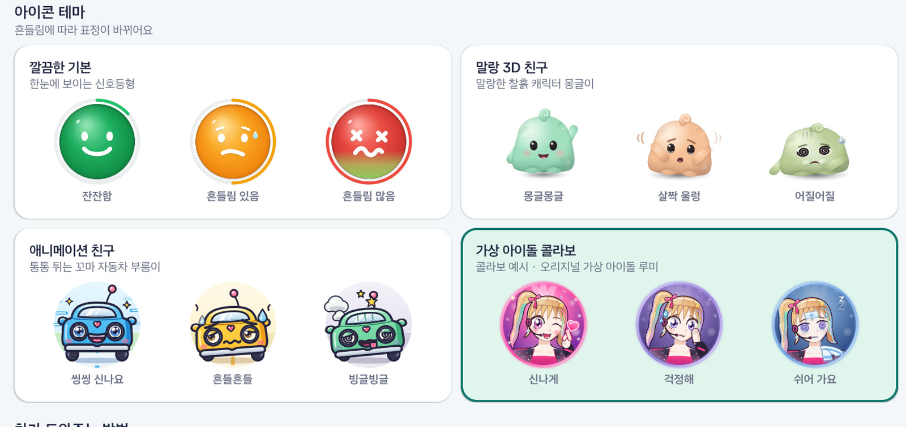

---

## 목차

1. [우리가 판단한 멀미 조건](#1-우리가-판단한-멀미-조건)
2. [근거](#2-근거)
3. [멀미 지수 계산](#3-멀미-지수-계산)
4. [구현 방법](#4-구현-방법)
5. [실제 구현](#5-실제-구현)
6. [확장 가능성과 가치](#6-확장-가능성과-가치)
7. [부록: 한계 · 실행 방법 · 문서](#7-부록-한계--실행-방법--문서)

---

## 1. 우리가 판단한 멀미 조건

| 조건 | 뜻 | 차에서 읽는 신호 | 앱이 하는 일 |
|---|---|---|---|
| ① 예고 없는 움직임 | 몸이 느끼는 움직임과 예상이 어긋남 (운전자는 알고, 동승자는 모름) | 방향지시등, 핸들 각도, 내비 다음 회전 | 회전 몇 초 전 알림음·목소리·무드등 예고 |
| ② 느린 흔들림의 누적 | 0.5 Hz 아래의 앞뒤·옆 흔들림이 쌓임 | 속도, 진행 방향 | 흔들림 지수와 누적량 계산 |
| ③ 덥고 답답한 실내 | 실내가 덥고 내기순환이 길면 더 쉽게 멀미 | 실내 온도, 내기순환 | 외기 전환 · 22°C |
| ④ 사람마다 다른 기준 | 4–13세 아이가 가장 약하고, 아이마다 다름 | 뒷좌석 탑승 | 아이별 기준선 학습, 가장 약한 아이 먼저 |

## 2. 근거

| 조건 | 근거 |
|---|---|
| ① | 움직임 1초 전 음성 예고가 멀미 점수를 낮춤 (Kuiper 외, 2020) |
| ② | 0.5 Hz 미만 옆 흔들림이 멀미와 가장 잘 맞음 (Turner & Griffin, 1999), 누적량 형태는 ISO 2631-1 |
| ③ | 바람이 멀미를 줄임 (D'Amour 외, 2017) |
| ④ | 4–13세에서 가장 흔함 (Huppert 외, 2019), 뒤쪽 좌석일수록 흔들림·멀미 증가 (Turner & Griffin, 1999) |

DOI와 한계는 [research/literature.md](research/literature.md).

## 3. 멀미 지수 계산

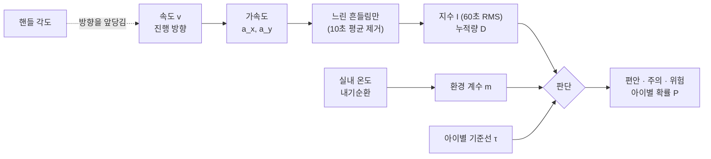

1초마다 계산합니다. 앞뒤 가속도 $a_x$, 옆 가속도 $a_y$에서 느린 성분만 남겨 누적합니다.

$$
D = \left( \sum_t \left( w_X a_x^2 + w_Y a_y^2 \right) \Delta t \right)^{1/2}
$$

덥고($T \gt 22$°C) 내기순환이 길수록 환경 계수 $m$이 작아져, 같은 흔들림에도 더 일찍 위험해집니다.

$$
m = 1 - \gamma_T \max(0, T - 22) - \gamma_V \min\left(1, \frac{t_{\mathrm{recirc}}}{3600}\right)
$$

아이마다 기준선 $\tau$를 학습하고, 확률이 0.5를 넘는 아이가 생기면 대응합니다.

$$
P = \frac{1}{1 + e^{-(D - \tau m)/s}}
$$

<details>
<summary>전체 수식 7개 (가속도, 핸들 각도, 기준선 학습, 예고 시점)</summary>

**① 가속도.** 속도 $v$와 진행 방향 변화율 $\omega$로 구합니다.

$$
a_x = \frac{\Delta v}{\Delta t}, \qquad a_y = v \omega
$$

**② 핸들 각도로 방향 앞당기기.** GPS 방향은 연속 위치에서 구하므로 회전보다 1–2초 늦습니다. 핸들 각도 $\delta_{sw}$를 조향비 $r = 14.5$로 나눈 바퀴 각도와 축간거리 $L = 2.9$ m로 회전 속도를 예측하고, GPS 방향 쪽으로 조금씩($k = 0.2$) 당겨 오차가 쌓이지 않게 합니다.

$$
\omega = \frac{v \tan(\delta_{sw} / r)}{L}
$$

**③ 느린 흔들림.** 최근 10초 평균을 빼서 0.1 Hz보다 느린 성분(꾸준한 가속, 긴 커브)을 지웁니다. 지수 $I$는 최근 60초 제곱평균제곱근, 누적량 $D$는 위 식입니다.

**④ 환경 계수.** 위 식, 최솟값 0.6. 알림 기준선은 주의 $0.9 \cdot m$, 높음 $1.5 \cdot m$입니다.

**⑤ 아이별 기준선.** 멀미가 난 시점의 누적량 기록 $n$개 평균을, 기록이 적을 때는 출발값 $\tau_0 = 30$ 쪽으로 당깁니다 ($n_0 = 5$).

$$
\tau = \frac{n \bar{D} + n_0 \tau_0}{n + n_0}
$$

**⑥ 멀미 확률.** 위 식.

**⑦ 예고 시점.** 회전까지 거리가 "말하는 시간 2초 + 몸이 대비할 시간 3초" 동안 갈 거리 안에 들어오면 예고합니다.

$$
d_{\mathrm{cue}} = v (t_{\mathrm{say}} + t_{\mathrm{prepare}})
$$

모든 상수는 [`shared/params.json`](shared/params.json)에 있고, 파이썬 시뮬레이터와 앱이 같은 파일을 읽습니다. 300개 샘플에서 두 계산이 같은지 단위 테스트로 확인합니다.

</details>

## 4. 구현 방법


| 단계 | Pleos SDK | 하는 일 |
|---|---|---|
| 읽기 | Vehicle (방향지시등·공조·좌석·핸들), NaviHelper, 위치 | 1초마다 속도·방향·방향지시등·핸들 각도·다음 회전·실내 온도·내기순환·뒷좌석 탑승 |
| 계산 | SDK와 분리된 순수 Kotlin 엔진 | 3절 |
| 행동 | TextToSpeech, Vehicle HVAC · Light, NaviHelper | 예고 (알림음·캐릭터 목소리·무드등), 외기·22°C, 휴게소 경유지 |
| 묻기 | SpeechToText + 화면 버튼 / 알림 카드 | "휴게소에 들를까요?", "가족 모드를 켤까요?", 정차 후 "오늘 민준 괜찮았어요?" |

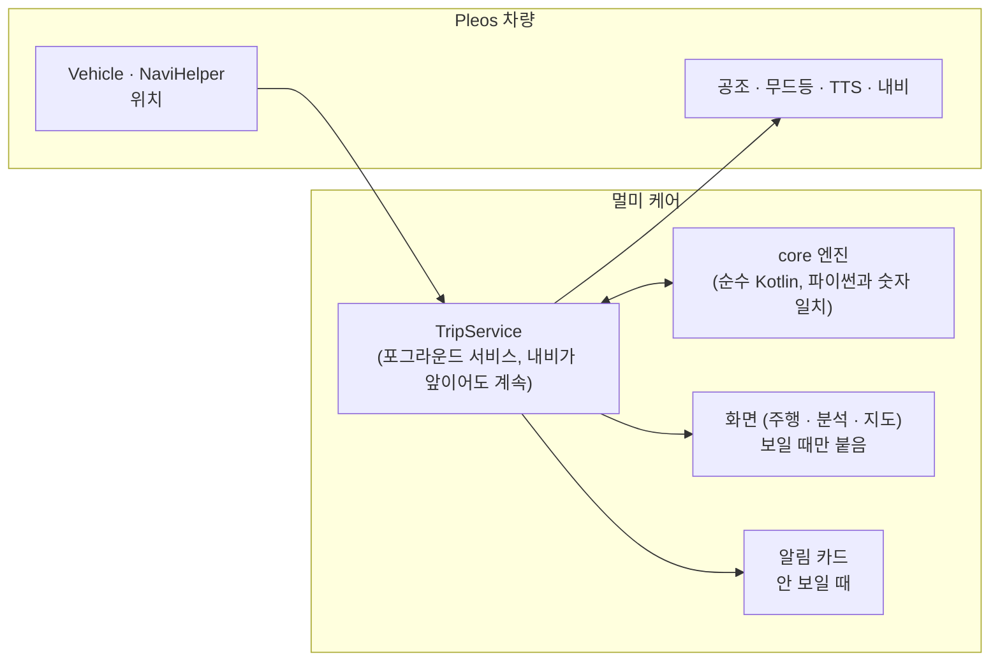

실차 없이 세 단계로 검증했습니다: **시나리오 시뮬레이션**(점검 10개 통과) → **실제 주행 데이터 비교**(comma2k19) → **Pleos 에뮬레이터**(실제 SDK).

---

## 5. 실제 구현

모든 화면은 Pleos Connect Emulator v2.1(Android Automotive, API 34)에서 앱을 실제로 실행해 찍었습니다. 차의 신호는 브라우저의 **Virtual Console**로 바꿨습니다.


### ① 첫 실행: 아이가 아이콘 테마를 고름


테마는 그림과 말투만 바꾸고, 계산과 안내는 똑같습니다.

| 테마 | 캐릭터 | 회전 예고 말투 |
|---|---|---|
| 깔끔한 기본 | 신호등형 표정 | "곧 왼쪽으로 돌아요." |
| 말랑 3D 친구 | 찰흙 캐릭터 몽글이 | "몽글이가 알려 줄게. 곧 왼쪽으로 돌아요!" |
| 애니메이션 친구 | 꼬마 자동차 부릉이 | "부릉이 출동! 곧 왼쪽으로 돌아요." |
| 가상 아이돌 콜라보 | 오리지널 가상 아이돌 루미 | "루미가 먼저 알려 줄게요. 곧 왼쪽으로 돌아요!" |

루미는 IP 협업 자리를 보여 주는 **오리지널 예시**이며 실제 IP 계약은 없습니다.

### ② 뒷좌석에 아이가 타면 가족 모드 제안


Virtual Console에서 뒷좌석 왼쪽 = 탑승 → 음성과 함께 화면 안 큰 "응 / 아니" 버튼.

### ③ 움직이기 전에 예고

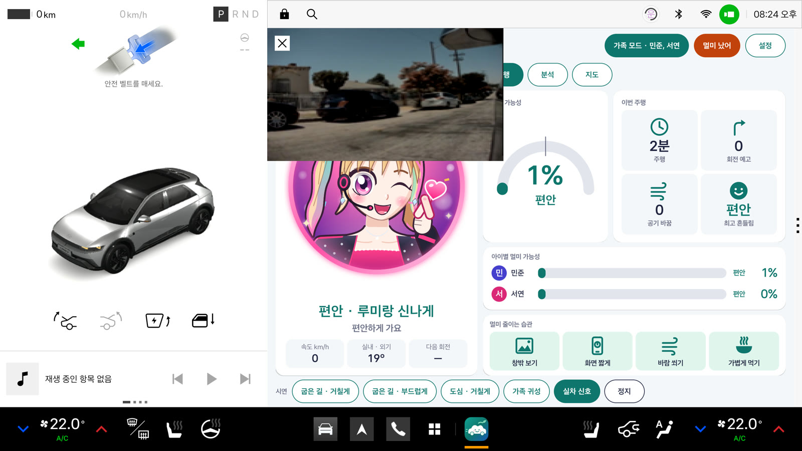

| 신호 | 쓰임 |
|---|---|
| 방향지시등 | 켜는 순간 예고 |
| 내비 다음 회전 | 회전까지 약 5초 남았을 때 예고 |
| 핸들 각도 | GPS보다 1–2초 먼저 방향 변화를 잡아 옆 흔들림 계산에 반영 |

**예고 방식은 설정에서 고릅니다** (회의 의견 반영: 내비 음성과 겹치면 시끄러움).

| 방식 | 동작 |
|---|---|
| 알림음 (기본) | 짧은 "띵" 한 번 + 무드등 |
| 캐릭터 목소리 | 테마 말투로 말함. 내비가 300 m 안의 회전을 안내 중이면 겹치지 않게 알림음으로 바꿈 |
| 무드등만 | 소리 없이 빛으로만 |

무드등은 **은은하게** 예고합니다. 도는 쪽은 호박색 60% 밝기, 반대쪽은 원래 밝기의 절반, 사이 박자는 원래 밝기로 돌아와 완전히 꺼지는 깜빡임이 없습니다.

### ④ 흔들림이 커지면 차가 공기를 바꿈

| 출발: 26.5°C · 내기순환 | 12초 뒤: 22°C · 외기 |
|---|---|
| 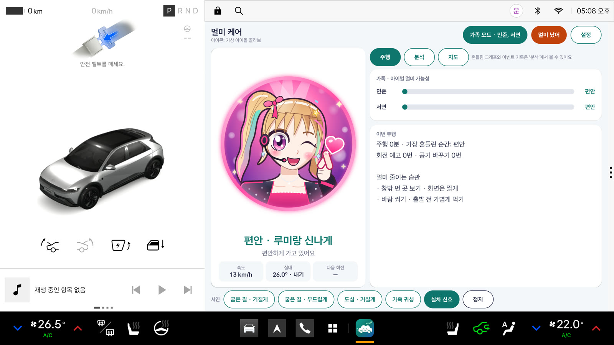 | 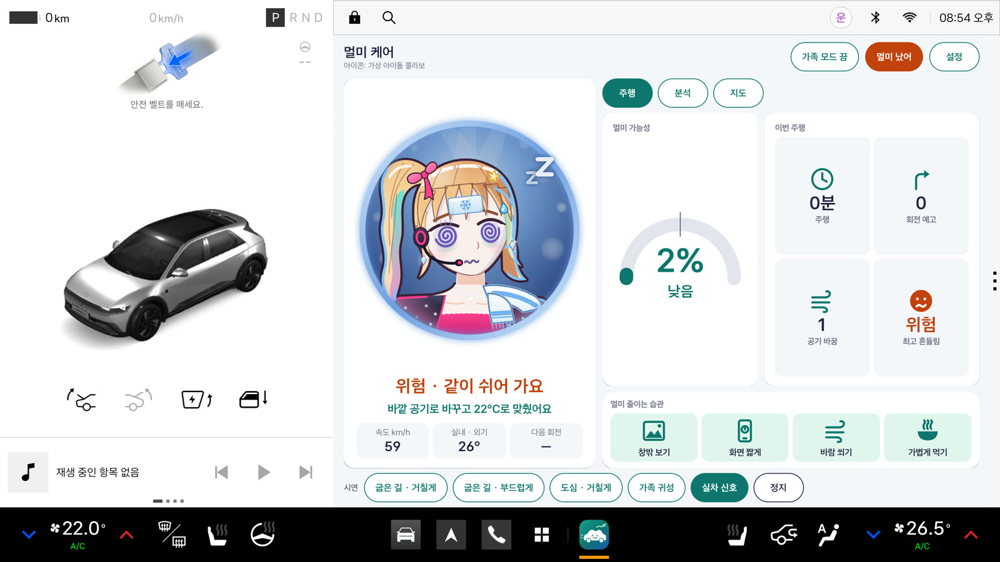 |

바뀐 온도·환기는 다시 계산에 들어가 기준이 올라갑니다 (**닫힌 고리**).

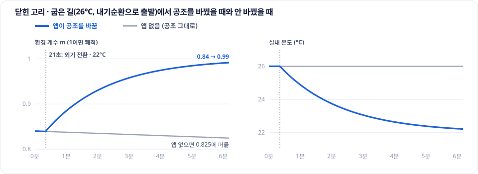

### ⑤ 가족 모드: 가장 약한 아이 기준으로 먼저

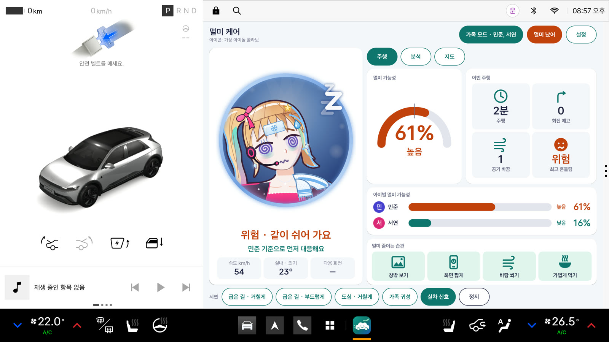


기준선이 낮은 민준(24.9)이 서연(35.9)보다 **2분 반 먼저** 기준에 닿아, 그때 대응합니다.

### ⑥ 흔들림이 계속되면 휴게소 제안

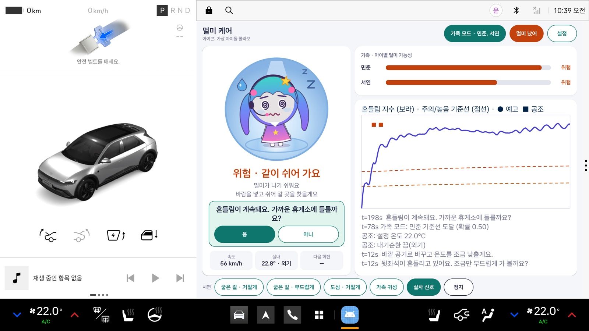

높음이 3분 이어지면 묻고, "응"이면 NaviHelper로 차량 내비에 경유지를 추가합니다.

### ⑦ 정차 후 한 질문으로 아이별 기준 학습

| 아이마다 한 번 묻고 | 답에 따라 기준선이 바뀜 |
|---|---|
|  |  |

차가 1분 서 있으면 주행이 끝난 것으로 보고 묻습니다. 프로필은 차량 기기에만 저장합니다.

### ⑧ 세 개의 탭: 주행 · 분석 · 지도

| 분석: 흔들림 그래프와 이벤트 기록 | 지도: 내 위치와 캐릭터 (시제품) |
|---|---|
|  |  |

주행 중 기본 화면("주행")에는 표정 · 가족 막대 · 주행 요약만 둡니다. 그래프는 "분석"으로 옮겼고, "지도"는 내비 화면 위에 캐릭터를 얹는 모습을 보여 주는 시제품입니다 (OpenStreetMap, 다음 회전 표시).

### ⑨ 내비 옆 한 화면 모드

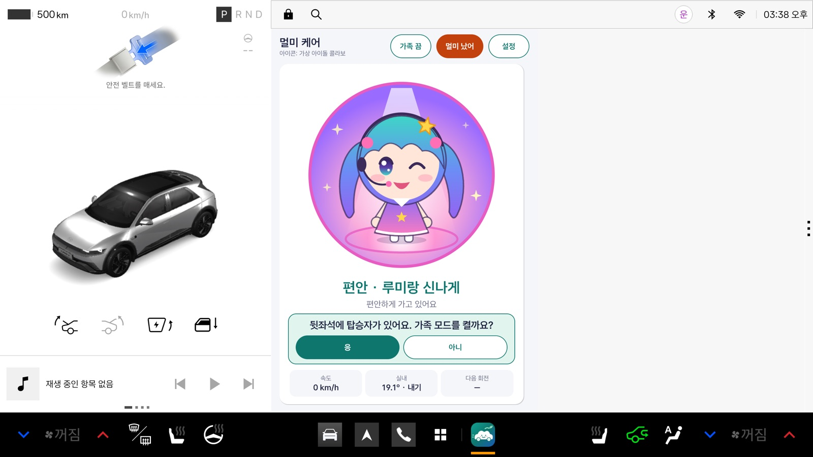

Pleos 화면을 내비와 나눠 쓰면 앱 폭이 좁아집니다. 900 dp보다 좁으면 표정 카드만 남기고 나머지를 숨깁니다.

### ⑩ 내비가 앞에 있을 때


판단과 행동은 포그라운드 서비스에서 돌아, 내비를 띄워 둔 채로도 예고·공조·가족 대응이 그대로 일어납니다. 질문은 응/아니 알림 카드로 가고, 앱으로 돌아오면 그동안의 기록과 대기 중인 질문이 이어집니다.

### ⑪ 설정 한 곳에서


소리 안내, 예고 방식, 무드등, 공조 자동 조절, 시연 패널, 아이 프로필. 주행 중에는 테마와 프로필 변경이 잠깁니다 (Car UX Restrictions).

### 검증 결과

| 도로·운전 방식별 지수 | 한 번의 주행에서 언제 무엇을 하나 |
|---|---|
|  |  |
| 고속도로 < 도심 < 굽은 길. 고속도로 14분 동안 알림 0번 | 12초에 안내·공조, 3분 18초에 휴게소 |
|  | 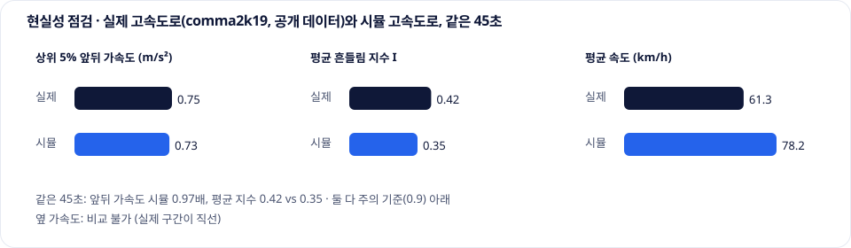 |
| 회전 4곳에서 정확히 한 번씩 예고 | 실제 주행 대비 앞뒤 가속도 1.5배 (기준 0.5–2배) |

### 에뮬레이터에서 확인한 것

| 확인한 것 | 결과 |
|---|---|
| 방향지시등 → 예고 | "곧 왼쪽으로 돌아요" / 알림음 모드에서는 알림음만 |
| 핸들 각도 | Virtual Console 540° → 앱 수신 (Pleos는 오른쪽을 음수로 보내 부호를 뒤집음, 권한 `CAR_DRIVE`) |
| 공조 닫힌 고리 | 차량 공조 바 26.0° → 22.0°, 내기순환 끔 |
| 무드등 예고 | 차량 로그에서 색·밝기 변화 후 원래 값 복귀 |
| Pleos 음성 | TTS·STT 서버 연결 |
| 가족 모드 · 정차 후 학습 | 확인 |
| 휴게소 경유지 | 내비 앱에 경유지 요청 도착 |
| 내비 다음 회전 | 경로 요청 후 "왼쪽 80 m" 수신 |
| 내비를 앞에 둔 채 | 공조·가족 경고·휴게소 질문이 그대로, 질문은 알림 카드로 |
| 한 화면 모드 · 지도 탭 | 앱 창 폭을 줄이면 표정 카드만, 지도 탭에 위치·지나온 길·캐릭터 |

고친 버그와 리뷰 기록은 [docs/qa.md](docs/qa.md), 숫자 표는 [docs/validation.md](docs/validation.md).

---

## 6. 확장 가능성과 가치

**왜 폰이 아니라 차여야 하나.** 흔들림 계산은 폰도 됩니다. 차라서 되는 것은 **미리 아는 것**과 **직접 바꾸는 것**입니다.

| 기능 | 폰 앱 | 멀미 케어 |
|---|---|---|
| 움직이기 전에 예고 | 폰 내비를 쓸 때만 일부 | 방향지시등 · 핸들 각도 · 차량 내비 다음 회전 |
| 실내 온도·환기 | 불가 | 읽고 바꾸고, 결과가 다시 계산으로 |
| 빛으로 예고 | 불가 | 실내 무드등 (어린아이용) |
| 휴게소 · 편안한 길 | 폰 내비 안에서만 | 차량 내비에 바로 |
| 매 주행 실행 | 사람이 켜야 함 | 뒷좌석 탑승으로 가족 모드 제안, 내비로 바꿔도 계속 |

**가치와 수익 모델**

- **타깃**: 아이가 있는 가족 운전자. 출시 1년 예상 MAU 약 1,800명 (계산과 출처는 [기획서 8절](docs/proposal.md)).
- **재사용**: 탈수록 우리 아이 기준이 정확해짐.
- **엔터테인먼트 연계**: 기본 기능 무료 + 캐릭터·가상 아이돌 IP 테마와 음성 팩 판매. 멀미 예방이 "좋아하는 캐릭터와 노는 시간"이 됩니다.

**확장**

| 대상 | 왜 맞나 |
|---|---|
| 택시·호출 서비스 (전국 약 24만 대) | 승객은 늘 뒷좌석, 다음 회전을 모름 |
| 통학 차량 (약 4만 대) | 멀미가 가장 흔한 4–13세가 매일 탐 |
| 자율주행 셔틀 | 운전자가 없어 모두가 동승자, 예고가 더 중요 |
| Pleos MiniApp · 계기판 | 내비 화면 옆에 표정 카드를 올리는 다음 단계 ([협의 문의 초안](docs/pleos-inquiry.md)) |

비슷한 서비스(Apple Vehicle Motion Cues, 현대차 스무스 모드 등) 비교는 [기획서 4절](docs/proposal.md)과 [research/market.md](research/market.md).

---

## 7. 부록: 한계 · 실행 방법 · 문서

### 한계

- 사람이 실제로 멀미했는지(정답 데이터)는 아직 없습니다. 기준선과 환경 계수 크기는 문헌값과 가정에서 시작하고, 정차 후 질문과 동승 조사([docs/ride-study.md](docs/ride-study.md))로 보정합니다.
- 실제 주행 비교는 고속도로 1분 한 구간뿐이라 옆 흔들림은 비교하지 못했습니다.
- 휴게소 좌표는 데모용 3곳입니다 (POI 검색 API 필요).
- Pleos 홈은 시스템 앱 알림만 지도 위에 띄워, 내비를 앞에 둔 동안의 질문 카드는 알림 센터로 갑니다. 그동안은 소리와 무드등이 주된 안내입니다. MiniApp 영역 등록은 Pleos와 협의할 부분입니다.
- 지도 탭은 시제품입니다 (OpenStreetMap 타일을 인터넷으로 받음). 실제 탑재에서는 차량 내비와 함께 보이는 방식이 목표입니다.
- 핸들 각도의 조향비·축간거리는 일반 승용차 값입니다. 차종별 값은 정식 탑재 때 맞춥니다.
- 앱은 한 번 열어야 서비스가 시작됩니다. 시동과 함께 자동 실행은 정식 탑재 때 Pleos 정책에 맞춰 붙입니다.

### 폴더 구조

```
android/
  core/            순수 Kotlin 판단 엔진 (+ 핸들 각도 방향 보정 SteeringYaw) + 단위 테스트
  app/             Android Automotive 앱
                   TripService: 주행 판단과 행동 (내비가 앞이어도 계속)
                   Notifier: 앱이 안 보일 때의 알림 카드와 질문 카드
                   MainActivity: 화면만 (서비스에 붙어 보여 줌)
    ui/            홈 화면 (주행 · 분석 · 지도 탭, 한 화면 모드), 설정 화면
    theme/         멀미 지수 아이콘 테마 4종 (Canvas로 그림, 이미지 파일 없음)
sim/               시나리오 생성, 기준 엔진, 점검, 실제 데이터 비교, README 그래프
shared/            params.json (파이썬·앱 공용 상수), test_vectors.csv
docs/              기획서, 검증, 에뮬레이터 확인 기록, 제출 체크리스트, 이미지
research/          문헌 근거, 경쟁 서비스 조사
data/rides/        동승 기록 원본 (로컬 전용, 커밋 안 함)
apk/               제출용 release APK (제출 때만 커밋)
.github/workflows/ci.yml   CI: 시뮬레이터 점검 + 테스트 벡터 + Kotlin 테스트 + 디버그 빌드
```

### 시뮬레이션과 그래프 (파이썬 3, 외부 라이브러리 없음)

```bash
python3 sim/generator.py
```

```bash
python3 sim/prototype.py
```

```bash
python3 sim/readme_figures.py
```

### 엔진 테스트와 앱 빌드

Android Studio에 들어 있는 JDK를 씁니다. `app:preBuild`가 `sim/scenarios/*.csv`와 `shared/params.json`을 앱 assets로 복사합니다. 빌드 폴더는 iCloud 동기화를 피하려고 `build.nosync`입니다.

```bash
cd android && JAVA_HOME="/Applications/Android Studio.app/Contents/jbr/Contents/Home" ./gradlew :core:test :app:assembleDebug
```

계산을 바꿀 때는 `sim/engine.py`를 먼저 고치고 `prototype.py`로 점검과 `test_vectors.csv`를 갱신한 뒤, `android/core`의 Kotlin을 같은 숫자가 나오게 고칩니다.

### 에뮬레이터

1. Android Studio SDK Manager에 Pleos 이미지 주소를 추가하고 Pleos Connect v2.1.0(API 34)을 설치합니다 (Pleos 개발 문서 "Pleos Connect Emulator 설치 및 실행").
2. 에뮬레이터 설정 › 연결 › Wi-Fi에서 `AndroidWifi`에 연결해야 Pleos 음성 서버, 내비 경로 탐색, 지도 타일이 됩니다.
3. Virtual Console: `adb forward tcp:8088 tcp:8088` 후 브라우저에서 http://127.0.0.1:8088/

```bash
nohup ~/Library/Android/sdk/emulator/emulator -avd Pleos_Connect_v2_1 -no-snapshot-load -gpu host > /tmp/emu.log 2>&1 &
```

화면 위쪽: "가족 모드", "멀미 났어", "설정". 오른쪽 위 탭: "주행"(기본), "분석", "지도". 아래쪽 시연 패널: 시나리오 4배속 재생, "실차 신호"(앱을 켜면 자동으로 시작), "정지". 디버그 빌드는 `--es theme toon --ez skip_welcome true`로 테마를 고르고 환영 화면을 건너뛸 수 있습니다.

### 키와 서명 (각자 `android/local.properties`, 커밋 금지)

```
pleos.clientId=...          # Pleos Playground › My Project
pleos.clientSecret=...
release.storeFile=keystore/motioncare-release.jks
release.storePassword=...
release.keyAlias=motioncare
release.keyPassword=...
apk.teamName=팀명            # → apk/팀명_MotionCare_release.apk
```

`./gradlew :app:assembleRelease`가 서명된 APK를 `apk/`로 복사합니다. 이 APK에는 클라이언트 키가 들어 있어 평소에는 git에서 빼고, 제출할 때만 `git add -f apk/...`로 올립니다. 키스토어(`android/keystore/`)는 잃어버리면 같은 서명으로 다시 낼 수 없으니 따로 백업하세요.

### 개발 환경

Android Studio 2026.2 · AGP 9.4.1 · Gradle 9.8.2 · Kotlin 2.4 · compileSdk 34 · Pleos Vehicle 2.3.2 · NaviHelper 3.0.5 · TextToSpeech/SpeechToText 3.3.1

### 문서

| 문서 | 내용 |
|---|---|
| [docs/proposal.md](docs/proposal.md) | 기획서 초안 (심사 기준별) |
| [docs/validation.md](docs/validation.md) | 시뮬레이션 점검과 실제 데이터 비교 숫자 |
| [docs/qa.md](docs/qa.md) | 에뮬레이터 확인 기록, 고친 버그 |
| [docs/submission.md](docs/submission.md) | 제출 체크리스트 |
| [docs/pleos-inquiry.md](docs/pleos-inquiry.md) | Pleos 협의 문의 초안 (MiniApp, 계기판, 자동 실행; 아직 보내지 않음) |
| [docs/demo-script.md](docs/demo-script.md) | 시연 영상 콘티 |
| [docs/ride-study.md](docs/ride-study.md) | 실제 동승 멀미 데이터 수집 안내 |
| [research/literature.md](research/literature.md) | 공식과 상수의 문헌 근거 (DOI 포함) |
| [research/market.md](research/market.md) | 경쟁 서비스 조사 |

**남은 일**: 실제 동승 데이터 5–10회 · 내비 경로를 따라가는 회전 예고와 "편안한 길" 실제 경로 변경 확인 · 새 화면(지도·한 화면·알림음)으로 시연 영상 다시 찍고 내레이션 · 기획서를 접수 양식으로 옮기기.
