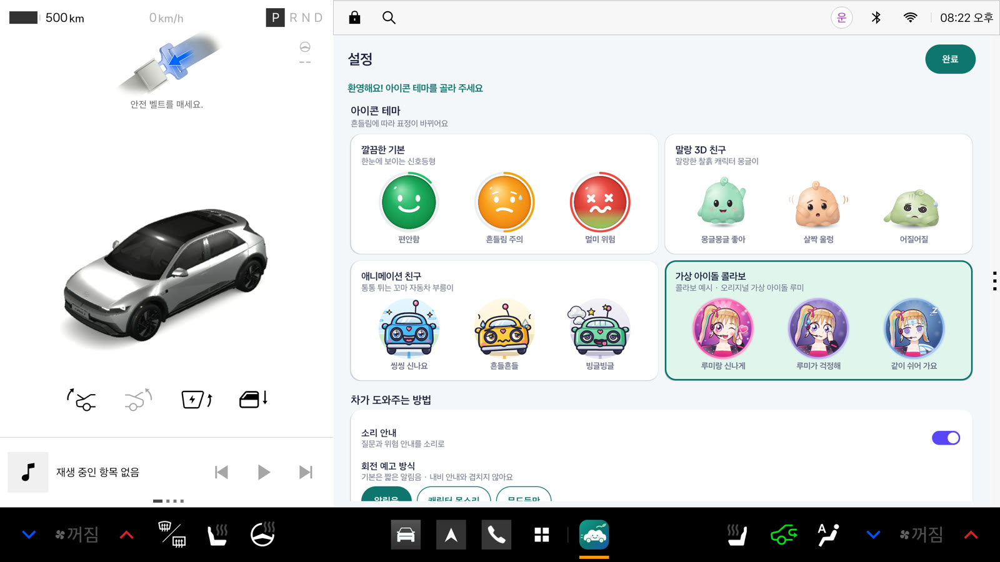
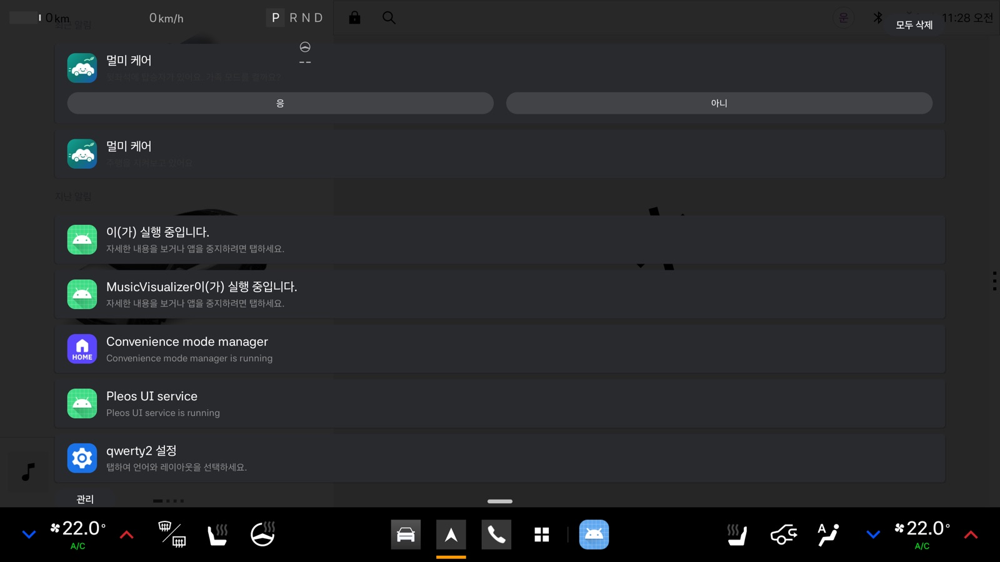
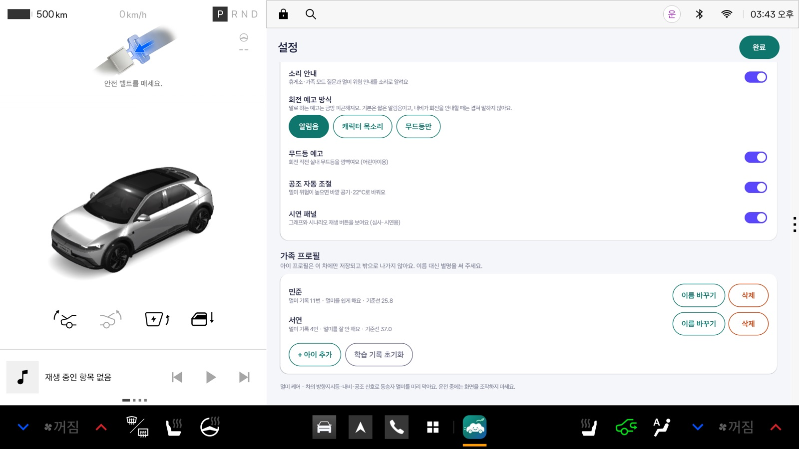
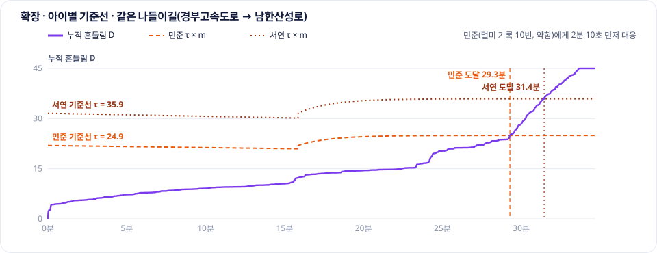
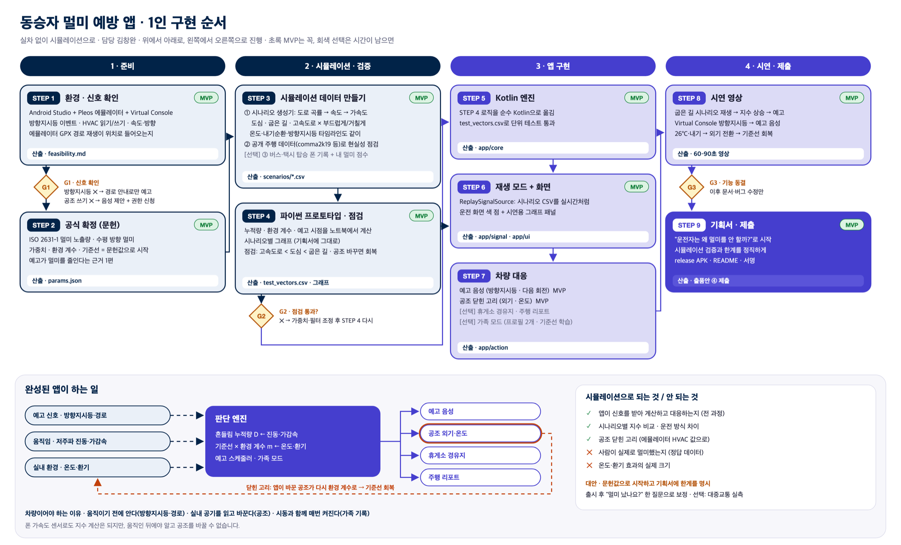

# 멀미 케어 (가칭) · 뒷좌석 멀미를 차가 먼저 막는 앱

[](https://github.com/toowani/motion-care/actions/workflows/ci.yml)

> Pleos Connect 차량앱 공모전 출품작 ④ · 1인 개발 (팀원)

**운전자는 왜 멀미를 덜 할까요?** 다음 움직임을 알고 있기 때문입니다. 동승자는 예고 없이 흔들리고, 몸이 느끼는 움직임과 예상이 어긋나면서 멀미가 납니다.

멀미 케어는 **차가 이미 알고 있는 신호**(방향지시등, 내비 경로, 속도, 실내 온도·환기)로 흔들림을 계산하고, **차가 직접** 세 가지를 합니다.

1. **움직이기 전에 알린다**: 회전 몇 초 전에 "곧 왼쪽으로 돌아요"라고 말하고, 실내 무드등을 깜빡여 어린아이에게도 알립니다.
2. **실내 공기를 바꾼다**: 덥고 내기순환이 길면 외기로 바꾸고 22°C로 낮춥니다. 바뀐 온도·환기는 다시 계산에 들어갑니다.
3. **가족 중 가장 약한 아이 기준으로 대응한다**: 아이마다 멀미 기준을 학습해 그 아이가 위험해지기 전에 움직입니다.

멀미 지수에 따라 표정이 바뀌는 아이콘은 **네 가지 테마**에서 고릅니다. 아이가 좋아하는 캐릭터가 "곧 왼쪽으로 돌아요"라고 알려 줍니다.


*Pleos Connect 에뮬레이터에서 실제로 실행한 화면입니다. 왼쪽은 차량 화면, 오른쪽이 멀미 케어입니다. 굽은 길에서 흔들림이 기준(점선)을 넘자 아이콘이 "위험 · 같이 쉬어 가요"로 바뀌고, 멀미를 잘하는 민준의 막대가 먼저 "위험"에 닿았습니다. 앱은 이미 공조를 22°C·외기로 바꿨습니다.*

---

## 목차

1. [어떻게 동작하나](#1-어떻게-동작하나)
2. [실제 화면](#2-실제-화면-pleos-connect-에뮬레이터)
3. [왜 폰이 아니라 차여야 하나](#3-왜-폰이-아니라-차여야-하나)
4. [검증: 실차 없이 어떻게 확인했나](#4-검증-실차-없이-어떻게-확인했나)
5. [계산 방법](#5-계산-방법)
6. [한계](#6-한계)
7. [폴더 구조와 실행 방법](#7-폴더-구조와-실행-방법)
8. [개발 과정과 남은 일](#8-개발-과정과-남은-일)

---

## 1. 어떻게 동작하나


| 단계 | 쓰는 Pleos SDK | 하는 일 |
|---|---|---|
| 읽기 | Vehicle (방향지시등·공조·좌석), NaviHelper, CarPropertyManager, 위치 | 1초마다 속도·진행 방향·방향지시등·다음 회전 거리·실내 온도·내기순환·뒷좌석 탑승을 받음 |
| 계산 | (SDK와 분리된 순수 Kotlin 엔진) | 앞뒤·옆 가속도 → 느린 흔들림만 남김 → 흔들림 지수 I와 누적량 D → 환경 계수 m과 아이별 기준선으로 판단 |
| 행동 | TextToSpeech, Vehicle HVAC · Light, NaviHelper | 예고·안내 음성, 무드등 예고, 외기 전환·온도 설정, 휴게소 경유지 추가 |
| 묻기 | SpeechToText (안 되면 화면 버튼) | "휴게소에 들를까요?", "가족 모드를 켤까요?", 정차 후 "오늘 민준 괜찮았어요?" |

**운전자는 화면을 보지 않아도 됩니다.** 안내는 음성과 무드등으로 하고, 화면에는 큰 표정 아이콘과 고정된 단계 단어(편안 · 주의 · 위험), 차가 방금 한 일 한 줄만 둡니다. 질문은 시스템 대화상자 대신 홈 화면 안의 큰 버튼으로 묻고, 주행 중에는 테마·프로필 변경을 잠급니다(Car UX Restrictions). 흔들림 그래프와 이벤트 기록은 **"분석" 탭**으로 옮겨, 주행 중 기본 화면에는 보이지 않습니다. 시나리오 재생 버튼은 시연 패널이며 설정에서 끌 수 있습니다.

**내비가 앞 화면이어도 계속 동작합니다.** 판단과 행동은 포그라운드 서비스(`TripService`)에서 돌기 때문에, 내비를 띄워 둔 채로도 회전 예고·무드등·공조·가족 대응·휴게소 질문이 그대로 일어납니다 (에뮬레이터에서 내비를 앞에 둔 채 확인). 앱 화면이 보이지 않을 때 생긴 질문과 사건은 표준 알림 카드(헤드업 알림)로 보내고, 앱으로 돌아오면 그동안의 주행 기록과 대기 중인 질문을 화면에 이어서 보여 줍니다.

> Pleos에서 확인한 제약: Pleos 홈의 헤드업 알림은 시스템 앱 알림만 지도 위에 띄웁니다. 그래서 이 앱의 카드는 지도 위에 뜨지 않고 알림 센터로만 갑니다. 내비와 함께 볼 수 있는 가장 좋은 자리는 홈 왼쪽 아래의 **MiniApp 영역**(음악·타이어 공기압·주행 정보 카드가 있는 곳, 앱 위젯 기반)입니다. 다만 에뮬레이터에서는 시스템 MiniApp만 올라가 있고 추가 메뉴도 없어서, 다른 앱이 올라갈 수 있는지는 확인하지 못했습니다. 정식 탑재 때 MiniApp 등록을 협의하는 것이 다음 단계입니다. 그 전까지는 음성과 무드등이 주된 안내 수단입니다.

---

## 2. 실제 화면 (Pleos Connect 에뮬레이터)

모든 화면은 Pleos Connect Emulator v2.1(Android Automotive, API 34)에서 앱을 실제로 실행해 찍었습니다. 차의 신호는 브라우저의 **Virtual Console**로 바꿨습니다. 같은 흐름을 담은 72초 시연 영상(자막 포함)은 저장소 밖 `../멀미케어_시연_v2.mp4`에 있습니다.


*Virtual Console. 실차 대신 여기서 방향지시등, 실내 온도, 내기순환, 뒷좌석 탑승을 바꿉니다.*

### ① 첫 실행: 아이가 아이콘 테마를 고름



처음 켜면 설정 화면이 환영 문구와 함께 열립니다. 테마 카드마다 편안·주의·위험 세 표정이 움직이는 미리보기로 보입니다. 테마는 그림만 바꾸고, 계산과 안내는 똑같습니다.

| 테마 | 캐릭터 | 회전 예고 말투 |
|---|---|---|
| 깔끔한 기본 | 신호등형 표정 | "곧 왼쪽으로 돌아요." |
| 말랑 3D 친구 | 찰흙 캐릭터 몽글이 (입체 음영, 말랑하게 숨쉬기) | "몽글이가 알려 줄게. 곧 왼쪽으로 돌아요!" |
| 애니메이션 친구 | 통통 튀는 꼬마 자동차 부릉이 | "부릉이 출동! 곧 왼쪽으로 돌아요." |
| 가상 아이돌 콜라보 | 오리지널 가상 아이돌 루미 (무대 조명, 반짝임) | "루미가 먼저 알려 줄게요. 곧 왼쪽으로 돌아요!" |

가상 아이돌 테마는 이 자리에 캐릭터·아이돌 IP를 협업으로 넣을 수 있다는 것을 보여 주는 **오리지널 예시**이며, 실제 IP 계약은 없습니다 (사업 연계는 [기획서 8절](docs/proposal.md)).

### ② 뒷좌석에 아이가 타면 가족 모드 제안


앱은 켜지자마자 차의 실시간 신호를 받습니다. Virtual Console에서 **뒷좌석 왼쪽 = 탑승**으로 바꾸자, 음성과 함께 홈 화면 안에 큰 "응 / 아니" 버튼이 뜹니다.

### ③ 움직이기 전에 예고 (음성 + 무드등)


왼쪽 방향지시등을 켜자 "루미가 먼저 알려 줄게요. 곧 왼쪽으로 돌아요!"(이벤트 기록)와 함께 **실내 무드등이 호박색으로 두 번 깜빡입니다** (차량 로그에서 색 (255, 160, 0), 밝기 100% → 0% → 100% → 원래대로 확인). 무드등 구역이 좌우로 나뉜 차에서는 도는 쪽만 켜집니다. 화면 위 카메라 창은 방향지시등에 반응한 차량 자체의 사각지대 카메라입니다. 내비 경로가 있으면 다음 회전까지 거리와 속도로 같은 예고를 합니다 (회전까지 약 5초 남았을 때).

### ④ 흔들림이 커지면 차가 공기를 바꿈

| 출발: 26.5°C · 내기순환 | 12초 뒤: 22°C · 외기 |
|---|---|
|  |  |

굽은 길을 거칠게 달리는 시나리오입니다. 지수가 기준을 넘자 아이콘이 "주의 · 루미가 걱정해"로 바뀌고, 앱이 Vehicle SDK로 **내기순환을 끄고 22°C로 설정**했습니다 (아래 공조 바 왼쪽 26.5° → 22.0°, 오른쪽 내기순환 아이콘 초록 → 흰색). 그래프의 주황 점선(기준선)이 오른쪽으로 갈수록 올라가는 것이 **닫힌 고리**입니다. 실내가 시원해지고 환기되면 같은 흔들림에도 멀미가 덜 나므로 기준이 다시 높아집니다.

### ⑤ 가족 모드: 가장 약한 아이 기준으로 먼저


오른쪽 위 가족 카드에 아이별 멀미 가능성이 막대로 보입니다. 기준선이 낮은 민준이 먼저 "위험"에 닿자 "민준에게는 벌써 흔들림이 많아요. 바람 넣고 천천히 갈게요."라고 말하고, 아이콘 아래에 "민준 기준으로 먼저 대응해요"가 뜹니다.

### ⑥ 흔들림이 계속되면 휴게소 제안


높음 상태가 3분 이어지면 "가까운 휴게소에 들를까요?"라고 묻습니다. "응"이면 NaviHelper로 **차량 내비에 휴게소를 경유지로 추가**합니다 (내비 앱이 경유지 요청을 받는 것까지 확인).

### ⑦ 정차 후 한 질문으로 아이별 기준 학습

| 아이마다 한 번 묻고 | 답에 따라 기준선이 바뀜 |
|---|---|
|  |  |

시연에서는 "정지"를 누르면, 실제 주행에서는 **차가 1분 동안 서 있으면** 주행이 끝난 것으로 보고 묻습니다. 답과 이번 주행의 누적 흔들림으로 아이별 기준선을 고칩니다 (이벤트 기록 맨 위 "기준선 갱신"). 주행 중에는 "멀미 났어"를 눌러 누가 멀미가 나는지 고를 수 있습니다. 프로필은 차량 기기에만 저장합니다.

### ⑧ 분석 탭: 흔들림 그래프와 이벤트 기록




*내비를 앞에 둔 동안 생긴 "가족 모드를 켤까요?" 질문은 알림 카드(응 / 아니 버튼)로 갑니다. Pleos에서는 지도 위로 뜨지 않고 알림 센터에 쌓이며, 카드에서 "응"을 누르면 가족 모드가 켜지는 것까지 확인했습니다.*

주행 중 기본 화면("주행" 탭)에는 가족 막대와 주행 요약만 두고, 흔들림 지수 그래프와 이벤트 기록은 "분석" 탭에서 봅니다. 위 화면은 내비를 앞에 둔 채 굽은 길 시나리오를 돌린 뒤 앱으로 돌아온 모습입니다. 그동안의 그래프가 이어지고, 대기 중이던 휴게소 질문이 화면 안 버튼으로 옮겨 왔습니다.

### ⑨ 설정 한 곳에서



음성 안내, 무드등 예고, 공조 자동 조절, 시연 패널을 켜고 끕니다. 아이 별명 추가·변경·삭제와 학습 초기화도 여기서 합니다. 주행 중에는 테마와 프로필 변경이 잠깁니다.

---

## 3. 왜 폰이 아니라 차여야 하나

흔들림 계산만이라면 폰 가속도 센서로도 됩니다. 차라서 되는 것은 **미리 아는 것**과 **직접 바꾸는 것**입니다.

| 기능 | 폰 앱 | 멀미 케어 |
|---|---|---|
| 흔들림 계산 | 가능 | 가능 |
| 움직이기 전에 예고 | 폰 내비를 쓸 때만 일부 | 방향지시등이 켜지는 순간, 내비 다음 회전 거리로 |
| 실내 온도·환기 읽기 | 불가 | HVAC 온도·내기순환 |
| 온도·환기 바꾸기 | 불가 | 외기 전환·22°C → 결과가 다시 계산으로 |
| 휴게소 경유지 | 폰 내비 안에서만 | 차량 내비에 바로 추가 |
| 빛으로 예고 | 불가 | 회전 직전 실내 무드등 깜빡임 (어린아이용) |
| 덜 흔들리는 길 | 폰 내비 안에서만 | 가족 모드에서 차량 내비 경로 옵션을 "편안한 길"로 |
| 매 주행 실행 | 사람이 켜야 함 | 시동과 함께, 뒷좌석 탑승으로 가족 모드 제안 |

비슷한 서비스(Apple Vehicle Motion Cues, 현대차 스무스 모드 등)와의 비교는 [기획서 4절](docs/proposal.md)과 [research/market.md](research/market.md)에 있습니다.

---

## 4. 검증: 실차 없이 어떻게 확인했나

실차가 없어서 세 단계로 검증했습니다.

1. **시나리오 시뮬레이션**: 도로 모양(곡률)에서 속도·가속도를 만들어 6가지 주행을 생성하고, 같은 엔진에 넣어 결과가 상식과 맞는지 10가지 점검 (모두 통과)
2. **실제 주행 데이터와 비교**: 공개 데이터(comma2k19)의 실제 고속도로 1분과 비교
3. **Pleos 에뮬레이터**: 실제 SDK로 신호를 받고 차를 움직이는 것까지 확인 (2절 화면)

### 도로와 운전 방식에 따라 지수가 달라지나


- **고속도로 < 도심 < 굽은 길** 순서로 흔들림이 큽니다. 고속도로에서는 14분 동안 알림이 한 번도 없습니다.
- 같은 길을 **거칠게** 몰면 분당 누적 흔들림이 도심 1.4배, 굽은 길 1.8배가 됩니다.

### 한 번의 주행에서 언제 무엇을 하나


- 굽은 길: 12초에 운전자 안내(◆)와 공조 외기 전환(■), 높음이 3분 이어진 3분 18초에 휴게소 제안(▲).
- 도심: 회전 4곳에서 **정확히 한 번씩** 예고(●). 같은 회전에 두 번 말하지 않습니다.

### 공조를 바꾸면 정말 달라지나 (닫힌 고리)


26°C·내기순환으로 출발한 굽은 길에서, 앱이 외기·22°C로 바꾸면 환경 계수가 **0.84 → 0.99**로 회복됩니다. 앱이 없으면 0.83에 머뭅니다. 환경 계수가 낮을수록 멀미 기준이 낮아져 같은 흔들림에도 더 일찍 위험해집니다.

### 가족 모드: 아이마다 다른 기준



30분 귀성길에 두 아이가 탔을 때입니다. 멀미 기록이 많은 민준의 기준선은 24.9, 서연은 35.9입니다. 누적 흔들림이 민준 기준에 먼저 닿아(26.1분), 가족 모드는 서연(28.6분)보다 **2분 반 먼저** 대응합니다.

### 시뮬레이션이 현실과 비슷한가


처음 만든 고속도로 시나리오는 시속 100 km 정속이라 앞뒤 가속도가 실제의 0.22배였습니다. 차량 흐름에 따른 속도 변화(60–105 km/h)를 넣어 1.5배로 맞췄습니다 (기준 0.5–2배). 자세한 표는 [docs/validation.md](docs/validation.md)에 있습니다.

### 에뮬레이터에서 확인한 것과 그 과정에서 고친 버그

| 확인한 것 | 결과 |
|---|---|
| 방향지시등 → 예고 | "곧 왼쪽으로 돌아요" |
| 공조 닫힌 고리 | 차량 공조 바 26.0° → 22.0°, 내기순환 끔 |
| Pleos 음성 | TTS·STT 서버 연결 (클라이언트 키) |
| 뒷좌석 탑승 → 가족 모드 제안 | 확인 |
| 가족 모드 대응, 정차 후 학습 | 확인 |
| 휴게소 경유지 | 내비 앱에 경유지 요청 도착 |
| 위치 기반 속도 | 시나리오 좌표를 GPS로 넣어 42 km/h 표시, 지수 상승 |
| 내비 다음 회전 | 경로 요청 후 "왼쪽 80 m" 수신 |

확인하면서 버그 6개를 고쳤습니다. 내비 권한 누락, 좌석 리스너가 마지막 좌석만 받던 문제, 에뮬레이터 GPS가 속도·방향을 0으로 보내는 문제, GPS 점프, 공조 안내 반복, 화면 밖으로 밀린 버튼입니다. 자세한 기록은 [docs/qa.md](docs/qa.md)에 있습니다.

---

## 5. 계산 방법

앱과 파이썬 시뮬레이터는 **같은 계산**을 하고, 300개 샘플에서 결과가 일치하는지 단위 테스트로 확인합니다. 모든 상수는 [`shared/params.json`](shared/params.json)에 있고 근거는 [research/literature.md](research/literature.md)에 정리했습니다.

**① 가속도.** 1초마다 들어오는 속도 $v$와 진행 방향의 변화율 $\omega$로 앞뒤 가속도 $a_x$와 옆 가속도 $a_y$를 구합니다.

$$
a_x = \frac{\Delta v}{\Delta t}, \qquad a_y = v \omega
$$

**② 느린 흔들림만 남기기.** 최근 10초 평균을 빼서 0.1 Hz보다 느린 성분(꾸준한 가속, 긴 커브)을 지웁니다. 멀미는 0.5 Hz 아래의 느린 흔들림과 가장 관련이 깊습니다 (Turner & Griffin, 1999).

**③ 흔들림 지수와 누적량.** 지수 $I$는 최근 60초의 제곱평균제곱근, 누적량 $D$는 ISO 2631-1의 멀미 노출량과 같은 형태입니다.

$$
D = \left( \sum_t \left( w_X a_x^2 + w_Y a_y^2 \right) \Delta t \right)^{1/2}
$$

**④ 환경 계수.** 실내가 덥고($T \gt T_0 = 22$°C) 내기순환이 길수록($t_{\mathrm{recirc}}$) 작아집니다. 최솟값은 0.6입니다.

$$
m = 1 - \gamma_T \max(0, T - T_0) - \gamma_V \min\left(1, \frac{t_{\mathrm{recirc}}}{3600}\right)
$$

알림 기준선은 주의 $0.9 \cdot m$, 높음 $1.5 \cdot m$입니다. 공조를 바꾸면 $m$이 1에 가까워져 기준이 다시 올라갑니다.

**⑤ 아이별 기준선.** 멀미가 난 시점의 누적량 기록 $n$개의 평균을, 기록이 적을 때는 출발값 $\tau_0 = 30$ 쪽으로 당깁니다 ($n_0 = 5$).

$$
\tau = \frac{n \bar{D} + n_0 \tau_0}{n + n_0}
$$

**⑥ 멀미 확률.** 가족 모드는 탑승한 아이마다 이 확률을 계산하고, 0.5를 넘는 아이가 생기면 대응합니다.

$$
P = \frac{1}{1 + e^{-(D - \tau m)/s}}
$$

**⑦ 예고 시점.** 회전까지 남은 거리가 "말하는 시간 2초 + 몸이 대비할 시간 3초" 동안 갈 거리 안에 들어오면 예고합니다.

$$
d_{\mathrm{cue}} = v (t_{\mathrm{say}} + t_{\mathrm{prepare}})
$$

---

## 6. 한계

- 사람이 실제로 멀미했는지(정답 데이터)는 시뮬레이션으로 알 수 없습니다. 기준선과 환경 계수 크기는 문헌값과 가정에서 시작하고, 정차 후 한 질문으로 사용자마다 보정합니다.
- 실제 주행 비교는 고속도로 1분 한 구간뿐이고, 직선이라 옆 흔들림은 비교하지 못했습니다.
- 휴게소 좌표는 데모용 3곳입니다. NaviHelper에 POI 검색이 없어 실제 서비스에서는 별도 POI API가 필요합니다.
- 에뮬레이터에서 지도 타일이 표시되지 않아, 경유지 추가는 내비 앱의 요청 수신 로그로 확인했습니다.

---

## 7. 폴더 구조와 실행 방법

```
android/
  core/            순수 Kotlin 판단 엔진 + 단위 테스트 (파이썬과 숫자 일치)
  app/             Android Automotive 앱: 신호 읽기, 공조·무드등·음성·내비
    ui/            홈 화면, 설정 화면
    theme/         멀미 지수 아이콘 테마 4종 (Canvas로 그림, 이미지 파일 없음)
sim/
  generator.py     시나리오 생성: 도로 곡률 → 속도 → 가속도 → CSV
  engine.py        기준 엔진 (Kotlin과 숫자가 같아야 함)
  prototype.py     전 시나리오 실행 + 합리성 점검 10개 + test_vectors.csv
  public_check.py  실제 주행 데이터(comma2k19) 비교
  readme_figures.py  이 README의 그래프 (docs/img/*.svg)
  feed_geo.py      시나리오 좌표를 에뮬레이터 GPS로 재생
  to_gpx.py        시나리오 → GPX
shared/
  params.json      가중치·기준선·환경 계수 (파이썬과 앱이 같이 읽음)
  test_vectors.csv 파이썬이 계산한 정답 → Kotlin 테스트
docs/              기획서 초안, 검증, 에뮬레이터 확인 기록, 시연 콘티, 이미지
research/          문헌 근거, 경쟁 서비스 조사
```

### 시뮬레이션과 그래프 (파이썬 3, 외부 라이브러리 없음)

```bash
python3 sim/generator.py
```

```bash
python3 sim/prototype.py
```

```bash
python3 sim/readme_figures.py
```

### 엔진 테스트와 앱 빌드

Android Studio에 들어 있는 JDK를 씁니다. `app:preBuild`가 `sim/scenarios/*.csv`와 `shared/params.json`을 앱 assets로 복사합니다.

```bash
cd android && JAVA_HOME="/Applications/Android Studio.app/Contents/jbr/Contents/Home" ./gradlew :core:test :app:assembleDebug
```

계산을 바꿀 때는 `sim/engine.py`를 먼저 고치고 `prototype.py`로 점검과 `test_vectors.csv`를 갱신한 뒤, `android/core`의 Kotlin을 같은 숫자가 나오게 고칩니다.

### 에뮬레이터

1. Android Studio SDK Manager에 Pleos 이미지 주소를 추가하고 Pleos Connect v2.1.0(API 34)을 설치합니다 (Pleos 개발 문서 "Pleos Connect Emulator 설치 및 실행").
2. 에뮬레이터는 터미널을 닫아도 꺼지지 않게 `nohup`으로 켭니다.
3. 에뮬레이터 설정 › 연결 › Wi-Fi에서 `AndroidWifi`에 연결해야 Pleos 음성 서버와 내비 경로 탐색이 됩니다.
4. Virtual Console: `adb forward tcp:8088 tcp:8088` 후 브라우저에서 http://127.0.0.1:8088/

```bash
nohup ~/Library/Android/sdk/emulator/emulator -avd Pleos_Connect_v2_1 -no-snapshot-load > /tmp/emu.log 2>&1 &
```

화면 위쪽: "가족 모드", "멀미 났어"(누가 멀미가 나는지 고르면 기록), "설정". 아래쪽 시연 패널: 시나리오 4배속 재생, "실차 신호"(에뮬레이터 신호, 앱을 켜면 자동으로 시작), "정지"(정차 후 질문). 디버그 빌드는 `--es theme toon --ez skip_welcome true`로 테마를 고르고 환영 화면을 건너뛸 수 있습니다.

### 키와 서명 (각자 `android/local.properties`, 커밋 금지)

```
pleos.clientId=...          # Pleos Playground › My Project
pleos.clientSecret=...
release.storeFile=keystore/motioncare-release.jks
release.storePassword=...
release.keyAlias=motioncare
release.keyPassword=...
apk.teamName=팀명            # → apk/팀명_MotionCare_release.apk
```

`./gradlew :app:assembleRelease`가 서명된 APK를 `apk/`로 복사합니다. 이 APK에는 클라이언트 키가 들어 있어 평소에는 git에서 빼고, 제출할 때만 `git add -f apk/...`로 올립니다. 키스토어(`android/keystore/`)는 잃어버리면 같은 서명으로 다시 낼 수 없으니 따로 백업하세요.

### 개발 환경

Android Studio 2026.2 · AGP 9.4.1 · Gradle 9.8.2 · Kotlin 2.4 · compileSdk 34 · Pleos Vehicle 2.3.2 · NaviHelper 3.0.5 · TextToSpeech/SpeechToText 3.3.1

---

## 8. 개발 과정과 남은 일



*처음에 세운 구현 순서입니다. 실차 없이 시뮬레이션으로 계산을 먼저 검증하고, 같은 계산을 앱으로 옮긴 뒤 에뮬레이터에서 실제 SDK로 확인했습니다.*

| 문서 | 내용 |
|---|---|
| [docs/proposal.md](docs/proposal.md) | 기획서 초안 (심사 기준별) |
| [docs/validation.md](docs/validation.md) | 시뮬레이션 점검과 실제 데이터 비교 숫자 |
| [docs/submission.md](docs/submission.md) | 제출 체크리스트 (APK 빌드, 설치 후 점검) |
| [docs/qa.md](docs/qa.md) | 에뮬레이터 확인 기록, 고친 버그, QA 명령 |
| [docs/feasibility.md](docs/feasibility.md) | Pleos 신호 확인 체크리스트 |
| [docs/demo-script.md](docs/demo-script.md) | 시연 영상 콘티 |
| [docs/ride-study.md](docs/ride-study.md) | 실제 동승 멀미 데이터 수집 안내 (`sim/import_ride.py`, `sim/ride_report.py`) |
| [research/literature.md](research/literature.md) | 공식과 상수의 문헌 근거 (DOI 포함) |
| [research/market.md](research/market.md) | 경쟁 서비스 조사 |

**남은 일**

- **실제 동승 데이터 5–10회**: 예측한 흔들림과 실제 멀미 점수가 맞는지 확인 ([docs/ride-study.md](docs/ride-study.md))
- 내비 경로를 따라 주행할 때 회전 예고, "편안한 길"로 경로가 바뀌는지 확인 (에뮬레이터 내비 서버 연결이 끊겨 보류)
- 시연 영상 v2(72초, 자막, 소리 없음)에 내레이션 입히기, 팀명 확정(APK 이름), 기획서를 접수 양식으로 옮기기
