# 멀미 케어 (가칭) · 뒷좌석 멀미를 차가 먼저 막는 앱

[](https://github.com/toowani/motion-care/actions/workflows/ci.yml)

>  Pleos Connect 차량앱 공모전 출품작 ④ · 팀 CRAVE (1인 개발, 팀원)

**차가 아는 신호로 흔들림을 미리 계산하고, 차가 직접 알리고 · 공기를 바꾸고 · 가장 약한 아이에 맞춥니다.**

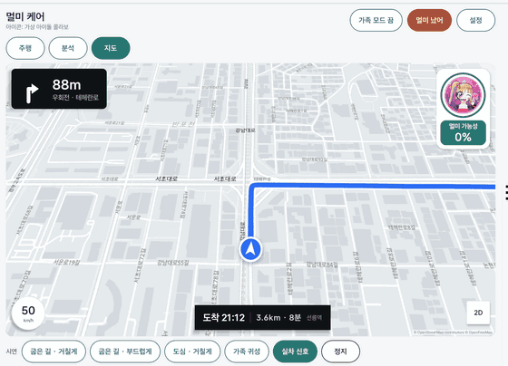

**실제 도로 시연** · Pleos Connect 에뮬레이터, 지도 탭, 4배속

- 강남 테헤란로: 회전 예고
- 북악스카이웨이: 멀미 위험, 휴게소 제안


---

## 목차

1. [우리가 판단한 멀미 조건](#1-우리가-판단한-멀미-조건)
2. [근거](#2-근거)
3. [멀미 지수 계산](#3-멀미-지수-계산)
4. [구현 방법](#4-구현-방법)
5. [실제 구현](#5-실제-구현)
6. [확장 가능성과 가치](#6-확장-가능성과-가치)
7. [부록: 한계 · 실행 방법 · 문서](#7-부록-한계--실행-방법--문서)

---

## 1. 우리가 판단한 멀미 조건

### ① 예고 없는 움직임

- 뜻: 몸이 느끼는 움직임과 예상이 어긋남
- 운전자는 알고, 동승자는 모름
- 읽는 신호: 방향지시등, 핸들 각도, 내비 다음 회전
- 앱: 회전 몇 초 전 알림음 · 목소리 · 무드등 예고

### ② 느린 흔들림의 누적

- 뜻: 0.5 Hz 아래의 앞뒤 · 옆 흔들림이 쌓임
- 읽는 신호: 속도, 진행 방향
- 앱: 흔들림 지수와 누적량 계산

### ③ 덥고 답답한 실내

- 뜻: 덥고 내기순환이 길수록 멀미가 쉬움
- 읽는 신호: 실내 온도, 내기순환
- 앱: 외기 전환 · 22°C

### ④ 사람마다 다른 기준

- 뜻: 4–13세 아이가 가장 약함, 아이마다 다름
- 읽는 신호: 뒷좌석 탑승
- 앱: 아이별 기준선 학습, 가장 약한 아이 먼저

## 2. 근거

| 조건 | 근거 |
|---|---|
| ① | 1초 전 음성 예고 → 멀미 점수 감소 (Kuiper 외, 2020) |
| ② | 0.5 Hz 미만 옆 흔들림이 멀미와 가장 잘 맞음 (Turner & Griffin, 1999) |
| ② | 누적량 형태: ISO 2631-1 |
| ③ | 바람 → 멀미 감소 (D'Amour 외, 2017) |
| ④ | 4–13세에서 가장 흔함 (Huppert 외, 2019) |
| ④ | 뒤쪽 좌석일수록 흔들림 · 멀미 증가 (Turner & Griffin, 1999) |

- DOI와 한계: [research/literature.md](research/literature.md)

## 3. 멀미 지수 계산


### 두 가지 값

| 값 | 뜻 | 단계 말 | 쓰는 곳 |
|---|---|---|---|
| 흔들림 지수 $I$ | 지금 얼마나 흔들리나 | 편안 · 주의 · 위험 (캐릭터 표정) | 캐릭터, 분석 탭 그래프 |
| 멀미 가능성 $P$ | 누적 $D$가 기준선을 넘을수록 커짐 | 낮음 · 보통 · 높음 (25%, 50%) | 지도 · 주행 탭 숫자, 분석 탭 그래프 |

- 두 값은 서로 다른 단계 말을 씀
- 짧고 센 흔들림: 표정은 "위험", 멀미 가능성은 아직 "낮음"일 수 있음

### 누적 흔들림 $D$

- 1초마다 계산
- 앞뒤 가속도 $a_x$, 옆 가속도 $a_y$
- 느린 성분만 남겨 누적

$$
D = \left( \sum_t \left( w_X a_x^2 + w_Y a_y^2 \right) \Delta t \right)^{1/2}
$$

### 환경 계수 $m$

- 덥고($T \gt 22$°C) 내기순환이 길수록 $m$ 감소
- 같은 흔들림에도 더 일찍 위험

$$
m = 1 - \gamma_T \max(0, T - 22) - \gamma_V \min\left(1, \frac{t_{\mathrm{recirc}}}{3600}\right)
$$

### 멀미 가능성 $P$

- 아이마다 기준선 $\tau$ 학습
- $P$가 0.5를 넘는 아이가 생기면 대응

$$
P = \frac{1}{1 + e^{-(D - \tau m)/s}}
$$

<details>
<summary>전체 수식 7개 (가속도, 핸들 각도, 기준선 학습, 예고 시점)</summary>

**① 가속도**

- 속도 $v$, 진행 방향 변화율 $\omega$에서 구함

$$
a_x = \frac{\Delta v}{\Delta t}, \qquad a_y = v \omega
$$

**② 핸들 각도로 방향 앞당기기**

- GPS 방향은 연속 위치에서 구함 → 회전보다 1–2초 늦음
- 핸들 각도 $\delta_{sw}$ ÷ 조향비 $r = 14.5$ = 바퀴 각도
- 축간거리 $L = 2.9$ m로 회전 속도 예측
- GPS 방향 쪽으로 조금씩($k = 0.2$) 당겨 오차 누적 방지

$$
\omega = \frac{v \tan(\delta_{sw} / r)}{L}
$$

**③ 느린 흔들림**

- 최근 10초 평균을 빼서 0.1 Hz보다 느린 성분 제거
- 제거 대상: 꾸준한 가속, 긴 커브
- 지수 $I$: 최근 60초 제곱평균제곱근
- 누적량 $D$: 위 식

**④ 환경 계수**

- 위 식, 최솟값 0.6
- 알림 기준선: 주의 $0.9 \cdot m$, 높음 $1.5 \cdot m$

**⑤ 아이별 기준선**

- 멀미가 난 시점의 누적량 기록 $n$개의 평균 $\bar{D}$
- 기록이 적으면 출발값 $\tau_0 = 30$ 쪽으로 당김 ($n_0 = 5$)

$$
\tau = \frac{n \bar{D} + n_0 \tau_0}{n + n_0}
$$

**⑥ 멀미 가능성**

- 위 식 $P$

**⑦ 예고 시점**

- 회전까지 거리가 아래 거리 안이면 예고
- 말하는 시간 2초 + 몸이 대비할 시간 3초

$$
d_{\mathrm{cue}} = v (t_{\mathrm{say}} + t_{\mathrm{prepare}})
$$

**상수와 검증**

- 모든 상수: [`shared/params.json`](shared/params.json)
- 파이썬 시뮬레이터와 앱이 같은 파일을 읽음
- 300개 샘플에서 두 계산 일치 (단위 테스트)

</details>

## 4. 구현 방법


| 단계 | Pleos SDK |
|---|---|
| 읽기 | Vehicle, NaviHelper, 위치 |
| 계산 | SDK와 분리된 순수 Kotlin 엔진 (3절) |
| 행동 | TextToSpeech, Vehicle HVAC · Light, NaviHelper |
| 묻기 | SpeechToText + 화면 버튼 / 알림 카드 |

**읽기** (1초마다)

- 속도 · 방향 · 핸들 각도
- 방향지시등 · 내비 다음 회전
- 실내 온도 · 내기순환 · 뒷좌석 탑승

**행동**

- 예고: 알림음 · 캐릭터 목소리 · 무드등
- 공조: 외기 · 22°C
- 내비: 휴게소 경유지

**묻기**

- "휴게소에 들를까요?"
- "가족 모드를 켤까요?"
- 정차 후 "오늘 민준 괜찮았어요?"


### 실차 없이 3단계 검증

1. 실제 도로 위 시나리오 시뮬레이션 (점검 10개 통과)
2. 실제 주행 데이터 비교 (comma2k19)
3. Pleos 에뮬레이터 (실제 SDK)

### 시나리오 (OpenStreetMap 실제 도로)

| 시나리오 | 경로 | 특징 |
|---|---|---|
| 도심 | 강남역 → 테헤란로 → 언주로 → 봉은사로 → 선릉로 | 회전 4곳, 신호 정지 6번 |
| 굽은 길 | 북악스카이웨이 (북악산로) | 반경 100 m 미만 커브 52곳 |
| 고속도로 | 경부고속도로 판교 → 수원신갈IC | |
| 가족 나들이 | 동탄 → 경부 · 수도권제1순환 → 남한산성로 | |

---

## 5. 실제 구현

- 촬영: Pleos Connect Emulator v2.1 (Android Automotive, API 34)에서 실제 실행
- 차 신호: 브라우저의 **Virtual Console**로 조작


### ① 첫 실행: 아이가 아이콘 테마를 고름


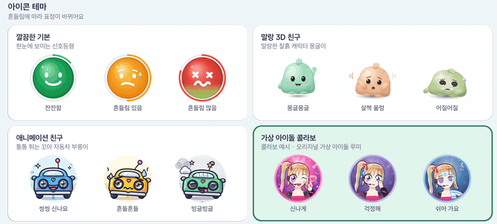

- 테마는 그림과 말투만 바꿈
- 계산과 안내는 똑같음

| 테마 | 캐릭터 |
|---|---|
| 깔끔한 기본 | 신호등형 표정 |
| 말랑 3D 친구 | 찰흙 캐릭터 몽글이 |
| 애니메이션 친구 | 꼬마 자동차 부릉이 |
| 가상 아이돌 콜라보 | 오리지널 가상 아이돌 루미 |

**회전 예고 말투**

- 기본: "곧 왼쪽으로 돌아요."
- 몽글이: "몽글이가 알려 줄게. 곧 왼쪽으로 돌아요!"
- 부릉이: "부릉이 출동! 곧 왼쪽으로 돌아요."
- 루미: "루미가 먼저 알려 줄게요. 곧 왼쪽으로 돌아요!"

> 루미는 IP 협업 자리를 보여 주는 **오리지널 예시**이며, 실제 IP 계약은 없음

### ② 뒷좌석에 아이가 타면 가족 모드 제안

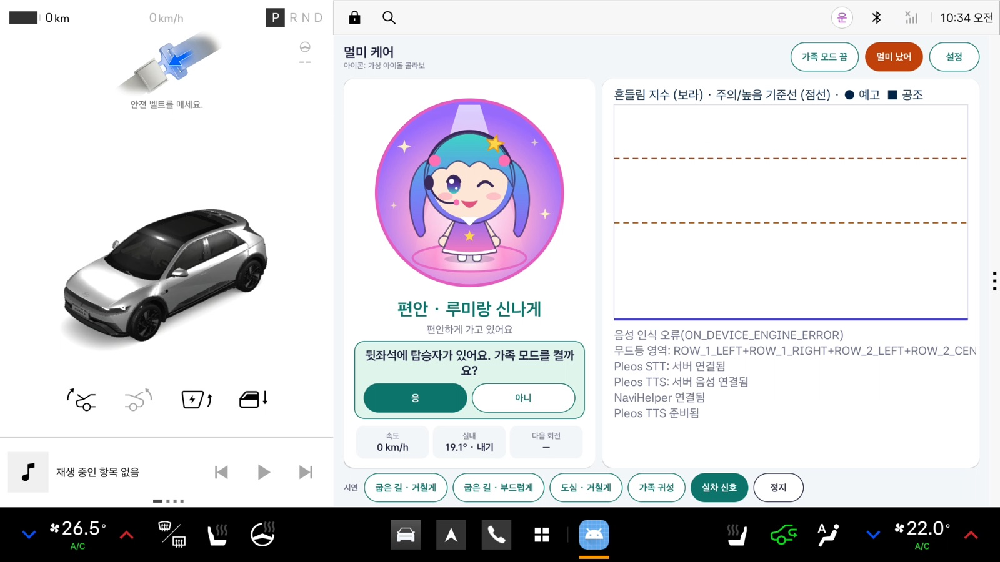

- Virtual Console: 뒷좌석 왼쪽 = 탑승
- 음성 + 화면 안 큰 "응 / 아니" 버튼

### ③ 움직이기 전에 예고


- 방향지시등을 켜면 Pleos가 사각지대 카메라 창을 띄움 → 앱 화면이 뒤로 감
- 그래서 이 순간 예고는 화면 대신 소리 + 무드등
- 내비 경로가 있으면 회전 몇 초 전 지도 탭 캐릭터 말풍선도 표시

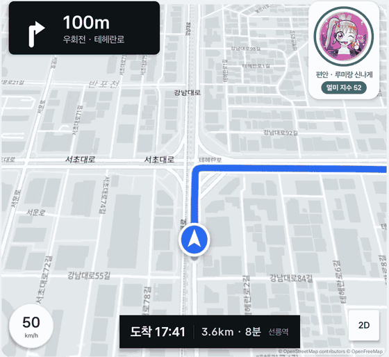

| 신호 | 쓰임 |
|---|---|
| 방향지시등 | 켜는 순간 예고 |
| 내비 다음 회전 | 회전 약 5초 전 예고 |
| 핸들 각도 | GPS보다 1–2초 먼저 방향 변화 반영 |

**예고 방식 (설정에서 선택)**

- 회의 의견 반영: 내비 음성과 겹치면 시끄러움

| 방식 | 동작 |
|---|---|
| 알림음 (기본) | 짧은 "띵" 한 번 + 무드등 |
| 캐릭터 목소리 | 테마 말투로 말함 |
| 무드등만 | 소리 없이 빛으로만 |

- 캐릭터 목소리: 내비가 300 m 안 회전을 안내 중이면 알림음으로 바꿈

**무드등은 은은하게**

- 도는 쪽: 호박색 60% 밝기
- 반대쪽: 원래 밝기의 절반
- 사이 박자: 원래 밝기로 복귀 (완전히 꺼지는 깜빡임 없음)

### ④ 흔들림이 커지면 차가 공기를 바꿈

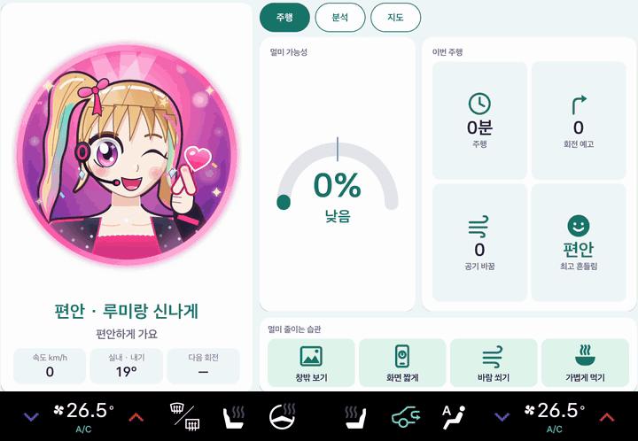

- 흔들림이 기준을 넘으면 Vehicle SDK로 **내기순환 끔 + 22°C**
- 아래 차량 공조 바에서 확인
- **닫힌 고리**: 바뀐 온도 · 환기가 다시 계산에 들어가 기준 상승


### ⑤ 가족 모드: 가장 약한 아이 기준으로 먼저

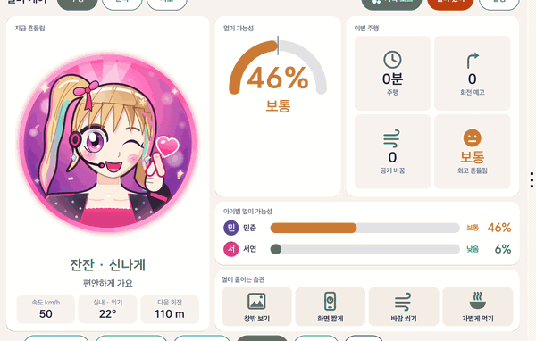


- 기준선: 민준 24.9, 서연 35.9
- 민준이 **3분 20초 먼저** 기준 도달 → 그때 대응

### ⑥ 흔들림이 계속되면 휴게소 제안


- 높음이 3분 이어지면 질문
- "응" → NaviHelper로 차량 내비에 경유지 추가

### ⑦ 정차 후 한 질문으로 아이별 기준 학습

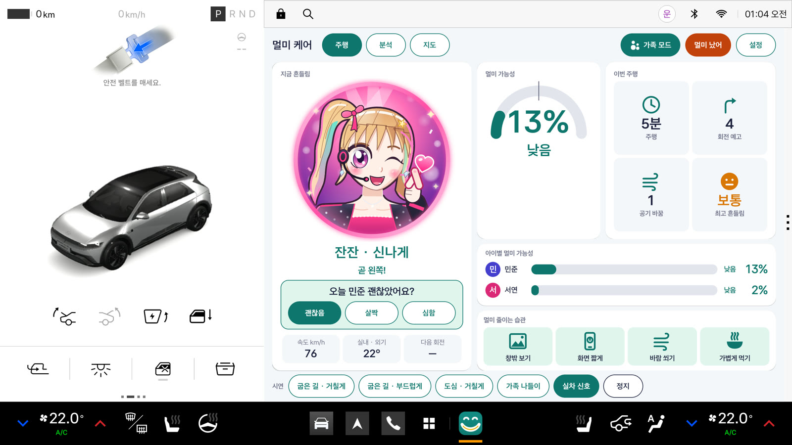

**아이마다 한 번 질문** · "오늘 민준 괜찮았어요?"

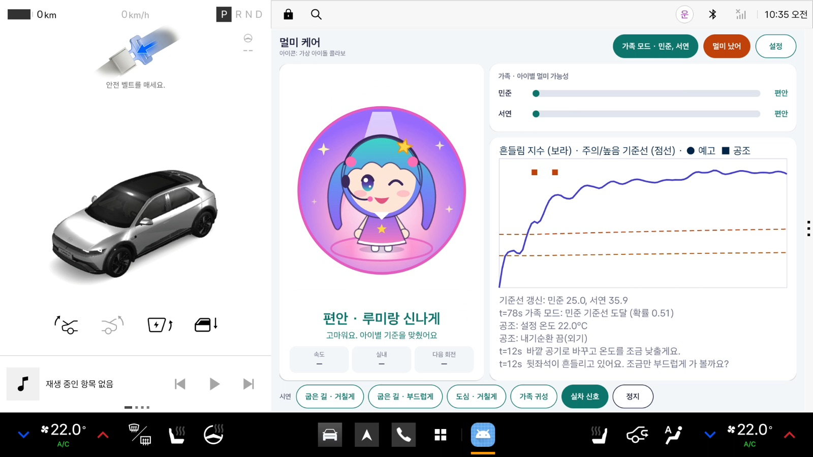

**답에 따라 기준선 갱신** · 수식 ⑤

- 차가 1분 서 있으면 주행 끝으로 보고 질문
- 프로필은 차량 기기에만 저장

### ⑧ 세 개의 탭: 주행 · 분석 · 지도

**주행 (기본 화면)**: 읽지 않고 보는 인포그래픽

- 운전자 · 동승자는 내비 보기에 바쁨 → 글 대신 그림과 색
- 왼쪽: 큰 캐릭터 표정
- 오른쪽:
  - 픽토그램 숫자 타일 (주행 요약)
  - 멀미 가능성 게이지 (낮음 · 보통 · 높음)
  - 두꺼운 가족 막대
  - 2×2 습관 타일
- 그래프는 분석 탭으로 옮김

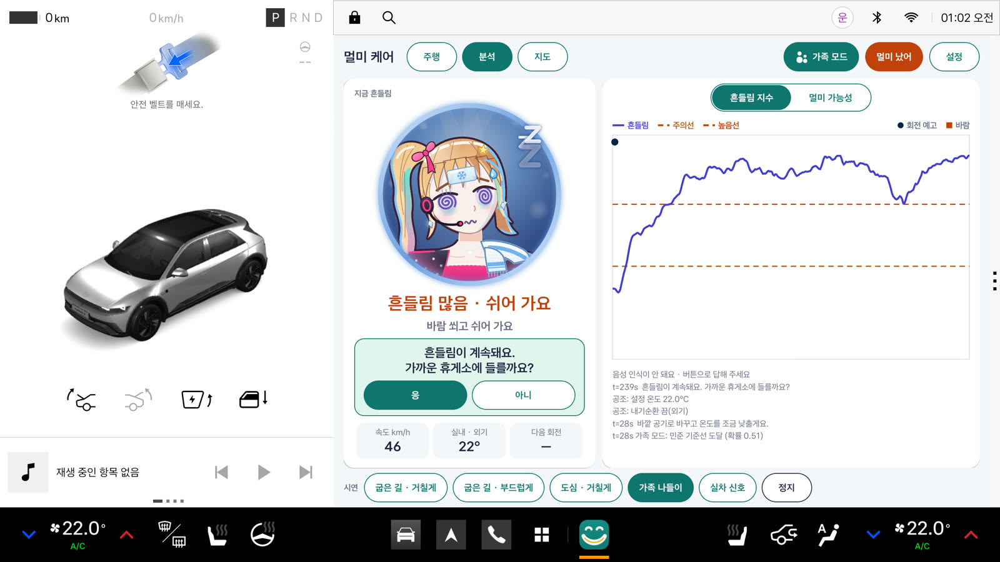

**분석 · 흔들림 지수** · 지금 흔들림과 주의·높음 기준선

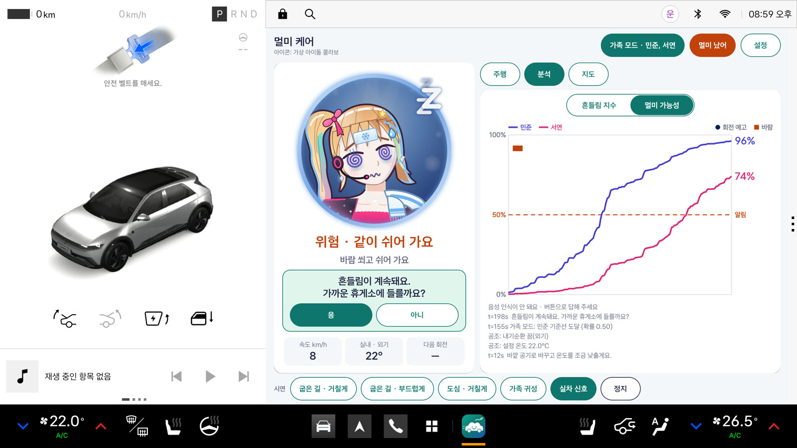

**분석 · 멀미 가능성** · 아이별 확률, 50%를 넘으면 대응

- 그래프 전환 토글: "흔들림 지수" ↔ "멀미 가능성"
- 한 번에 하나만 표시 (두 개를 겹치면 어지러움)

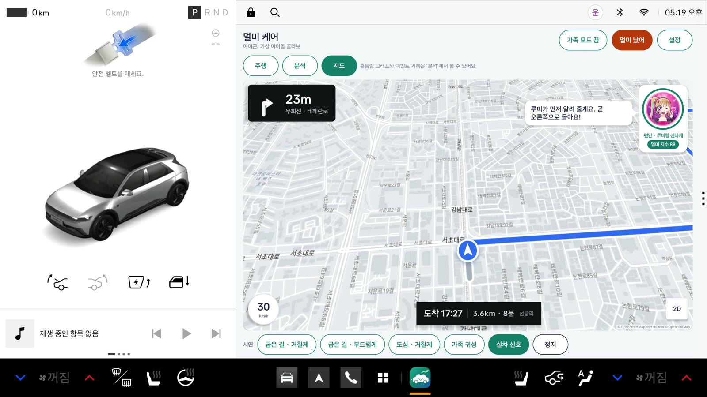

**지도** · 내비처럼 보는 경로와 캐릭터

- Pleos 내비와 같은 모습
- 멀미 케어가 내비 위에 얹히면 어떻게 보이는지 보여 줌

| 요소 | 내용 |
|---|---|
| 지도 | 진행 방향이 위, 기울어진 지도, 한글 도로 이름 |
| 경로 | 파란 경로선, 지나온 길은 회색 |
| 회전 안내 카드 | 왼쪽 위: 화살표 · 남은 거리 · 도로 이름 |
| 도착 바 | 도착 시각 · 남은 거리 · 남은 시간 · 목적지 |
| 캐릭터 | 오른쪽 위: "멀미 가능성 N%" |

- 지도: OpenFreeMap 벡터 지도, WebGL이 있으면 3D 건물
- 경로: 차는 도로 위에 고정
- 회전 안내 카드: 시연은 경로 파일, 실차는 NaviHelper TBT
- 도착 바: 실차는 NaviHelper DrivingInfo
- 캐릭터 위젯
  - 멀미 가능성 = 수식 ⑥의 $P$
  - 가족 모드: 가장 약한 아이 기준
  - 그 외: 기본 기준선
  - 숫자만 표시 (낮음 초록 · 보통 주황 · 높음 빨강)
  - 표정은 흔들림이 이어질 때 바뀜
  - 회전 예고 때 테마 말투 말풍선

### ⑨ 내비 옆 한 화면 모드

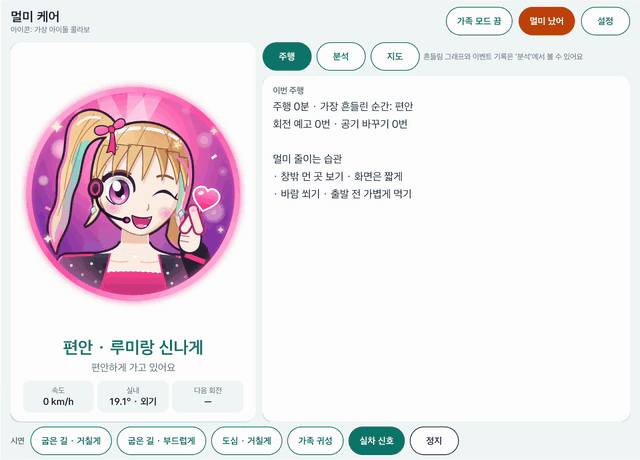

**실제 Pleos 내비와 함께 쓰기** · 에뮬레이터에서 화면 가운데 손잡이를 끌어 나눔

- 왼쪽: 멀미 케어 (표정 카드만 남은 한 화면 모드)
- 오른쪽: 실제 Pleos 내비 (판교역 경로 안내 중, 회전 안내 · 도착 시간)
- 앱 폭이 900 dp보다 좁으면 표정 카드만 남김
- 에뮬레이터에서는 내비 지도 타일이 그려지지 않아 지도 바탕이 비어 보임

### ⑩ 내비가 앞에 있을 때


- 판단과 행동은 포그라운드 서비스에서 실행
- 내비를 띄워 둔 채로도 예고 · 공조 · 가족 대응 그대로
- 질문: 응 / 아니 알림 카드
- 앱으로 돌아오면 기록과 대기 중인 질문 이어짐

### ⑪ 설정 한 곳에서


- 소리 안내, 예고 방식, 무드등
- 공조 자동 조절, 시연 패널, 아이 프로필
- 주행 중 테마 · 프로필 변경 잠금 (Car UX Restrictions)

### 검증 결과


**도로 · 운전 방식별 지수** · 고속도로 < 도심 < 굽은 길, 고속도로 13분 동안 알림 0번


**굽은 길 한 번의 주행** · 12초에 안내 · 공조, 3분 18초에 휴게소


**도심 주행** · 회전 4곳에서 정확히 한 번씩 예고


**실제 vs 시뮬레이션** · 앞뒤 가속도 1.4배 (기준 0.5–2배)

### 에뮬레이터에서 확인한 것

| 확인한 것 | 결과 |
|---|---|
| 방향지시등 → 예고 | "곧 왼쪽으로 돌아요" / 알림음 모드는 알림음만 |
| 핸들 각도 | Virtual Console 540° → 앱 수신 |
| 공조 닫힌 고리 | 공조 바 26.0° → 22.0°, 내기순환 끔 |
| 무드등 예고 | 색 · 밝기 변화 후 원래 값 복귀 (차량 로그) |
| Pleos 음성 | TTS · STT 서버 연결 |
| 가족 모드 · 정차 후 학습 | 확인 |
| 휴게소 경유지 | 내비 앱에 경유지 요청 도착 |
| 내비 다음 회전 | 경로 요청 후 "왼쪽 80 m" 수신 |
| 내비를 앞에 둔 채 | 공조 · 가족 경고 · 휴게소 질문 그대로 |
| 한 화면 모드 | 앱 창 폭을 줄이면 표정 카드만 |
| 지도 탭 | 경로 · 회전 카드 · 도착 시간 · 말풍선 |
| 내비에 앱 영역 알리기 | 거절됨 → Pleos 협의 항목 |

- 핸들 각도: Pleos는 오른쪽을 음수로 보냄 → 부호 뒤집음, 권한 `CAR_DRIVE`
- 내비를 앞에 둔 채: 질문은 알림 카드로
- 지도 탭: 에뮬레이터 WebView에 WebGL 없음 → 2D 벡터 지도로 동작
- 앱 영역 알리기: NaviHelper `updateOccupiedRegion` 호출 → "시스템 앱만 허용"
- 고친 버그와 리뷰 기록: [docs/qa.md](docs/qa.md)
- 숫자 표: [docs/validation.md](docs/validation.md)

---

## 6. 확장 가능성과 가치

### 왜 폰이 아니라 차여야 하나

- 흔들림 계산은 폰도 가능
- 차라서 되는 것: **미리 아는 것**, **직접 바꾸는 것**

| 기능 | 폰 앱 | 멀미 케어 |
|---|---|---|
| 움직이기 전 예고 | 폰 내비를 쓸 때만 일부 | 방향지시등 · 핸들 · 차량 내비 |
| 실내 온도 · 환기 | 불가 | 읽고 바꾸고, 다시 계산 |
| 빛으로 예고 | 불가 | 실내 무드등 (어린아이용) |
| 휴게소 · 편안한 길 | 폰 내비 안에서만 | 차량 내비에 바로 |
| 매 주행 실행 | 사람이 켜야 함 | 뒷좌석 탑승 → 가족 모드 제안 |

- 매 주행 실행: 내비로 바꿔도 계속 동작

### 가치와 수익 모델

- **타깃**: 아이가 있는 가족 운전자
- **규모**: 출시 1년 예상 MAU 약 1,800명 ([기획서 8절](docs/proposal.md))
- **재사용**: 탈수록 우리 아이 기준이 정확해짐
- **엔터테인먼트 연계**
  - 기본 기능 무료
  - 캐릭터 · 가상 아이돌 IP 테마와 음성 팩 판매
  - 멀미 예방 → "좋아하는 캐릭터와 노는 시간"

### 확장

| 대상 | 왜 맞나 |
|---|---|
| 택시 · 호출 (약 24만 대) | 승객은 늘 뒷좌석, 다음 회전을 모름 |
| 통학 차량 (약 4만 대) | 멀미가 가장 흔한 4–13세가 매일 탐 |
| 자율주행 셔틀 | 모두가 동승자, 예고가 더 중요 |
| Pleos MiniApp · 계기판 | 내비 옆에 표정 카드 올리기 |

- MiniApp · 계기판: [협의 문의 초안](docs/pleos-inquiry.md)
- 비슷한 서비스 비교 (Apple Vehicle Motion Cues, 현대차 스무스 모드 등)
  - [기획서 4절](docs/proposal.md)
  - [research/market.md](research/market.md)

---

## 7. 부록: 한계 · 실행 방법 · 문서

### 한계

**정답 데이터 없음**

- 실제 멀미 여부 데이터는 아직 없음
- 기준선 · 환경 계수 크기는 문헌값과 가정에서 시작
- 정차 후 질문과 동승 조사로 보정 ([docs/ride-study.md](docs/ride-study.md))

**실제 주행 비교 범위**

- 고속도로 1분 한 구간뿐
- 옆 흔들림은 비교 못 함

**휴게소 좌표**

- 데모용 3곳 (POI 검색 API 필요)

**내비가 앞일 때 질문 카드**

- Pleos 홈은 시스템 앱 알림만 지도 위에 띄움
- 질문 카드는 알림 센터로 감 → 소리와 무드등이 주된 안내
- MiniApp 영역 등록은 Pleos 협의 사항

**지도 탭**

- Pleos 내비를 흉내 낸 화면
- 지도는 인터넷으로 받음 (OpenFreeMap, OpenStreetMap 데이터)
- 실차 모드: NaviHelper가 경로선을 안 줌 → 차 위치와 지나온 길만
- 목표: Pleos 내비 화면에 캐릭터 올리기 (MiniApp, 앱 영역 알리기 API)
- 현재 해당 API는 시스템 앱에만 열림

**핸들 각도 상수**

- 조향비 · 축간거리는 일반 승용차 값
- 차종별 값은 정식 탑재 때 맞춤

**자동 실행**

- 앱을 한 번 열어야 서비스 시작
- 시동과 함께 자동 실행은 정식 탑재 때 Pleos 정책에 맞춰 추가

### 앱 아이콘과 크레딧

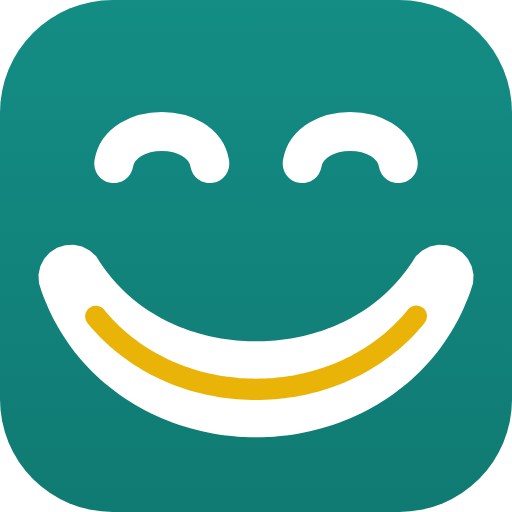

- 런처 아이콘: 멀미 케어 전용 아이콘
- 청록 바탕, 눈을 감고 웃는 얼굴
- 입은 노란 중앙선이 이어진 하얀 도로 (가운데는 넓고 끝으로 좁아짐)
- 뜻: 부드러운 길 위에서 편안한 아이
- 적응형 아이콘 + 테마 아이콘용 단색 버전
- 시안 3개를 심사 3명이 비교해 고름 (이빨처럼 보이던 점선 대신 이어진 중앙선)

<br clear="left">

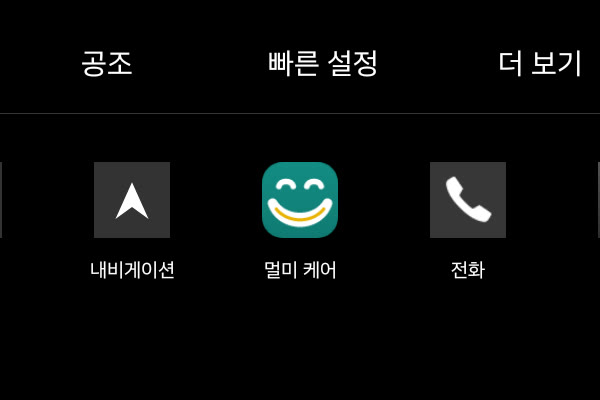

- 팀 CRAVE 로고: README 맨 위, 앱 설정 맨 아래 크레딧 줄 ([docs/img/crave_logo.svg](docs/img/crave_logo.svg))

### 폴더 구조

```
android/
  core/            순수 Kotlin 판단 엔진 (+ 핸들 각도 방향 보정 SteeringYaw) + 단위 테스트
  app/             Android Automotive 앱
                   TripService: 주행 판단과 행동 (내비가 앞이어도 계속)
                   Notifier: 앱이 안 보일 때의 알림 카드와 질문 카드
                   MainActivity: 화면만 (서비스에 붙어 보여 줌)
    ui/            홈 화면 (주행 · 분석 · 지도 탭, 한 화면 모드), 설정 화면
    theme/         멀미 지수 아이콘 테마 4종 (Canvas로 그림, 이미지 파일 없음)
sim/               시나리오 생성, 기준 엔진, 점검, 실제 데이터 비교, README 그래프
shared/            params.json (파이썬·앱 공용 상수), test_vectors.csv
docs/              기획서, 검증, 에뮬레이터 확인 기록, 제출 체크리스트, 이미지
research/          문헌 근거, 경쟁 서비스 조사
data/rides/        동승 기록 원본 (로컬 전용, 커밋 안 함)
apk/               제출용 release APK (제출 때만 커밋)
.github/workflows/ci.yml   CI: 시뮬레이터 점검 + 테스트 벡터 + Kotlin 테스트 + 디버그 빌드
```

### 시뮬레이션과 그래프

- 파이썬 3, 외부 라이브러리 없음

```bash
python3 sim/generator.py
```

```bash
python3 sim/prototype.py
```

```bash
python3 sim/readme_figures.py
```

### 엔진 테스트와 앱 빌드

- JDK: Android Studio에 들어 있는 것 사용
- `app:preBuild`: `sim/scenarios/*.csv`, `shared/params.json`을 앱 assets로 복사
- 빌드 폴더: `build.nosync` (iCloud 동기화 회피)

```bash
cd android && JAVA_HOME="/Applications/Android Studio.app/Contents/jbr/Contents/Home" ./gradlew :core:test :app:assembleDebug
```

**계산을 바꿀 때 순서**

1. `sim/engine.py` 수정
2. `prototype.py`로 점검, `test_vectors.csv` 갱신
3. `android/core` Kotlin을 같은 숫자가 나오게 수정

### 에뮬레이터

1. Pleos 이미지 설치
   - Android Studio SDK Manager에 Pleos 이미지 주소 추가
   - Pleos Connect v2.1.0 (API 34) 설치
   - 참고: Pleos 개발 문서 "Pleos Connect Emulator 설치 및 실행"
2. Wi-Fi 연결
   - 에뮬레이터 설정 › 연결 › Wi-Fi › `AndroidWifi`
   - 필요: Pleos 음성 서버, 내비 경로 탐색, 지도 타일
3. Virtual Console
   - `adb forward tcp:8088 tcp:8088`
   - 브라우저에서 http://127.0.0.1:8088/

```bash
nohup ~/Library/Android/sdk/emulator/emulator -avd Pleos_Connect_v2_1 -no-snapshot-load -gpu host > /tmp/emu.log 2>&1 &
```

**화면 조작**

| 위치 | 버튼 |
|---|---|
| 위쪽 | "가족 모드", "멀미 났어", "설정" |
| 오른쪽 위 탭 | "주행"(기본), "분석", "지도" |
| 아래쪽 시연 패널 | 시나리오 4배속 재생, "실차 신호", "정지" |

- "실차 신호": 앱을 켜면 자동 시작
- 디버그 빌드 옵션: `--es theme toon --ez skip_welcome true`
  - 테마 선택, 환영 화면 건너뛰기

### 키와 서명

- 각자 `android/local.properties`에 작성, 커밋 금지

```
pleos.clientId=...          # Pleos Playground › My Project
pleos.clientSecret=...
release.storeFile=keystore/motioncare-release.jks
release.storePassword=...
release.keyAlias=motioncare
release.keyPassword=...
apk.teamName=팀명            # → apk/팀명_MotionCare_release.apk
```

- `./gradlew :app:assembleRelease` → 서명된 APK를 `apk/`로 복사
- APK에 클라이언트 키 포함 → 평소 git에서 제외
- 제출 때만 `git add -f apk/...`
- 키스토어(`android/keystore/`)는 따로 백업
  - 잃어버리면 같은 서명으로 다시 낼 수 없음

### 개발 환경

| 항목 | 버전 |
|---|---|
| Android Studio | 2026.2 |
| AGP · Gradle | 9.4.1 · 9.8.2 |
| Kotlin · compileSdk | 2.4 · 34 |
| Pleos Vehicle | 2.3.2 |
| NaviHelper | 3.0.5 |
| TextToSpeech / SpeechToText | 3.3.1 |

### 문서

| 문서 | 내용 |
|---|---|
| [docs/proposal.md](docs/proposal.md) | 기획서 초안 (심사 기준별) |
| [docs/validation.md](docs/validation.md) | 시뮬레이션 점검, 실제 데이터 비교 |
| [docs/qa.md](docs/qa.md) | 에뮬레이터 확인 기록, 고친 버그 |
| [docs/submission.md](docs/submission.md) | 제출 체크리스트 |
| [docs/pleos-inquiry.md](docs/pleos-inquiry.md) | Pleos 협의 문의 초안 (미발송) |
| [docs/demo-script.md](docs/demo-script.md) | 시연 영상 콘티 |
| [docs/ride-study.md](docs/ride-study.md) | 실제 동승 멀미 데이터 수집 안내 |
| [research/literature.md](research/literature.md) | 공식 · 상수의 문헌 근거 (DOI) |
| [research/market.md](research/market.md) | 경쟁 서비스 조사 |

- Pleos 협의 문의 범위: MiniApp, 계기판, 자동 실행

### 남은 일

- 실제 동승 데이터 5–10회
- 내비 경로를 따라가는 회전 예고 확인
- "편안한 길" 실제 경로 변경 확인
- 새 화면(지도 · 한 화면 · 알림음)으로 시연 영상 재촬영, 내레이션
- 기획서를 접수 양식으로 옮기기
