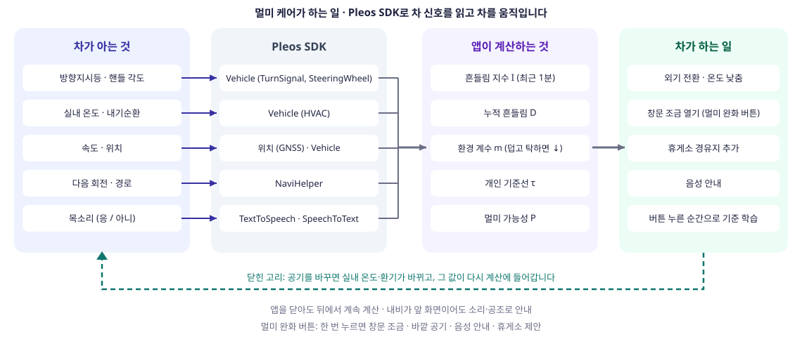
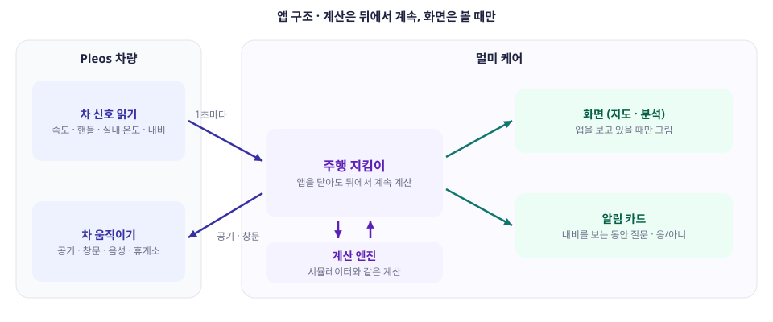
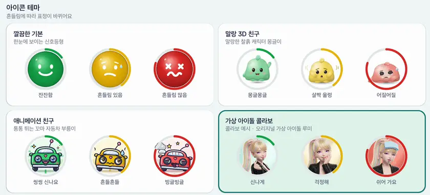
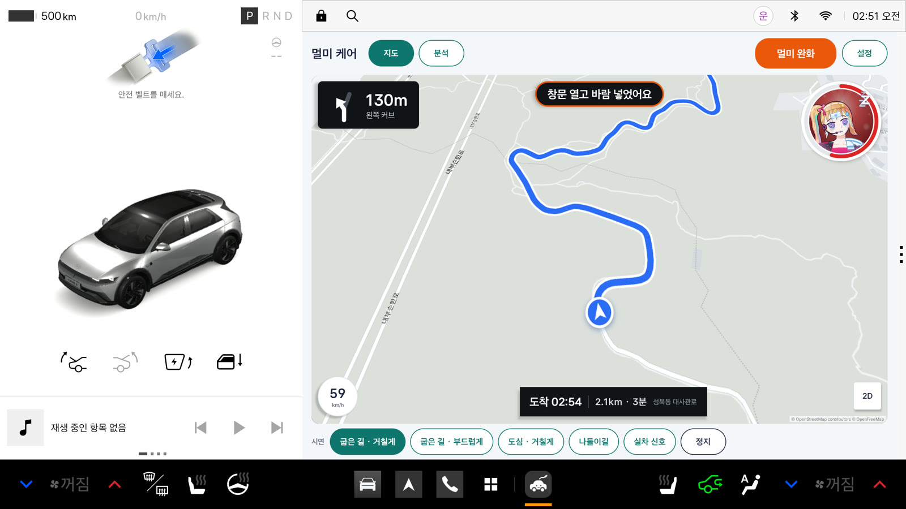
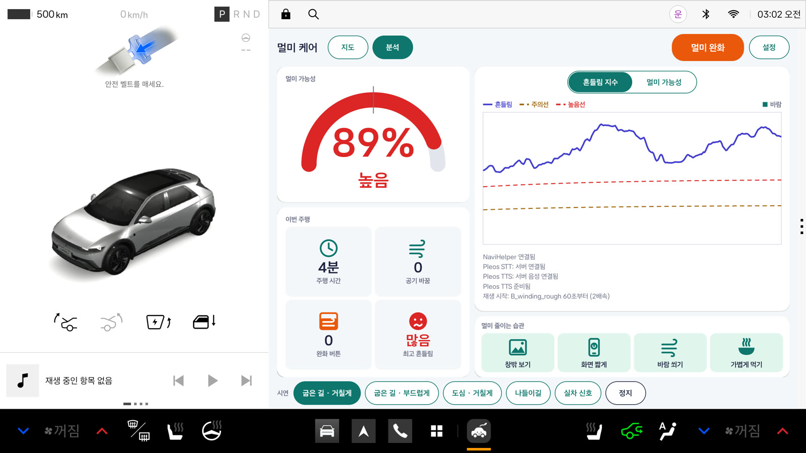
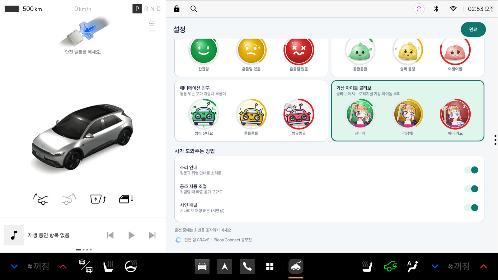

# 멀미 케어

**멀미 지수로 높이는 탑승 쾌적함**

>  현대자동차그룹 차량용 앱 개발 공모전 (Pleos Connect) · 팀 CRAVE


**시뮬레이션 시연** · 북악스카이웨이 실제 도로 경로를 에뮬레이터에서 재생 (3배속)

### 어떻게 동작하나

1. 흔들림 지수가 오르면 → 차가 외기 · 온도를 바꿈 (멀미 완화 버튼이면 창문까지)
2. 멀미가 날 때 누른 "멀미 완화" 순간의 지수를 모아 → 그 사람만의 기준선 → 멀미 가능성

### 다른 점

- **차에서 받고 차에서 조작하는 앱**: 핸들 · 공조 신호로 계산, 공조 · 창문을 직접 바꿈
- **문헌 근거 공식**: 0.1–0.5 Hz 흔들림 누적 (ISO 2631-1 형태, [근거](#2-근거))
- **누구나 아는 문제**: 뒷좌석 멀미, 4–13세에서 가장 흔함

---

## 목차

1. [우리가 판단한 멀미 조건](#1-우리가-판단한-멀미-조건)
2. [근거](#2-근거)
3. [멀미 지수 계산](#3-멀미-지수-계산)
4. [구현 방법](#4-구현-방법)
5. [실제 구현](#5-실제-구현)
6. [가치](#6-가치)
7. [확장 가능성](#7-확장-가능성)
8. [부록: 한계 · 실행 방법 · 문서](#8-부록-한계--실행-방법--문서)

---

## 1. 우리가 판단한 멀미 조건

| 조건 | 한 줄 뜻 | 읽는 신호 | 앱이 하는 일 |
|---|---|---|---|
| ① 예고 없는 움직임 | 몸의 느낌과 예상이 어긋남 | 핸들 각도 · 방향지시등 · 다음 회전 | 흔들림을 1–2초 먼저 계산 |
| ② 느린 흔들림 누적 | 0.1–0.5 Hz 흔들림이 쌓임 | 속도 · 진행 방향 | 흔들림 지수 · 누적량 |
| ③ 덥고 답답한 실내 | 덥고 내기순환이 길수록 쉬움 | 실내 온도 · 내기순환 | 외기 전환 · 온도 낮춤 |
| ④ 사람마다 다른 기준 | 같은 흔들림에도 다름 | 멀미 완화 버튼을 누른 순간 | 개인 기준선 학습 |

- 운전자는 다음 움직임을 알고, 동승자는 모름
- 4–13세 아이가 가장 약함

## 2. 근거

| 조건 | 근거 |
|---|---|
| ① | 1초 전 음성 예고 → 멀미 점수 감소 (Kuiper 외, 2020) |
| ② | 0.5 Hz 미만 옆 흔들림이 멀미와 가장 잘 맞음 (Turner & Griffin, 1999) |
| ② | 누적량 형태: ISO 2631-1 |
| ③ | 바람 → 멀미 감소 (D'Amour 외, 2017) |
| ④ | 4–13세에서 가장 흔함 (Huppert 외, 2019) |
| ④ | 뒤쪽 좌석일수록 흔들림 · 멀미 증가 (Turner & Griffin, 1999) |

- DOI와 한계: [research/literature.md](research/literature.md)

## 3. 멀미 지수 계산


### 두 가지 값

| 값 | 뜻 | 단계 이름 | 쓰는 곳 |
|---|---|---|---|
| 흔들림 지수 $I$ | 지금 얼마나 흔들리나 | 잔잔 · 흔들림 · 흔들림 많음 | 표정 (한 화면 모드 "지금 흔들림"), 분석 탭 그래프 |
| 멀미 가능성 $P$ | 누적 $D$가 기준선을 넘을수록 커짐 | 낮음 · 보통 · 높음 (25%, 50%) | 캐릭터 둘레 링 (차오르는 양 · 색), 분석 탭 게이지, 한 화면 % 알약 |

- 색은 하나의 척도: 초록 → 노랑 → 빨강 (테마 4종 · 링 · 게이지 · 그래프 모두)
- 짧고 센 흔들림: 표정은 "흔들림", 멀미 가능성은 아직 "낮음"일 수 있음
- 멀미 가능성이 25% 아래면 표정은 "흔들림"(노랑)까지만

### 누적 흔들림 $D$

- 1초마다 계산
- 앞뒤 가속도 $a_x$, 옆 가속도 $a_y$
- 0.1–0.5 Hz 흔들림만 남겨 누적

$$
D = \left( \sum_t \left( w_X a_x^2 + w_Y a_y^2 \right) \Delta t \right)^{1/2}
$$

- 길이가 다른 주행 비교: 시간 보정 누적량 $D/\sqrt{t}$ (분 단위, [docs/validation.md](docs/validation.md))

### 환경 계수 $m$

- 덥고($T \gt 22$°C) 내기순환이 길수록 $m$ 감소
- 같은 흔들림에도 더 일찍 위험

$$
m = 1 - \gamma_T \max(0, T - 22) - \gamma_V \min\left(1, \frac{t_{\mathrm{recirc}}}{3600}\right)
$$

### 멀미 가능성 $P$

- 개인 기준선 $\tau$: 멀미 완화 버튼을 누른 순간의 누적량으로 학습
- 버튼을 누르기 전에는 출발값 $\tau_0 = 30$

$$
P = \frac{1}{1 + e^{-(D - \tau m)/s}}
$$

<details>
<summary>전체 수식 7개 (가속도, 핸들 각도, 기준선 학습, 예고 시점)</summary>

**① 가속도**

- 속도 $v$, 진행 방향 변화율 $\omega$에서 구함

<div align="center">

$$a_x = \frac{\Delta v}{\Delta t}, \qquad a_y = v \omega$$

</div>

**② 핸들 각도로 방향 앞당기기**

- GPS 방향은 연속 위치에서 구함 → 회전보다 1–2초 늦음
- 핸들 각도 $\delta_{sw}$ ÷ 조향비 $r = 14.5$ = 바퀴 각도
- 축간거리 $L = 2.9$ m로 회전 속도 예측
- GPS 방향 쪽으로 조금씩($k = 0.2$) 당겨 오차 누적 방지

<div align="center">

$$\omega = \frac{v \tan(\delta_{sw} / r)}{L}$$

</div>

**③ 느린 흔들림**

- 1초 샘플이라 0.5 Hz까지만 담김
- 최근 10초 평균을 빼서 0.1 Hz보다 느린 성분 제거
- 결과: 0.1–0.5 Hz 흔들림만 남겨 누적
- 제거 대상: 꾸준한 가속, 긴 커브
- 지수 $I$: 최근 60초 제곱평균제곱근 (처음 60초도 60으로 나눔)
- 누적량 $D$: 위 식

**④ 환경 계수**

- 위 식, 최솟값 0.6
- 알림 기준선: 주의 $0.9 \cdot m$, 높음 $1.5 \cdot m$

**⑤ 개인 기준선**

- 멀미 완화 버튼을 누른 순간의 누적량 기록 $n$개의 평균 $\bar{D}$
- 주행마다 첫 번째 누름만, 누적량 5 이상일 때만 기록
- 기록이 적으면 출발값 $\tau_0 = 30$ 쪽으로 당김 ($n_0 = 5$)

<div align="center">

$$\tau = \frac{n \bar{D} + n_0 \tau_0}{n + n_0}$$

</div>

**⑥ 멀미 가능성**

- 위 식 $P$

**⑦ 예고 시점 (엔진에만 있음, 앱 화면 · 소리에서는 꺼 둠)**

- 회전까지 거리가 아래 거리 안이면 예고
- 말하는 시간 2초 + 몸이 대비할 시간 3초
- 회전마다 한 번, 신호 대기 뒤 출발하면 한 번 더
- 굽은 길: 150 m 안에서 45°를 넘게 꺾이는 커브도 예고 시점 계산

<div align="center">

$$d_{\mathrm{cue}} = v (t_{\mathrm{say}} + t_{\mathrm{prepare}})$$

</div>

**상수와 검증**

- 모든 상수: [`shared/params.json`](shared/params.json)
- 파이썬 시뮬레이터와 앱이 같은 파일을 읽음
- 세 구간(굽은 길 · 도심 · 앱 없는 나들이길) 2,162개 샘플에서 두 계산 일치 (단위 테스트, 오차 $2\times10^{-6}$ 이하)

</details>

## 4. 구현 방법



| 단계 | Pleos SDK |
|---|---|
| 읽기 (1초마다) | Vehicle (TurnSignal, SteeringWheel, HVAC), 위치 (GNSS), NaviHelper |
| 계산 | SDK와 분리된 순수 Kotlin 엔진 (3절) |
| 행동 | Vehicle (HVAC: 외기 · 22°C, Window: 뒷창문 조금), TextToSpeech (안내 한 줄) |



### 실차 없이 3단계 검증

1. 실제 도로 위 시나리오 시뮬레이션 (점검 10개 통과)
2. 실제 주행 데이터 비교 (comma2k19)
3. Pleos 에뮬레이터 (실제 SDK)

### 시나리오 (OpenStreetMap 실제 도로)

| 시나리오 | 경로 | 특징 |
|---|---|---|
| 도심 | 강남역 → 테헤란로 → 언주로 → 봉은사로 → 선릉로 | 회전 4곳, 신호 정지 6번 |
| 굽은 길 | 북악스카이웨이 (북악산로) | 반경 100 m 미만 커브 52곳 |
| 고속도로 | 경부고속도로 판교 → 수원신갈IC | |
| 나들이길 | 동탄 → 경부 · 수도권제1순환 → 남한산성로 | 긴 주행 |

- 입력: 경로 → 1초 간격 가상 센서 값 (속도 · 진행 방향 · 핸들 · 실내 온도)

---

## 5. 실제 구현

- 촬영: Pleos Connect Emulator v2.1 (Android Automotive, API 34)에서 실제 실행
- 진짜 (Pleos SDK): 공조 · 창문 · 음성, 방향지시등 · 핸들 각도 · 실내 온도
- 시뮬레이션: 속도 · 진행 방향 · 경로 · 회전 안내 카드 · 도착 시간
- 차 신호: Pleos 에뮬레이터에 들어 있는 **Virtual Console**로 조작 (우리 앱 아님)


### ① 아이가 고르는 아이콘 테마




- 첫 실행 때 고름, 설정에서 바꿈
- 테마는 그림과 말투만 바꿈, 계산과 안내는 같음
- 모든 테마: 캐릭터 둘레 링이 멀미 가능성만큼 차오름 (초록 → 노랑 → 빨강)

| 테마 | 캐릭터 |
|---|---|
| 깔끔한 기본 | 신호등형 표정 |
| 말랑 3D 친구 | 찰흙 캐릭터 몽글이 |
| 애니메이션 친구 | 꼬마 자동차 부릉이 |
| 가상 아이돌 콜라보 | 오리지널 가상 아이돌 루미 |

> 루미는 IP 협업 자리를 보여 주는 **오리지널 예시**이며, 실제 IP 계약은 없음

### ② 지도 탭 (기본 화면)


**앱을 열면 바로 지도** · 탭은 두 개: 지도 | 분석

| 요소 | 내용 |
|---|---|
| 지도 | 진행 방향이 위, 한글 도로 이름, 줌 고정 |
| 경로 | 앞으로 갈 길만 파란 선 (지나온 길은 안 그림) |
| 회전 안내 카드 · 도착 바 | 시연은 경로 파일, 실차는 NaviHelper (TBT, DrivingInfo) |
| 캐릭터 | 오른쪽 위, 둘레 링 = 멀미 가능성 (숫자 없음) |

- 링 색: 25% 아래 초록 · 25–50% 노랑 · 50% 이상 빨강, 회색 바탕 위로 12시부터 시계 방향
- 지도: OpenFreeMap 벡터 지도, 에뮬레이터는 WebGL이 없어 2D

### ③ 멀미 완화 버튼: 한 번 누르면 바로



**위쪽 큰 주황 버튼 "멀미 완화"** · 지도 · 분석 · 한 화면 모드 어디서나

| 순서 | 차가 하는 일 | SDK |
|---|---|---|
| 1 | 뒷창문을 조금 (전체의 20%) | Vehicle Window |
| 2 | 바깥 공기 + 온도 낮춤 (22°C) | Vehicle HVAC |
| 3 | "창문 열고 바람 넣을게요. 먼 곳을 보세요." | TextToSpeech |
| 4 | 누른 순간의 누적량 → 내 기준선 (수식 ⑤) | 앱 안 |

- 창문을 못 열면 (거절 · 뒷창문 없음 · 4초 무응답): 화면 + 음성 "창문을 조금 열어 주세요"
- 공조가 꺼져 있으면 공조는 그대로, 20초 안에 다시 누르면 "바람 넣는 중이에요"만
- 권한: `pleos.car.permission.CONTROL_CAR_WINDOWS`

### ④ 흔들림이 커지면 차가 공기를 바꿈

- 기준을 넘으면 **내기순환 끔 + 22°C**, 바뀐 실내가 다시 계산에 들어가는 닫힌 고리 (정지하면 원래대로)

### ⑤ 분석 탭



**읽지 않고 보는 인포그래픽**

- 멀미 가능성 게이지, 타일 4개 (주행 시간 · 공기 바꿈 · 완화 버튼 · 최고 흔들림)
- 그래프 토글 "흔들림 지수" ↔ "멀미 가능성", 아래에 차가 한 일 기록
- 멀미 줄이는 습관 타일 4개

### ⑥ 내비 옆 한 화면 모드


**실제 Pleos 내비와 함께** · Pleos 화면 나누기 손잡이로 앱 폭을 줄인 모습

- 왼쪽: 링을 두른 표정 카드 + 멀미 가능성 % 알약, 위: 멀미 완화 버튼
- 앱 폭이 900 dp보다 좁으면 이 모드
- 에뮬레이터에서는 내비 지도 타일이 안 그려져 바탕이 비어 보임

### ⑦ 내비가 앞에 있을 때

- 계산과 행동은 앱을 닫아도 뒤에서 계속, 내비를 띄워 둔 채로도 공조 · 음성 안내 그대로

### ⑧ 설정 한 곳에서



- 아이콘 테마, 소리 안내, 공조 자동 조절, 시연 패널
- 주행 중 테마 변경 잠금 (Car UX Restrictions)

### 검증 결과


**도로 · 운전 방식별 지수** · 고속도로 → 도심 → 굽은 길 순으로 커짐, 고속도로 13분 동안 알림 0번


**굽은 길 한 번의 주행** · 21초에 안내 · 공조


**실제 vs 시뮬레이션 (같은 45초)** · 앞뒤 가속도 1.41배 (기준 0.5–2배), 평균 지수 0.35 vs 0.27

### 에뮬레이터에서 확인한 것

| 확인한 것 | 결과 |
|---|---|
| 멀미 완화 · 창문 | 뒷창문 2개에 위치 2 (범위 0–10) 명령, 차가 수락 |
| 멀미 완화 · 학습 | "누적량 32.3 · 기준 30.6" 기록, 20초 안 다시 누름은 무시 |
| 공조 닫힌 고리 | 공조 바 26.0° → 22.0°, 내기순환 끔 |
| 공조가 꺼져 있을 때 | 바꾸지 않고 창문 안내 |
| 핸들 각도 | Virtual Console 540° → 앱 수신 |
| Pleos 음성 | TTS · STT 서버 연결 |
| 내비 다음 회전 | 경로 요청 후 "왼쪽 80 m" 수신 |
| 내비를 앞에 둔 채 | 공조 · 안내 그대로 |
| 한 화면 모드 | Pleos 화면 나누기 손잡이 → 표정 카드 + % 알약 |
| 지도 탭 | 링이 초록 → 빨강으로 차오름, 지나온 길 없음, 93 km/h에서도 줌 17 |
| 내비에 앱 영역 알리기 | 거절됨 → Pleos 협의 항목 |

- 창문: 명령은 수락됐지만 Virtual Console의 창문 연결이 꺼져 있어 움직임은 못 봄
- 핸들 각도: Pleos는 오른쪽을 음수로 보냄 → 부호 뒤집음, 권한 `CAR_DRIVE`
- 지도 탭: 에뮬레이터 WebView에 WebGL 없음 → 2D 지도(OpenLayers)로 확인
- 고친 버그와 리뷰 기록: [docs/qa.md](docs/qa.md), 숫자 표: [docs/validation.md](docs/validation.md)

---

## 6. 가치

### 왜 폰이 아니라 차여야 하나

| 기능 | 폰 앱 | 멀미 케어 |
|---|---|---|
| 흔들림을 먼저 계산 | 폰 센서로 뒤늦게 | 핸들 각도로 1–2초 먼저 |
| 실내 온도 · 환기 | 불가 | 읽고 바꾸고, 다시 계산 |
| 창문 열기 | 불가 | 버튼 하나로 뒷창문 조금 |
| 매 주행 실행 | 사람이 켜야 함 | 한 번 켜 두면 뒤에서 계속 |

### 가치와 수익 모델

- **타깃**: 아이가 있는 가족 운전자, 멀미가 잦은 동승자
- **규모**: 출시 1년 예상 MAU 약 1,800명 ([기획서 8절](docs/proposal.md))
- **재사용**: 버튼을 누를수록 내 기준이 정확해짐
- **엔터테인먼트 연계**: 기본 무료, 캐릭터 · 가상 아이돌 IP 테마와 음성 팩 판매

### 확장 대상

| 대상 | 왜 맞나 |
|---|---|
| 택시 · 호출 (약 24만 대) | 승객은 늘 뒷좌석, 다음 회전을 모름 |
| 통학 차량 (약 4만 대) | 멀미가 가장 흔한 4–13세가 매일 탐 |
| 자율주행 셔틀 | 모두가 동승자, 예고가 더 중요 |
| Pleos MiniApp · 계기판 | 내비 옆에 표정 카드 올리기 ([협의 문의 초안](docs/pleos-inquiry.md)) |

- 비슷한 서비스 비교 (Apple Vehicle Motion Cues, 현대차 스무스 모드 등): [기획서 4절](docs/proposal.md), [research/market.md](research/market.md)

---

## 7. 확장 가능성

- 엔진은 이미 계산하고, 앱 화면 · 소리에서만 꺼 둔 기능 포함
- 숨긴 화면 코드: [`android/app/src/main/kotlin/ai/motioncare/app/later/`](android/app/src/main/kotlin/ai/motioncare/app/later/README.md)

### ① 예측 음성 안내 (회전 예고)

- 회전 · 커브 몇 초 전에 "곧 왼쪽으로 돌아요"
- 근거: 1초 전 음성 예고 → 멀미 점수 감소 (Kuiper 외, 2020), 운전자가 멀미를 덜 하는 이유와 같음
- 지금: 엔진이 예고 시점만 계산 (수식 ⑦), 실제 효과는 동승 실험 뒤 켬


### ② 휴게소 추천 (LLM 연결로 확장)

- 흔들림이 길게 이어지면 가까운 휴게소를 내비 경유지로 제안
- 지금: 엔진이 제안 시점만 계산 (굽은 길 거칠게 3분 45초), 질문 코드는 보관
- 확장: LLM에 남은 경로 · 멀미 가능성 · 동승자를 넘겨 들를 곳을 한 줄로 추천 (POI 검색 API 필요)

### ③ 개인 맞춤 · 아이별 (가족 모드)

- 아이마다 따로 기준선 학습, 기준선이 가장 낮은 아이에게 먼저 대응


**아이별 기준선** · 대응 순서를 보여 주는 그림 (검증 아님)

### ④ 승차감 정량 지표

- 흔들림 지수 $I$와 누적량 $D$ = 차 신호만으로 누구나 같은 값을 내는 승차감 숫자

| 쓰임 | 내용 |
|---|---|
| 차종 비교 | 같은 길에서 차종 · 서스펜션별 지수 |
| 택시 · 기사 평가 | 주행마다 얼마나 부드러웠는지 점수 |
| 업계 표준 | ISO 2631-1 형태 → 차량 데이터 표준 지표로 제안 |

---

## 8. 부록: 한계 · 실행 방법 · 문서

> **심사용 빠른 실행** (Pleos Connect 에뮬레이터 v2.1이 설치된 Mac)
>
> 1. 에뮬레이터 켜기 (아래 명령), 설정 › 연결 › Wi-Fi › `AndroidWifi`
> 2. 설치: `adb install apk/CRAVE_MotionCare_release.apk`
> 3. 실행: `adb shell am start --user 10 -n ai.motioncare.app/.MainActivity`
> 4. 아래 시연 패널 "굽은 길 · 거칠게" → 위 "멀미 완화"
>
> ```bash
> nohup ~/Library/Android/sdk/emulator/emulator -avd Pleos_Connect_v2_1 -no-snapshot-load -no-boot-anim -gpu host > /tmp/emu.log 2>&1 < /dev/null & disown
> ```

### 한계

**정답(실제 멀미) 데이터 없음**

- 실제 멀미 여부 데이터는 아직 없음
- 기준선 · 환경 계수 크기는 문헌값과 가정에서 시작
- 멀미 완화 버튼 기록과 동승 조사로 보정 ([docs/ride-study.md](docs/ride-study.md))

**실차 시험 불가**

- 공모전 기간에 실차를 쓸 수 없음 → 에뮬레이터와 시뮬레이션까지만

**실제 주행 비교 범위**

- 고속도로 45초 한 구간뿐
- 옆 흔들림은 비교 못 함

**창문**

- 에뮬레이터는 명령을 받지만 창문 움직임은 안 보임 (Virtual Console 창문 연결 꺼짐)

**내비가 앞일 때 알림 카드**

- Pleos 홈은 시스템 앱 알림만 지도 위에 띄움 → 소리가 주된 안내
- MiniApp 영역 등록은 Pleos 협의 사항

**지도 탭**

- Pleos 내비를 흉내 낸 화면, 지도는 인터넷으로 받음 (OpenFreeMap, OpenStreetMap 데이터)
- 실차 모드: NaviHelper가 경로선을 안 줌 → 차 위치만
- 지나온 길 지우기는 2D 지도(OpenLayers)에서만 화면으로 확인 (에뮬레이터에 WebGL 없음)
- 내비 화면에 캐릭터 올리기(MiniApp, 앱 영역 알리기 API)는 시스템 앱에만 열림

**핸들 각도 상수**

- 조향비 · 축간거리는 일반 승용차 값
- 차종별 값은 정식 탑재 때 맞춤

**자동 실행**

- 앱을 한 번 열어야 서비스 시작
- 한 번 켜 두면 백그라운드로 계속
- 시동 자동 시작은 Pleos 협의 후

### 앱 아이콘과 크레딧


- Pleos 시스템 아이콘 스타일: 진회색(#363636) 사각 + 흰색 단색 글리프
- 글리프: 웃는 자동차 + 바람결 잎사귀 (상쾌한 공기)

<br clear="left">


- 팀 CRAVE 로고: README 맨 위, 앱 설정 맨 아래 크레딧 줄 ([docs/img/crave_logo.svg](docs/img/crave_logo.svg))

### 폴더 구조

```
android/
  core/            순수 Kotlin 판단 엔진 (+ 핸들 각도 방향 보정 SteeringYaw) + 단위 테스트
  app/             Android Automotive 앱
                   TripService: 주행 판단과 행동 (내비가 앞이어도 계속)
                   Notifier: 앱이 안 보일 때의 알림 카드
                   MainActivity: 화면만 (서비스에 붙어 보여 줌)
    ui/            홈 화면 (지도 · 분석 탭, 한 화면 모드), 설정 화면
    theme/         멀미 지수 아이콘 테마 4종 (Canvas로 그림, 이미지 파일 없음)
    later/         화면에서 숨긴 기능 (회전 예고 · 가족 모드 · 휴게소 질문), 컴파일만 됨
sim/               시나리오 생성, 기준 엔진, 점검, 실제 데이터 비교, README 그래프
shared/            params.json (파이썬·앱 공용 상수), test_vectors.csv
docs/              기획서, 검증, 에뮬레이터 확인 기록, 제출 체크리스트, 이미지
research/          문헌 근거, 경쟁 서비스 조사
data/rides/        동승 기록 원본 (로컬 전용, 커밋 안 함)
apk/               제출용 release APK (제출 때만 커밋)
.github/workflows/ci.yml   CI: 시뮬레이터 점검 + 테스트 벡터 + Kotlin 테스트 + 디버그 빌드
```

### 시뮬레이션과 그래프

- 파이썬 3, 외부 라이브러리 없음

```bash
python3 sim/generator.py
```

```bash
python3 sim/prototype.py
```

```bash
python3 sim/readme_figures.py
```

### 엔진 테스트와 앱 빌드

- JDK: Android Studio에 들어 있는 것 사용
- `app:preBuild`: `sim/scenarios/*.csv`, `shared/params.json`을 앱 assets로 복사
- 빌드 폴더: `build.nosync` (iCloud 동기화 회피)

```bash
cd android && JAVA_HOME="/Applications/Android Studio.app/Contents/jbr/Contents/Home" ./gradlew :core:test :app:lintDebug :app:assembleDebug
```

**계산을 바꿀 때 순서**

1. `sim/engine.py` 수정
2. `prototype.py`로 점검, `test_vectors.csv` 갱신
3. `android/core` Kotlin을 같은 숫자가 나오게 수정

### 에뮬레이터

1. Pleos 이미지 설치
   - Android Studio SDK Manager에 Pleos 이미지 주소 추가
   - Pleos Connect v2.1.0 (API 34) 설치
   - 참고: Pleos 개발 문서 "Pleos Connect Emulator 설치 및 실행"
2. Wi-Fi 연결
   - 에뮬레이터 설정 › 연결 › Wi-Fi › `AndroidWifi`
   - 필요: Pleos 음성 서버, 내비 경로 탐색, 지도 타일
3. Virtual Console
   - `adb forward tcp:8088 tcp:8088`
   - 브라우저에서 http://127.0.0.1:8088/

```bash
nohup ~/Library/Android/sdk/emulator/emulator -avd Pleos_Connect_v2_1 -no-snapshot-load -no-boot-anim -gpu host > /tmp/emu.log 2>&1 < /dev/null & disown
```

**화면 조작**

| 위치 | 버튼 |
|---|---|
| 위쪽 | "멀미 완화", "설정" |
| 머리 줄 탭 (고정) | "지도"(기본), "분석" |
| 아래쪽 시연 패널 | 굽은 길 · 거칠게 / 부드럽게, 도심 · 거칠게, 나들이길 (4배속), "실차 신호", "정지" |

- "실차 신호": 앱을 켜면 자동 시작
- 앱은 Pleos 사용자 10에서 돎 → `adb shell am` 명령에 `--user 10`
- 디버그 빌드 옵션
  - `--es theme toon --ez skip_welcome true`: 테마 선택, 환영 화면 건너뛰기
  - `--es replay B_winding_rough`: 시나리오 재생
  - `--ei replay_from 120`: 120초부터 (건너뛴 구간은 소리 없이 계산)
  - `--ef replay_speed 2`: 2배속 (버튼은 4배속)
  - `--es route_to "37.3947,127.1112,판교역"`: 실제 내비 경로 요청
- 앱이 이미 열려 있으면 옵션이 안 넘어감 → 먼저 종료

```bash
adb shell am force-stop --user 10 ai.motioncare.app
```

```bash
adb shell am start --user 10 -n ai.motioncare.app/.MainActivity --ez skip_welcome true --es replay B_winding_rough --ei replay_from 120 --ef replay_speed 2
```

### 키와 서명

- 각자 `android/local.properties`에 작성, 커밋 금지

```
pleos.clientId=...          # Pleos Playground › My Project
pleos.clientSecret=...
release.storeFile=keystore/motioncare-release.jks
release.storePassword=...
release.keyAlias=motioncare
release.keyPassword=...
apk.teamName=팀명            # → apk/팀명_MotionCare_release.apk
```

- `./gradlew :app:assembleRelease` → 서명된 APK를 `apk/`로 복사
- APK에 클라이언트 키 포함 → 평소 git에서 제외
- 제출 때만 `git add -f apk/...`
- 키스토어(`android/keystore/`)는 따로 백업
  - 잃어버리면 같은 서명으로 다시 낼 수 없음

### 개발 환경

| 항목 | 버전 |
|---|---|
| Android Studio | 2026.2 |
| AGP · Gradle | 9.4.1 · 9.8.2 |
| Kotlin · compileSdk | 2.4 · 34 |
| Pleos Vehicle | 2.3.2 |
| NaviHelper | 3.0.5 |
| TextToSpeech / SpeechToText | 3.3.1 |

### 문서

| 문서 | 내용 |
|---|---|
| [docs/proposal.md](docs/proposal.md) | 기획서 초안 (심사 기준별) |
| [docs/validation.md](docs/validation.md) | 시뮬레이션 점검, 실제 데이터 비교 |
| [docs/qa.md](docs/qa.md) | 에뮬레이터 확인 기록, 고친 버그 |
| [docs/submission.md](docs/submission.md) | 제출 체크리스트 |
| [docs/pleos-inquiry.md](docs/pleos-inquiry.md) | Pleos 협의 문의 초안 (미발송) |
| [docs/demo-script.md](docs/demo-script.md) | 시연 영상 콘티 |
| [docs/ride-study.md](docs/ride-study.md) | 실제 동승 멀미 데이터 수집 안내 |
| [research/literature.md](research/literature.md) | 공식 · 상수의 문헌 근거 (DOI) |
| [research/market.md](research/market.md) | 경쟁 서비스 조사 |

- Pleos 협의 문의 범위: MiniApp, 계기판, 자동 실행

### 남은 일

- 실제 동승 데이터 5–10회
- 창문이 실제로 열리는지 확인 (창문 연결이 되는 환경)
- 시연 영상 v3 촬영 ([docs/demo-script.md](docs/demo-script.md)), 내레이션
- 제출용 release APK 다시 빌드 (이번 회차 변경 반영)
- 기획서를 접수 양식으로 옮기기
