# 🤢 멀미 케어

### 멀미 케어는 차량 주행 중 예고없는 움직임, 흔들림 누적, 실내 환경 때문에 사람마다 다르게 나타나는 멀미를 저주파, 환기, 음성 안내를 통해 해결하며, 그 순간을 기록해 멀미 기준을 학습하는 개인화된 Pleos 차량용 앱입니다.

**알려 주는 데서 멈추지 않습니다.**


<sub>앱 화면·음성은 실제 녹화 · 차 안 장면은 Kling 2.5 Turbo AI 생성 · 영상은 저주파 소리를 넣기 전에 만들었습니다</sub>

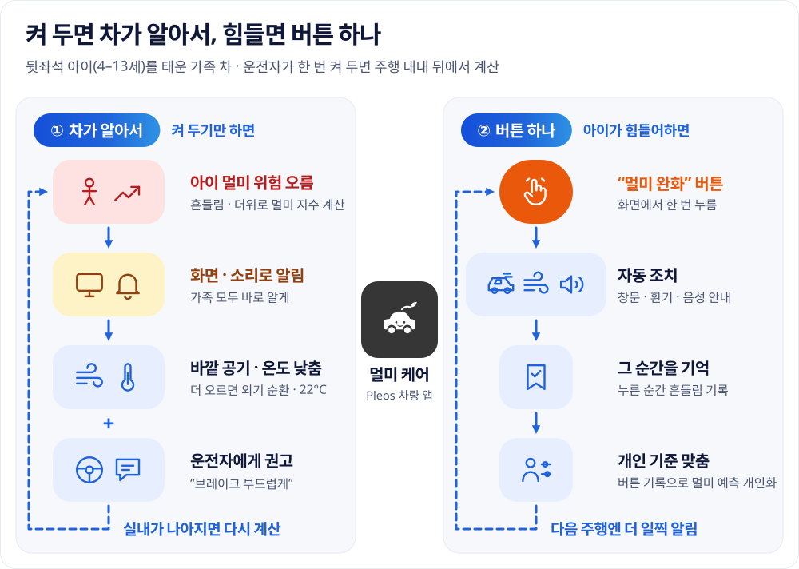


<a href="docs/demo-script.md"></a> <a href="https://github.com/toowani/motion-care/releases/latest/download/CRAVE_MotionCare_release.apk"></a> <a href="#심사용-빠른-실행"></a>

 **현대자동차그룹 차량용 앱 개발 공모전 (Pleos Connect) · 팀 CRAVE**

[1 문제](#1-문제-멀미는-왜-누구에게) · [2 해결](#2-해결-저주파--환기--음성-안내) · [3 멀미 지수](#3-멀미-지수-차-신호로-흔들림을-계산) · [4 핵심 기술](#4-핵심-기술-차-신호로-때를-잡는-저주파-소리) · [5 구현](#5-구현-방법) · [6 실제 화면](#6-실제-구현) · [7 가치](#7-가치) · [8 확장](#8-확장-가능성) · [9 부록](#9-부록-한계--실행-방법--문서)

---

## 1. 문제: 멀미는 왜, 누구에게

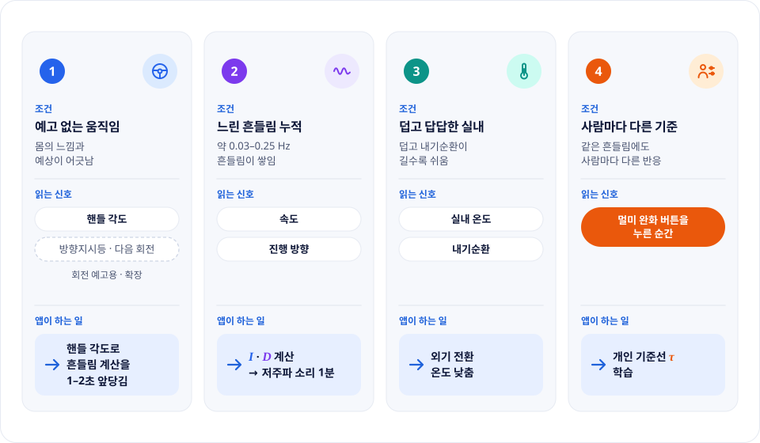

## 2. 해결: 저주파 · 환기 · 음성 안내

### 그래도 힘들면: 멀미 완화 버튼 하나


### 그 순간을 기록해 멀미 기준을 학습

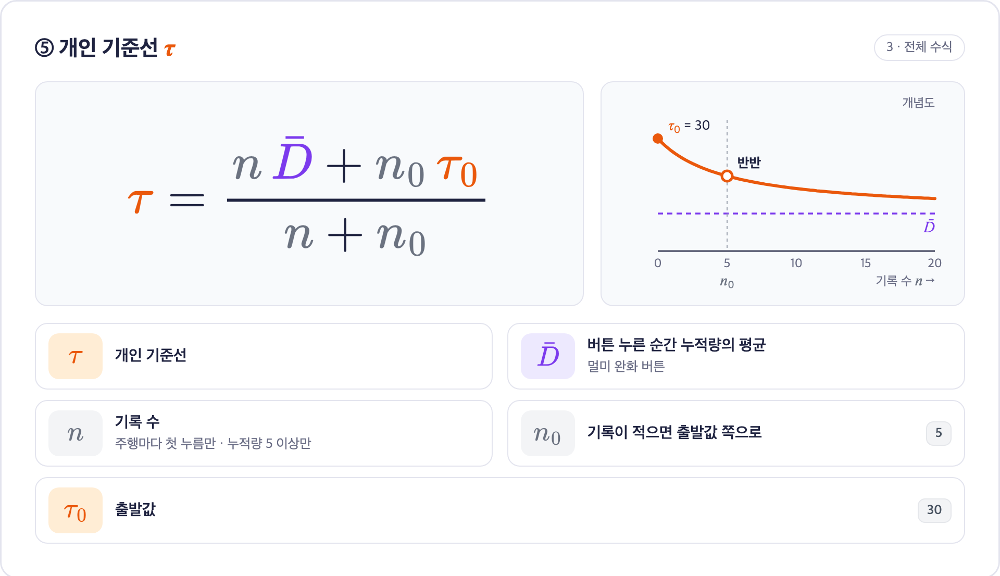

### 근거


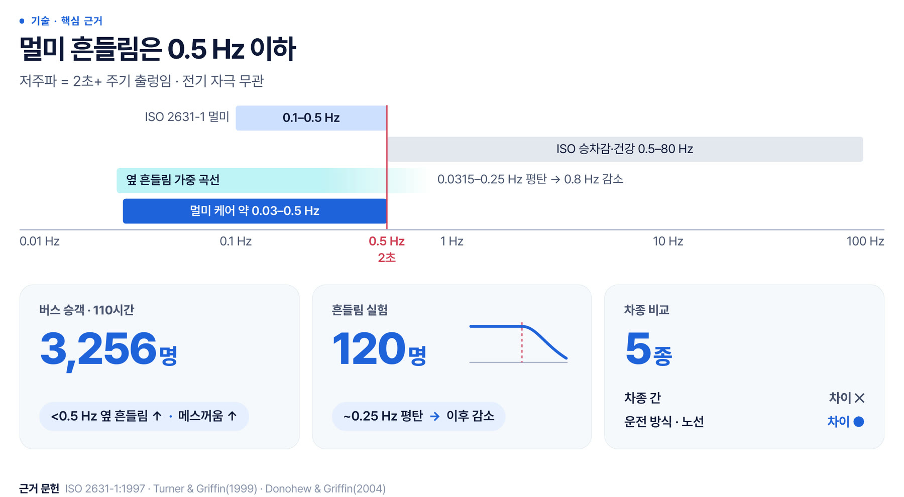

DOI와 한계: [research/literature.md](research/literature.md)

## 3. 멀미 지수: 차 신호로 흔들림을 계산

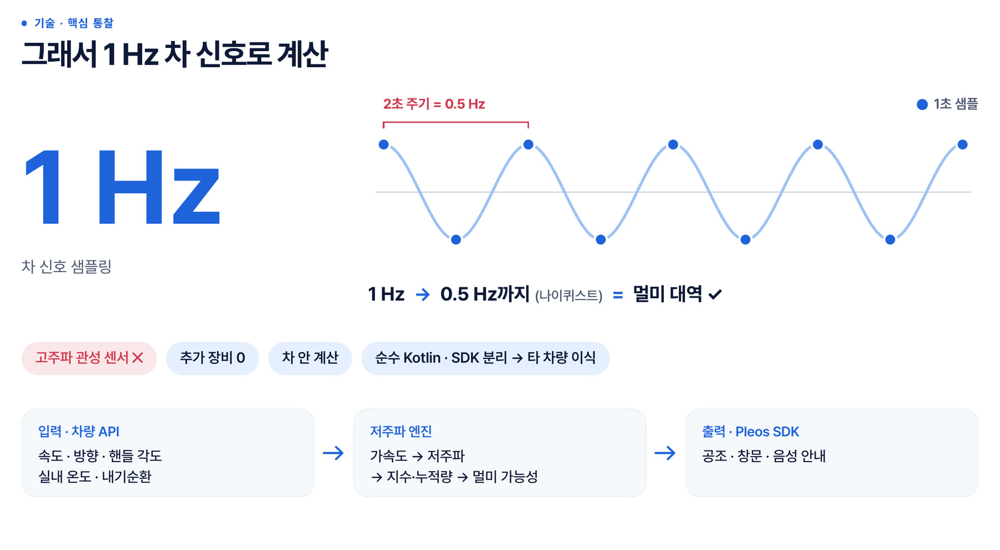

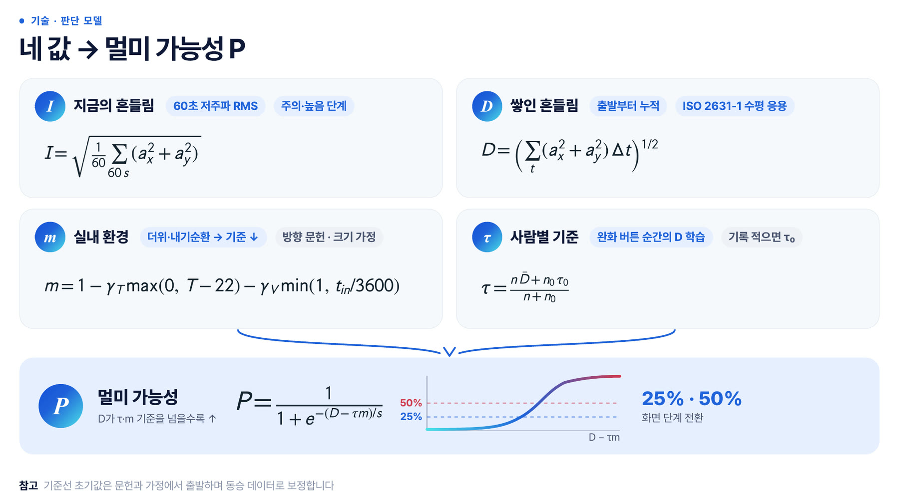

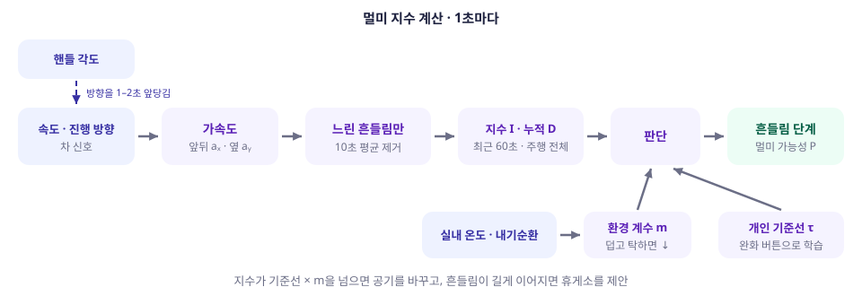 주의 기준 0.9·m (10초 유지) → 음성 안내·외기 전환·22°C, 멀미 완화 버튼 → 창문·바람·음성">


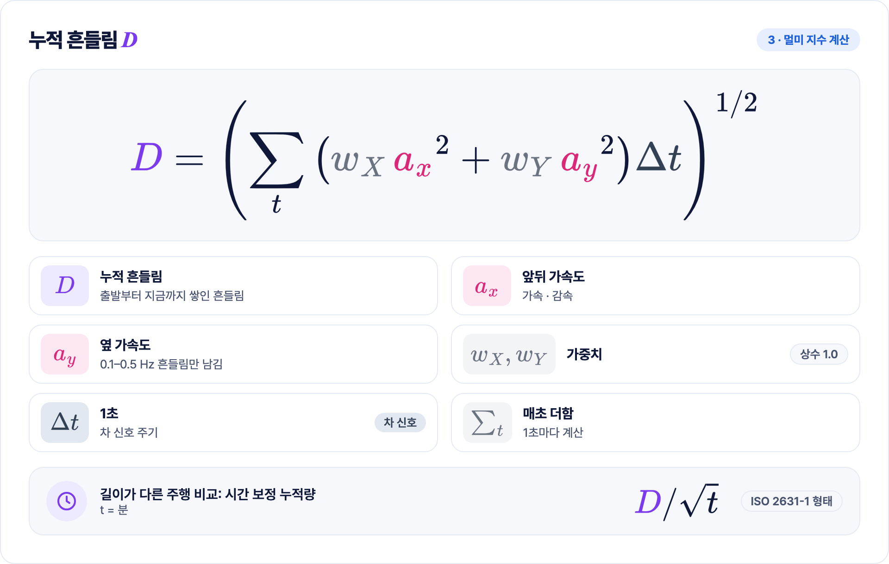

<sub>가중치 $w_X$ · $w_Y$는 주행 중 바뀌지 않는 상수이고 지금은 둘 다 $1$입니다 (앞뒤 · 옆 흔들림을 같게 셈). 동승 데이터가 쌓이면 보정할 자리입니다.</sub>

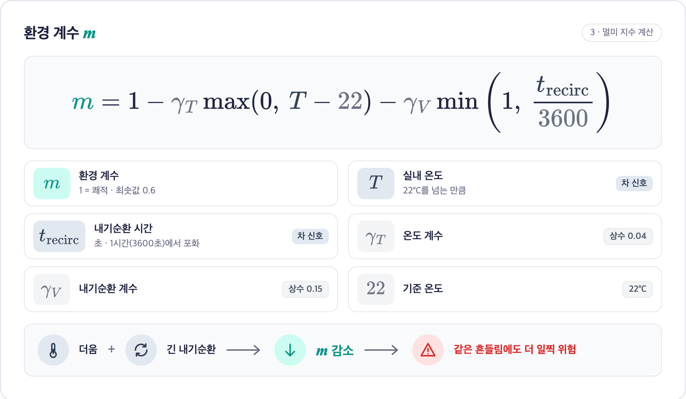


<sub>$P$는 확률이 아니라 보정 전 점수입니다.</sub>

<details>
<summary>전체 수식 (가속도 · 핸들 각도 · 흔들림 지수 · 알림 기준선 · 예고 시점)</summary>


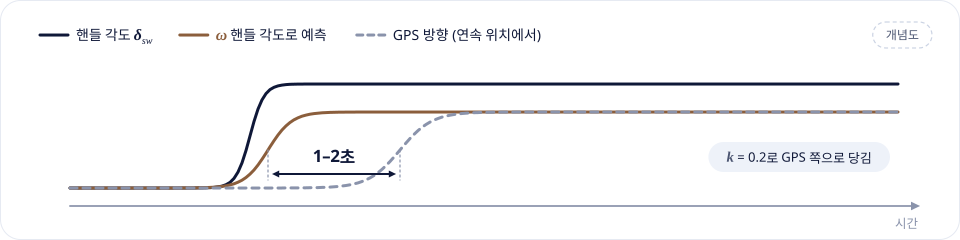

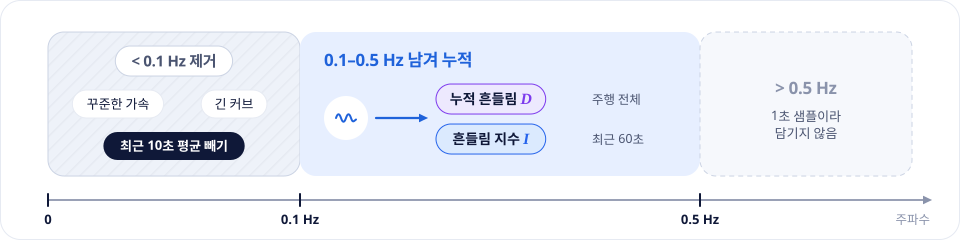


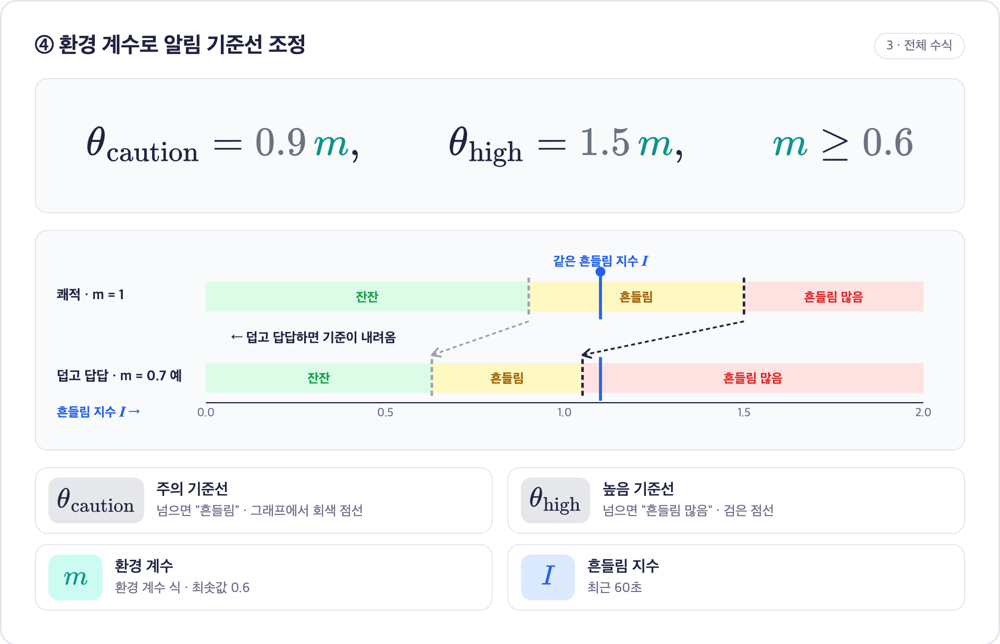


모든 상수: [`shared/params.json`](shared/params.json) · 저주파 소리 상수: [`LowTone.kt`](android/app/src/main/kotlin/ai/motioncare/app/LowTone.kt)

</details>

## 4. 핵심 기술: 차 신호로 때를 잡는 저주파 소리

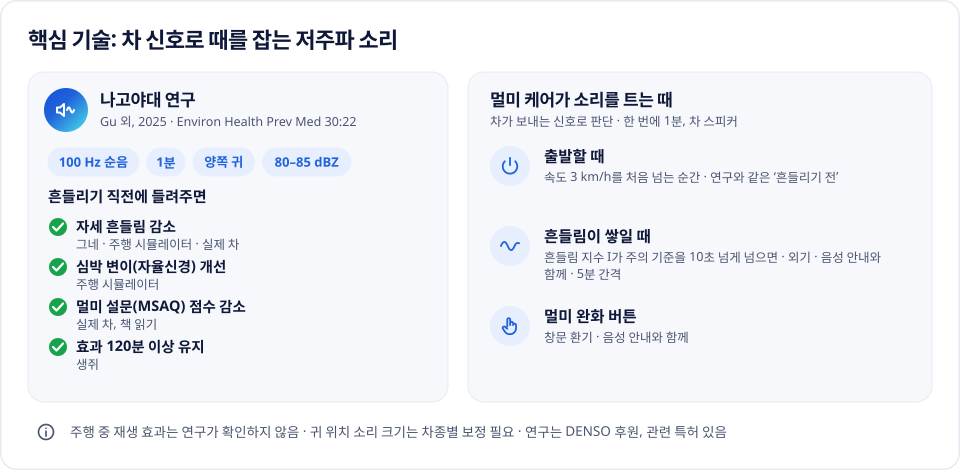

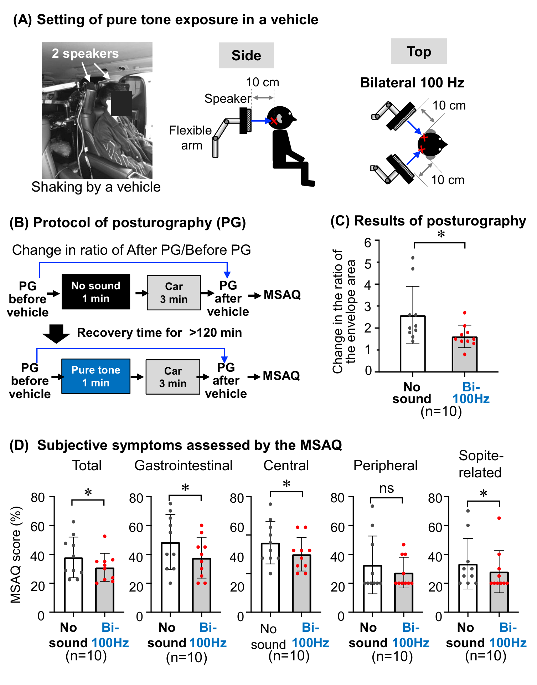

<sub>논문 그림: 실제 차 실험 (Gu 외, 2025, Fig. 6, n=10). (A) 머리받침 스피커로 양쪽 귀에 100 Hz · (B) 소리 1분 뒤 3분 주행, 같은 사람이 소리 있음 · 없음을 모두 받음 · (C) 자세 흔들림 증가가 줄어듦 · (D) 멀미 설문(MSAQ) 총점이 낮아짐. 출처: Environ Health Prev Med 2025;30:22, [doi:10.1265/ehpm.24-00247](https://doi.org/10.1265/ehpm.24-00247), [CC BY 4.0](https://creativecommons.org/licenses/by/4.0/) · 원문 그림을 잘라 씀, 내용은 바꾸지 않음.</sub>

<sub>한계: 연구는 흔들리기 **전** 재생만 확인했고, 흔들리는 **중** 재생 효과는 저자도 추가 연구가 필요하다고 썼습니다. 그래서 흔들림이 쌓일 때 · 버튼을 누를 때의 재생은 동승 조사로 확인할 항목입니다. </sub>

<sub>특허 (2026-11-13 확인): 나고야대는 '50–140 Hz · 70–85 dB 소리로 이석을 자극하는 장치'를 미국(US12023222B2)·유럽(EP3804672B1)·일본(JP7191400B2)·중국(CN112243368B)에 등록했고, DENSO가 이 특허의 라이선스 옵션 비용을 냈습니다(논문 이해관계 공개). Google Patents 패밀리 기준 한국 출원은 없고 PCT 국내 진입 기한(2020년 말)도 지나, 국내 사용은 이 특허에 걸리지 않는 것으로 봅니다(KIPRIS 직접 조회와 변리사 확인은 전). 해외 판매 차량에 넣으려면 라이선스가 필요합니다. 주파수가 시간에 따라 바뀌는 소리를 다룬 후속 출원(US20260007850A1·EP4555983A1, 심사 중)은 고정 100 Hz인 멀미 케어와 청구항 1이 다릅니다. sound spice®는 상표로 표기되며, 앱은 이 이름을 쓰지 않습니다.</sub>

## 5. 구현 방법

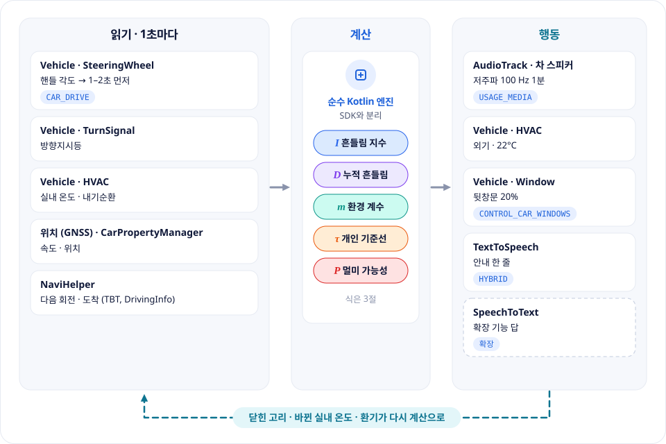


### 실차 없이 3단계 점검


<sub>검증은 시뮬레이션 · 에뮬레이터까지입니다. 실제 동승자가 탄 주행 데이터는 아직 없어, 멀미 가능성의 정확도는 확인 전입니다 · 다음 단계: [동승 조사](docs/ride-study.md)</sub>

### 도로 4곳 · 주행 6회 (OpenStreetMap)

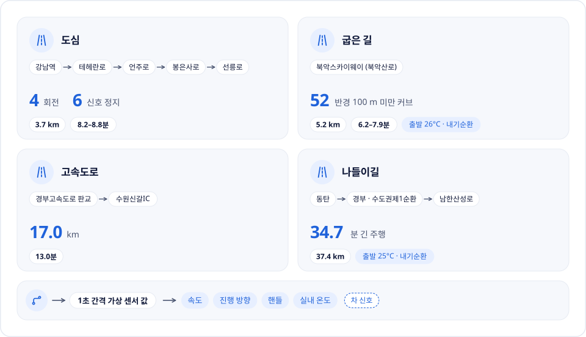

---

## 6. 실제 구현


### ① 고르는 아이콘 테마


### ② 지도 탭 (기본 화면)

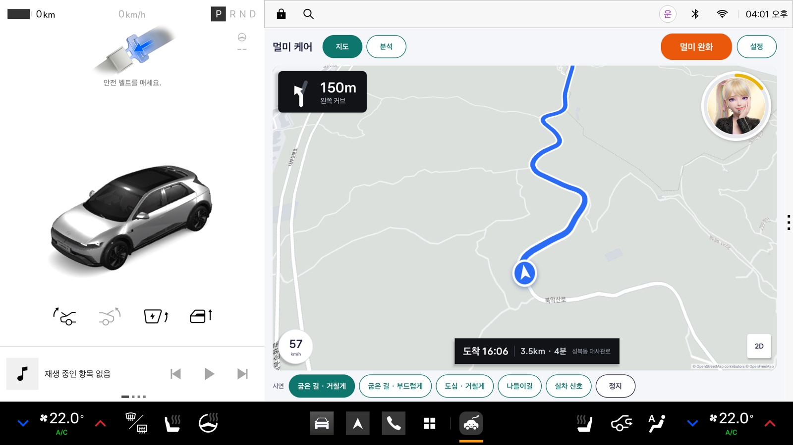


### ③ 멀미 완화 버튼: 한 번 누르면 바로


<sub>저주파 소리 · 창문 · 공조 · 음성이 함께 움직입니다. 순서와 못 쓸 때의 대응은 [2절](#그래도-힘들면-멀미-완화-버튼-하나).</sub>

### ④ 흔들림이 커지면 차가 소리와 공기를 바꿈


### ⑤ 분석 탭

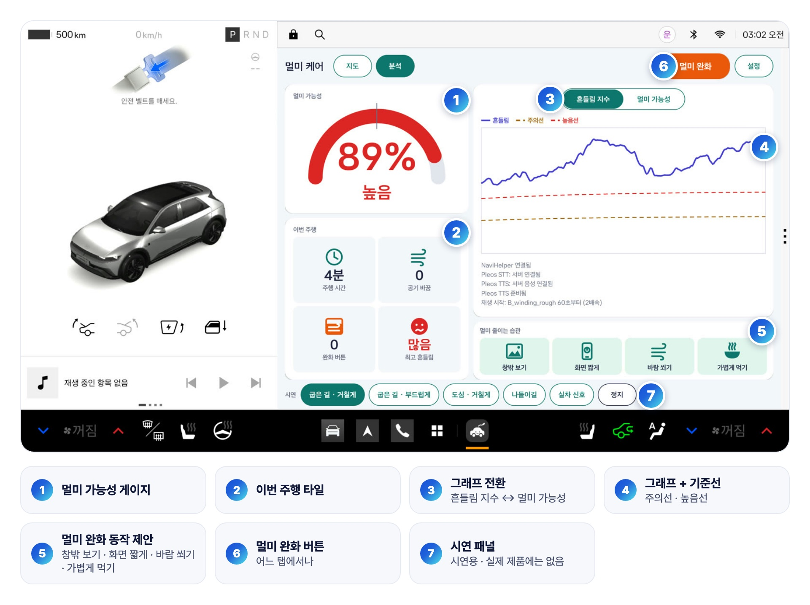

### ⑥ 내비와 함께

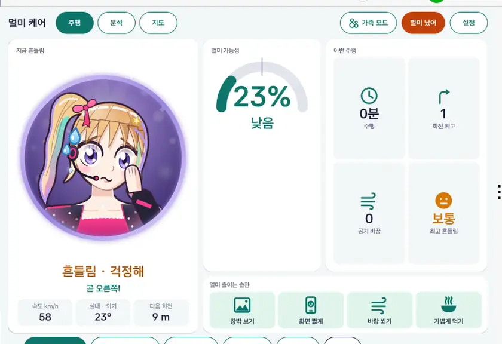

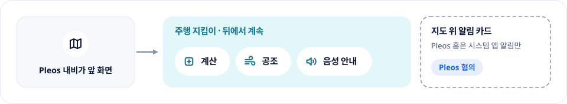

**한 화면 모드** · 앱 폭 900 dp 미만

### ⑦ 설정 한 곳에서


<sub>설정에는 "저주파 소리" 켜기 · 끄기가 "소리 안내"와 "공조 자동 조절" 사이에 더 있습니다 (위 화면은 추가 전 녹화).</sub>

### 검증 결과


<sub>굽은 길은 부드럽게 달려도 지수가 높습니다. 운전 방식보다 길 모양이 크게 작용하기 때문입니다. 주의 $0.9$ · 높음 $1.5$는 문헌값이 아니라 시뮬레이션에 맞춘 출발값이고, 동승 조사로 보정합니다.</sub>

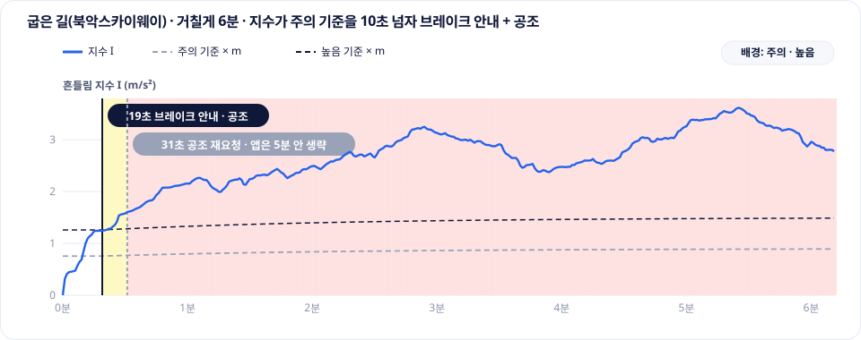


### 에뮬레이터에서 확인한 것


저주파 소리는 같은 에뮬레이터에서 따로 확인했습니다 (2026-11-13): 굽은 길 재생에서 출발 순간 `AudioTrack`(USAGE_MEDIA, 100 Hz, 8 kHz 모노)이 시작되고 1분 뒤 해제됨, 멀미 완화 버튼을 누르면 다시 시작됨. 실제 소리 크기(dBA)는 실차에서 잴 항목입니다.

고친 버그: [docs/qa.md](docs/qa.md) · 숫자: [docs/validation.md](docs/validation.md)

---

## 7. 가치

### 타깃


### 왜 폰이 아니라 차여야 하나

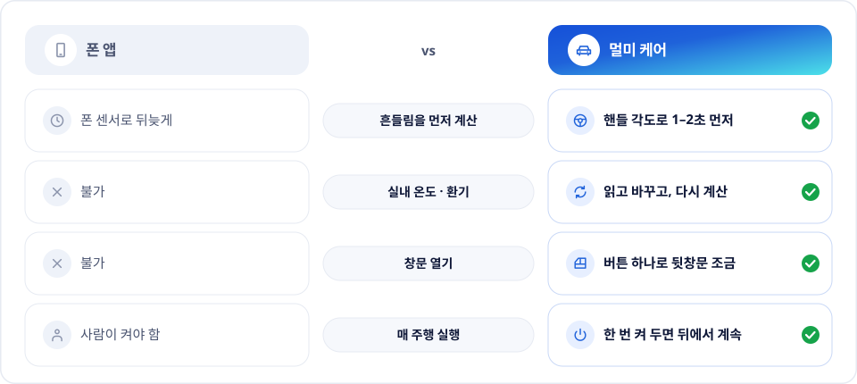

### 다른 서비스와 비교


<sub>저주파 소리 열은 이번에 넣었습니다. 같은 100 Hz 소리를 차에 넣는 일은 연구를 후원한 DENSO와 나고야대가 준비 중이라는 보도가 있습니다 (sound spice®, 공식 발표는 확인 못 함). 우리 차이는 차 신호로 재생 때를 잡고, 환기 · 음성 안내 · 개인 기준 학습과 한 앱으로 묶어 Pleos 앱 마켓으로 배포한다는 점입니다.</sub>

[기획서 4절](docs/proposal.md) · [research/market.md](research/market.md)

### MAU · Retention · 수익


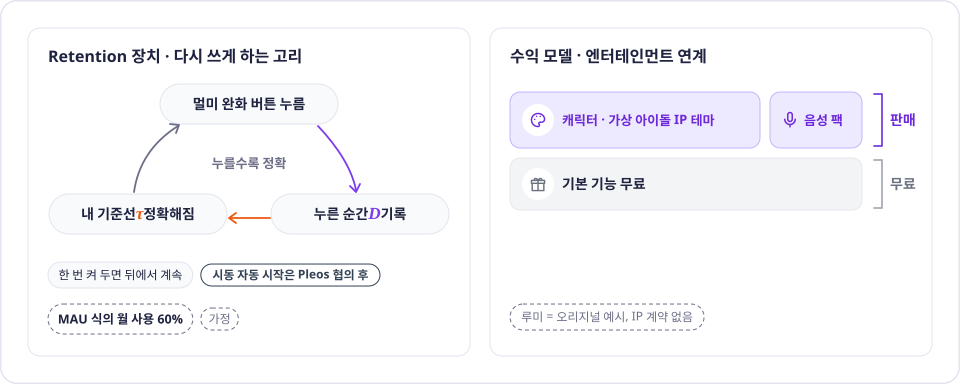

[기획서 8절](docs/proposal.md)

### 확장 대상


[협의 문의 초안](docs/pleos-inquiry.md)

---

## 8. 확장 가능성

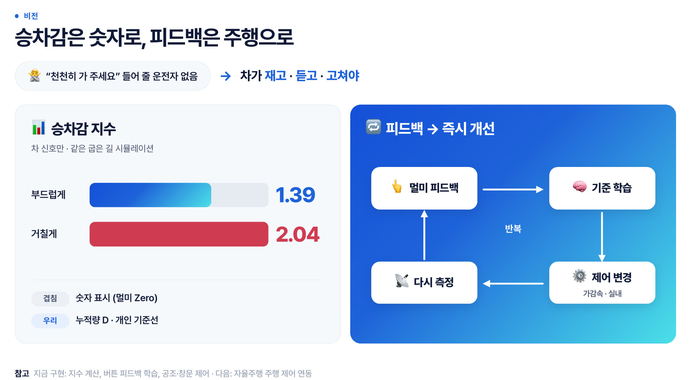

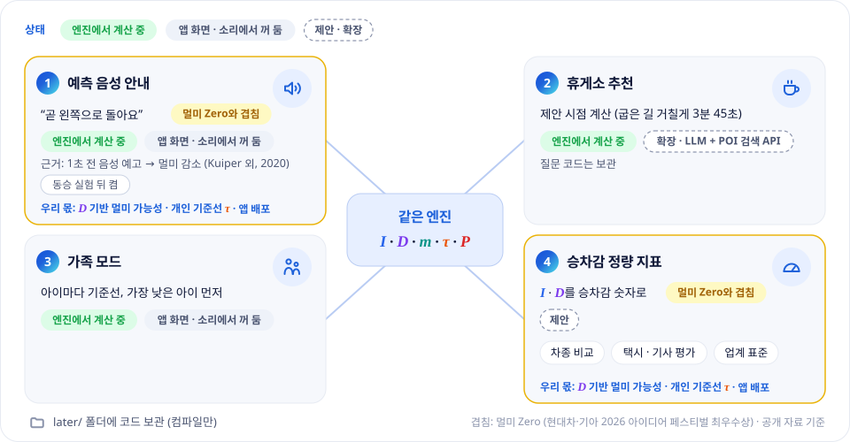

숨긴 화면 코드: [`android/app/src/main/kotlin/ai/motioncare/app/later/`](android/app/src/main/kotlin/ai/motioncare/app/later/README.md)

### ① 예측 음성 안내 (회전 예고)

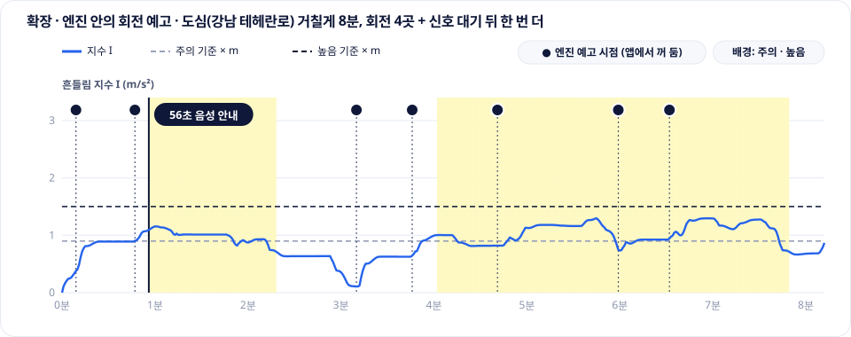

### ② 휴게소 추천 (LLM 연결로 확장)


### ③ 개인 맞춤 · 아이별 (가족 모드)


**대응 순서를 보여 주는 그림** · 검증 아님

### ④ 승차감 정량 지표

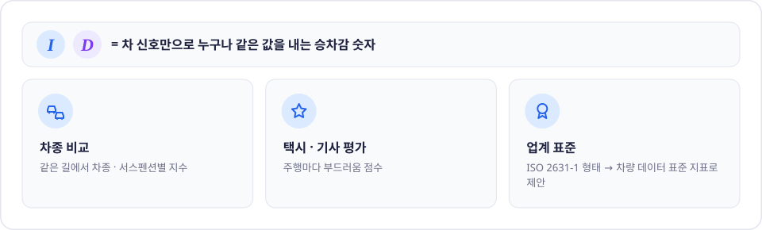

---

## 9. 부록: 한계 · 실행 방법 · 문서

### 심사용 빠른 실행

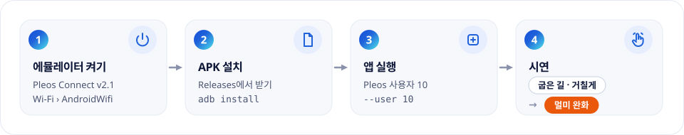

```bash
nohup ~/Library/Android/sdk/emulator/emulator \
  -avd Pleos_Connect_v2_1 -no-snapshot-load -no-boot-anim -gpu host \
  > /tmp/emu.log 2>&1 < /dev/null & disown
```

```bash
adb install -r CRAVE_MotionCare_release.apk
```

```bash
adb shell am start --user 10 -n ai.motioncare.app/.MainActivity
```

APK는 [Releases](https://github.com/toowani/motion-care/releases/latest/download/CRAVE_MotionCare_release.apk)에서 바로 받을 수 있습니다 (공모전 시뮬레이터용 빌드). 직접 빌드하려면 아래 "키와 서명"의 `android/local.properties`를 채운 뒤 빌드합니다.

### 한계


동승 조사 안내: [docs/ride-study.md](docs/ride-study.md)

### 앱 아이콘

<p align="center"></p>

### 폴더 구조


### 시뮬레이션과 그래프

```bash
python3 sim/generator.py
python3 sim/prototype.py
python3 sim/freq_response.py      # 엔진 주파수 응답 (--svg: docs/img/freq_response.svg)
python3 sim/readme_figures.py
```

### 엔진 테스트와 앱 빌드


```bash
cd android
JAVA_HOME="/Applications/Android Studio.app/Contents/jbr/Contents/Home" \
  ./gradlew :core:test :app:lintDebug :app:assembleDebug
```

### 에뮬레이터

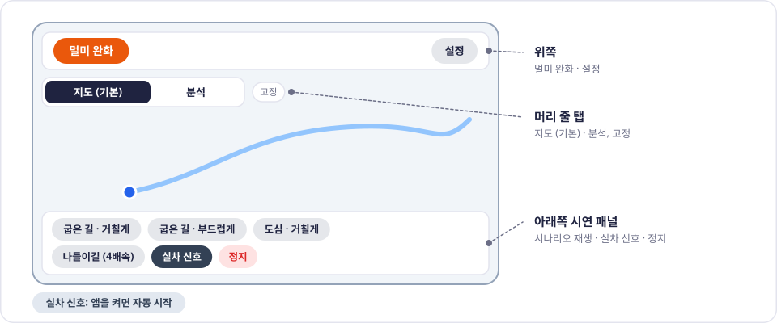

<details>
<summary>Virtual Console (Pleos 제공 차 신호 도구)</summary>

<p align="center"></p>

```bash
adb forward tcp:8088 tcp:8088   # → http://127.0.0.1:8088/
```

</details>

디버그 빌드 옵션 (Pleos 사용자 10, 앱을 먼저 종료)

```bash
adb shell am force-stop --user 10 ai.motioncare.app
adb shell am start --user 10 -n ai.motioncare.app/.MainActivity \
  --es theme toon --ez skip_welcome true \
  --es replay B_winding_rough --ei replay_from 120 --ef replay_speed 2
# 실제 내비 경로: --es route_to "37.3947,127.1112,판교역"
```

### 키와 서명

`android/local.properties` (커밋 금지)

```properties
pleos.clientId=...          # Pleos Playground › My Project
pleos.clientSecret=...
release.storeFile=keystore/motioncare-release.jks
release.storePassword=...
release.keyAlias=motioncare
release.keyPassword=...
apk.teamName=팀명            # → apk/팀명_MotionCare_release.apk
```

```bash
cd android && ./gradlew :app:assembleRelease   # 서명된 APK → apk/ (클라이언트 키 포함, git 제외)
```

### 개발 환경


### 문서

[기획서](docs/proposal.md) · [검증](docs/validation.md) · [확인 기록](docs/qa.md) · [제출 체크리스트](docs/submission.md) · [Pleos 문의 초안](docs/pleos-inquiry.md) · [시연 콘티](docs/demo-script.md) · [동승 조사](docs/ride-study.md) · [문헌 근거](research/literature.md) · [경쟁 조사](research/market.md)

<sub>멀미를 실제로 막는지는 동승 조사로 확인이 필요합니다.</sub>
