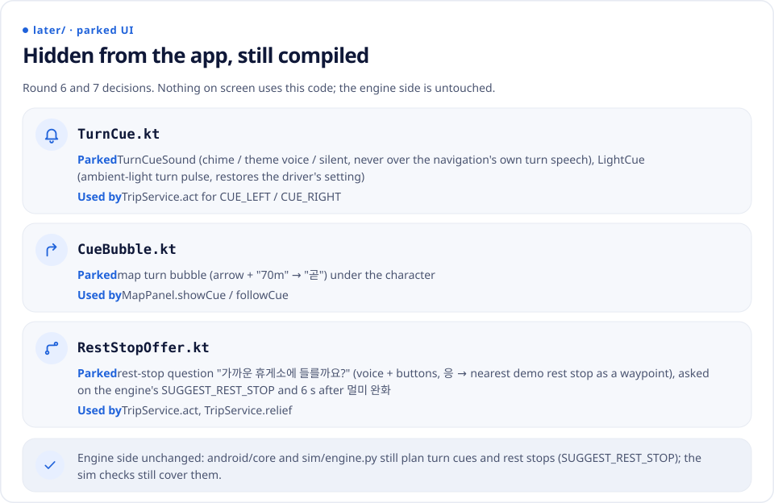
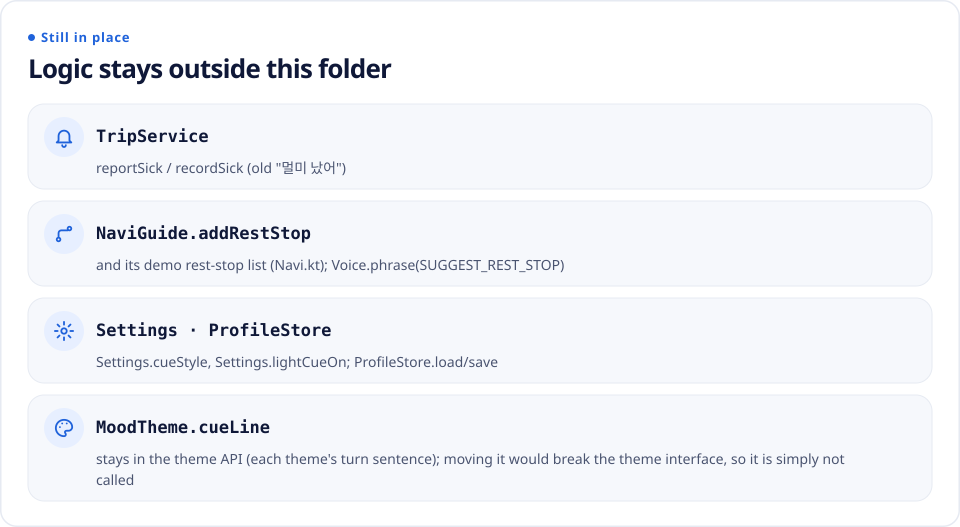
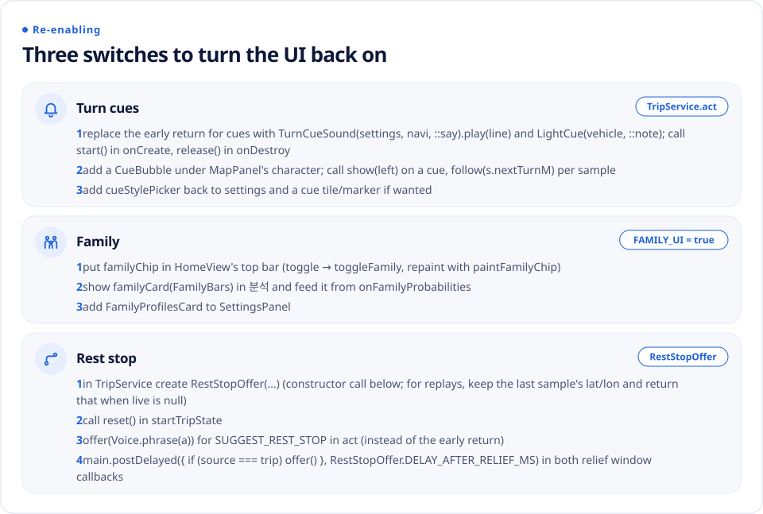

# later/ — parked UI



## Still in place



## Re-enabling



Rest-stop constructor call:

```kotlin
RestStopOffer(navi, ::askYesNo, { f -> pending?.question?.let(f) == true || queued.any { f(it.question) } }, { live?.lat to live?.lon }, ::action)
```
