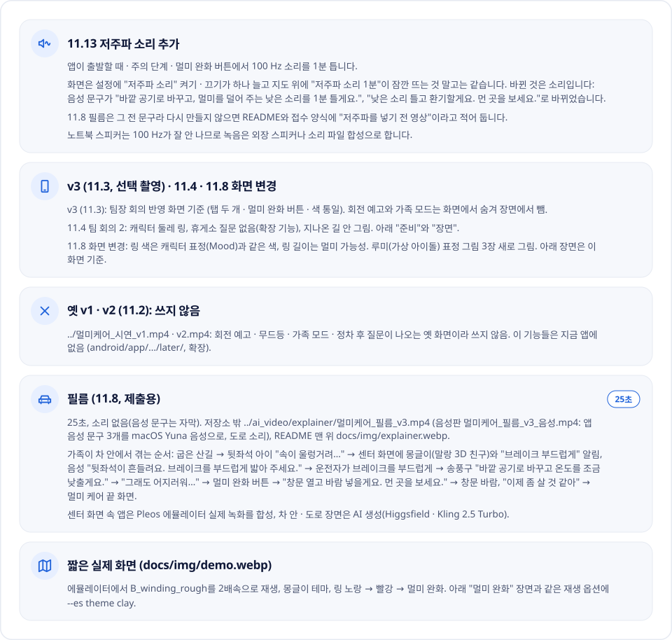
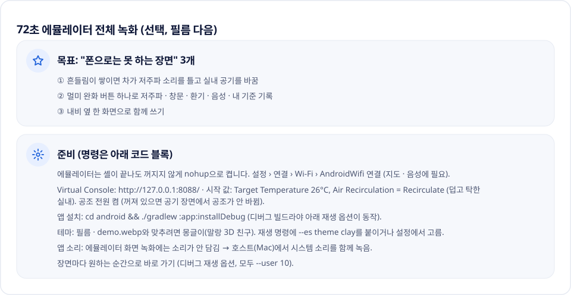
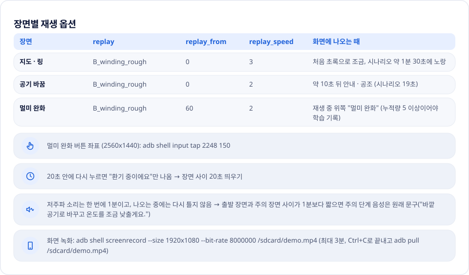
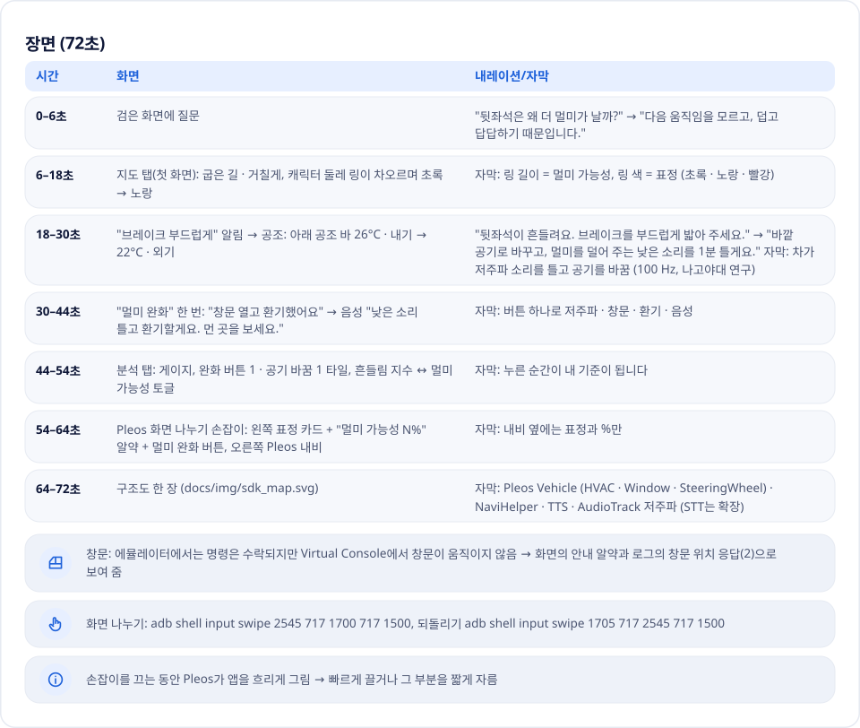
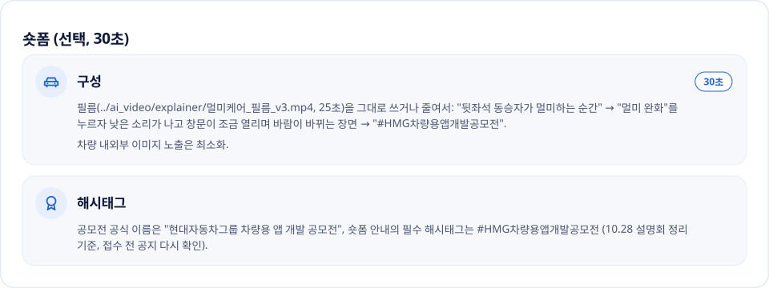

# 시연 영상 콘티 v3 (72초)



> 필름: `../ai_video/explainer/멀미케어_필름_v3.mp4` (음성판 `멀미케어_필름_v3_음성.mp4`), README 맨 위 `docs/img/explainer.webp`. 옛 `../멀미케어_시연_v1.mp4` · `v2.mp4`는 쓰지 않음.

## 72초 콘티와 준비



에뮬레이터는 셸이 끝나도 꺼지지 않게 `nohup`으로 켭니다.

```bash
nohup ~/Library/Android/sdk/emulator/emulator -avd Pleos_Connect_v2_1 -no-snapshot-load -no-boot-anim -gpu host > /tmp/emu.log 2>&1 < /dev/null & disown
```

```bash
adb forward tcp:8088 tcp:8088
```

- Virtual Console: http://127.0.0.1:8088/
- 앱 설치: `cd android && ./gradlew :app:installDebug`
- 테마: 재생 명령에 `--es theme clay`를 붙이거나 설정에서 고름

```bash
adb shell am force-stop --user 10 ai.motioncare.app
```

```bash
adb shell am start --user 10 -n ai.motioncare.app/.MainActivity --ez skip_welcome true --es replay B_winding_rough --ei replay_from 60 --ef replay_speed 2
```



- 멀미 완화 버튼 좌표 (2560x1440): `adb shell input tap 2248 150`
- 화면 녹화: `adb shell screenrecord --size 1920x1080 --bit-rate 8000000 /sdcard/demo.mp4` (최대 3분, Ctrl+C로 끝내고 `adb pull /sdcard/demo.mp4`)

## 장면



- 화면 나누기: `adb shell input swipe 2545 717 1700 717 1500`, 되돌리기 `adb shell input swipe 1705 717 2545 717 1500`

## 숏폼(선택, 30초)



- 필수 해시태그 `#HMG차량용앱개발공모전` (10.28 설명회 정리 기준, 접수 전 공지 다시 확인)
