# 기획서 초안 · 멀미 케어

**차 신호로 때를 잡는 저주파 소리 · 환기 · 음성 안내** · 팀 CRAVE

> 접수 양식 항목에 맞춰 옮기기 전의 초안입니다. 수치의 근거는 [`docs/validation.md`](validation.md), 문헌은 [`research/literature.md`](../research/literature.md)에 있습니다. [확인 필요] 표시는 제출 전에 채웁니다.

## 1. 한 줄 소개

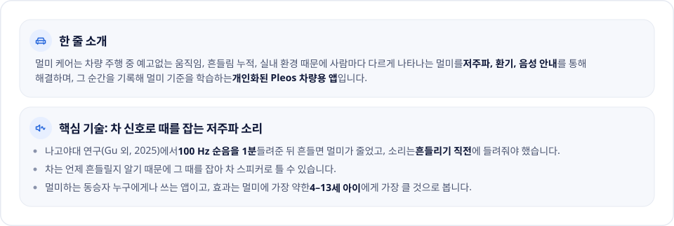

## 2. 문제

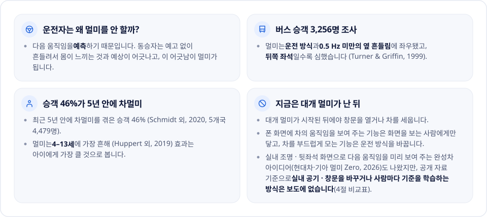

## 3. 해결 방법 (저주파 · 환기 · 음성 안내)

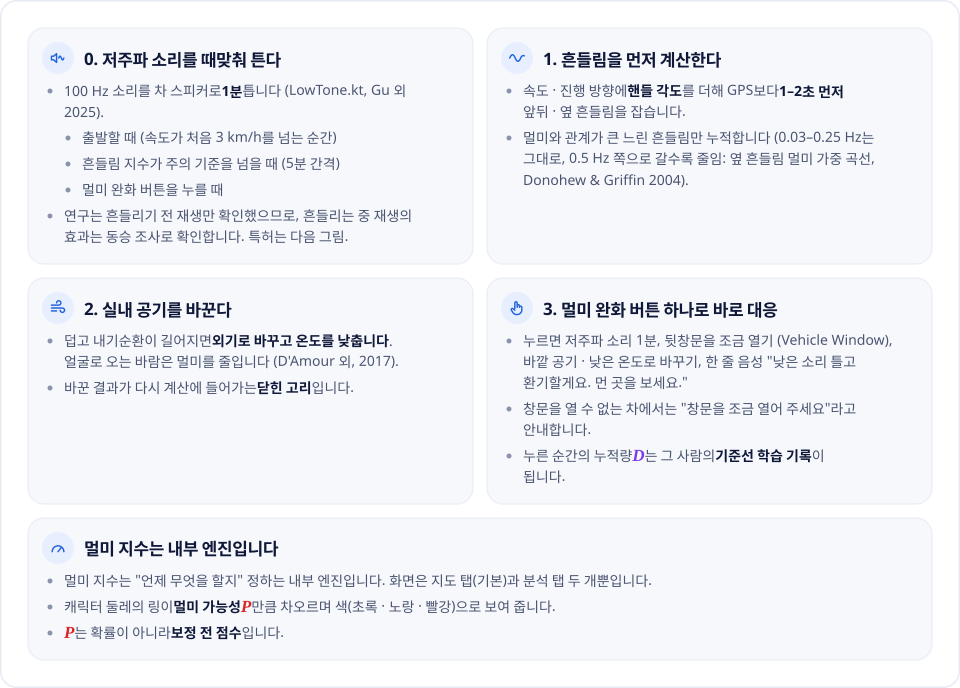

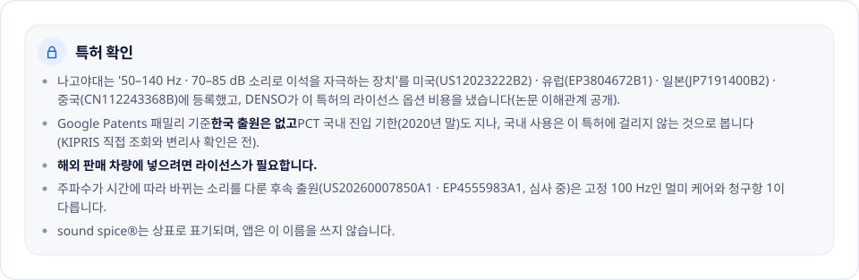

### 사용자 경험 (UX)

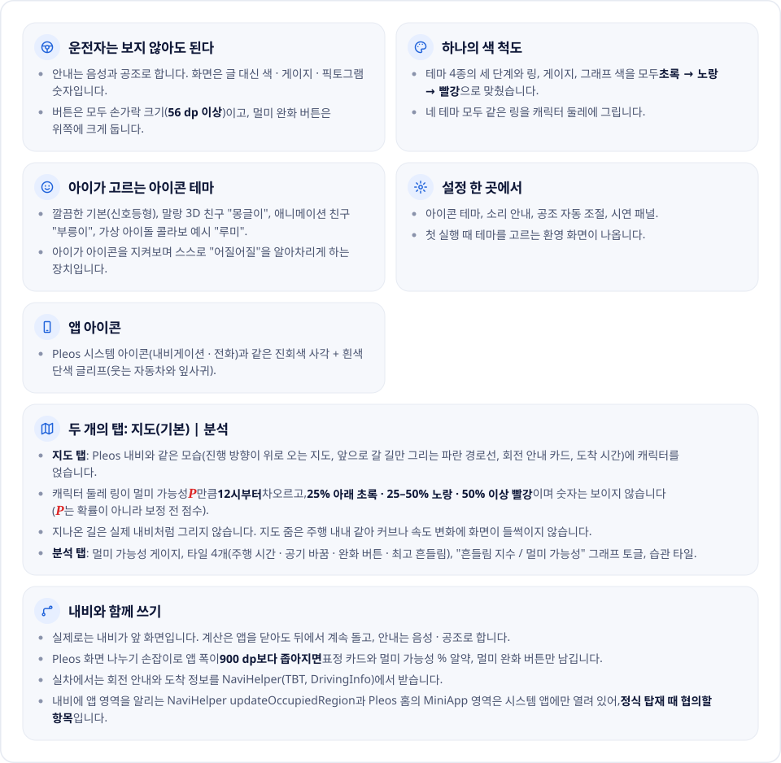

## 4. 차량특화성 (왜 차여야 하나)

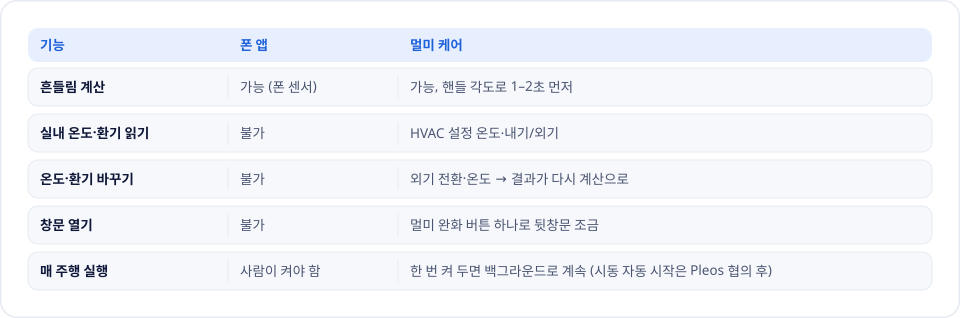

### 다른 멀미 대응 서비스와 비교

출처와 자세한 메모는 [`research/market.md`](../research/market.md)에 있습니다.

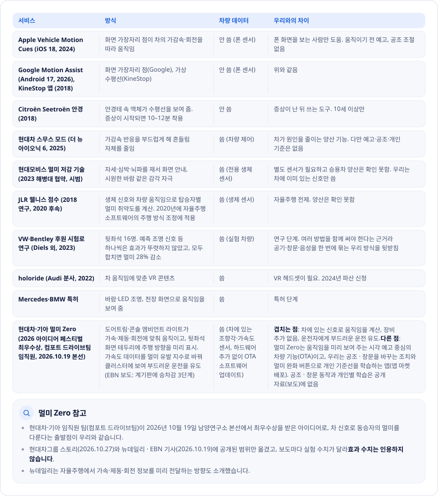

## 5. 창의성

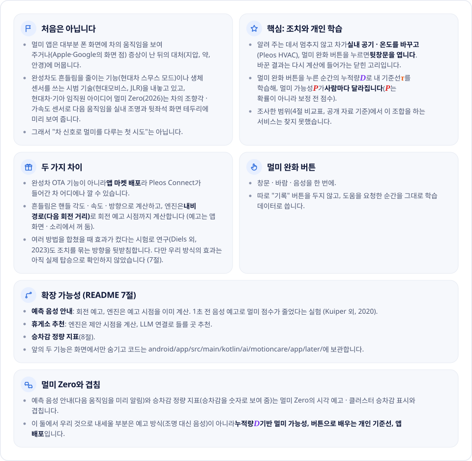

확장 기능 코드 위치: `android/app/src/main/kotlin/ai/motioncare/app/later/`

## 6. 기술 활용성 (Pleos SDK)

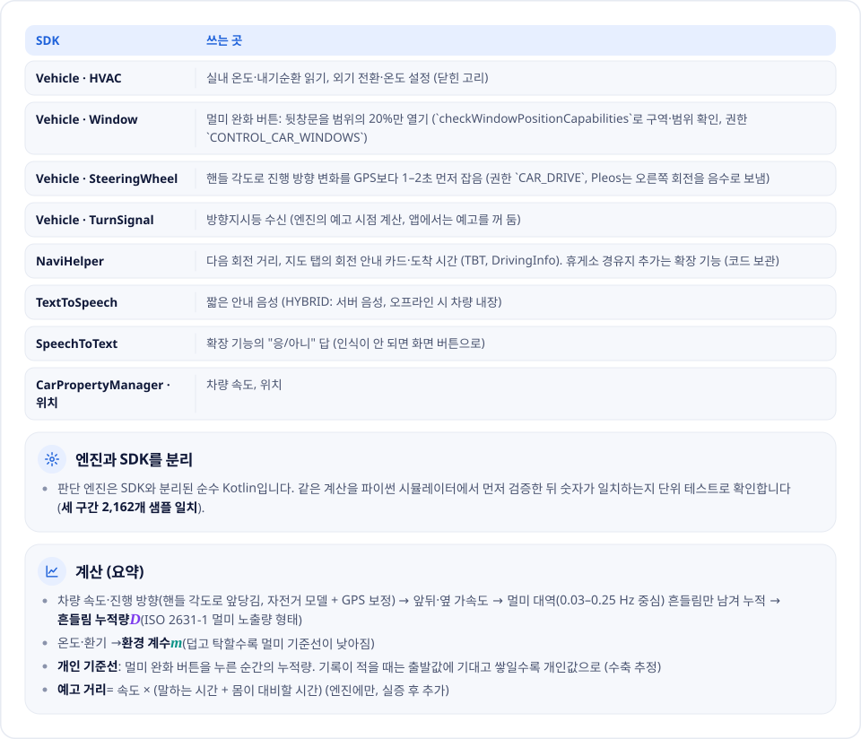

## 7. 검증

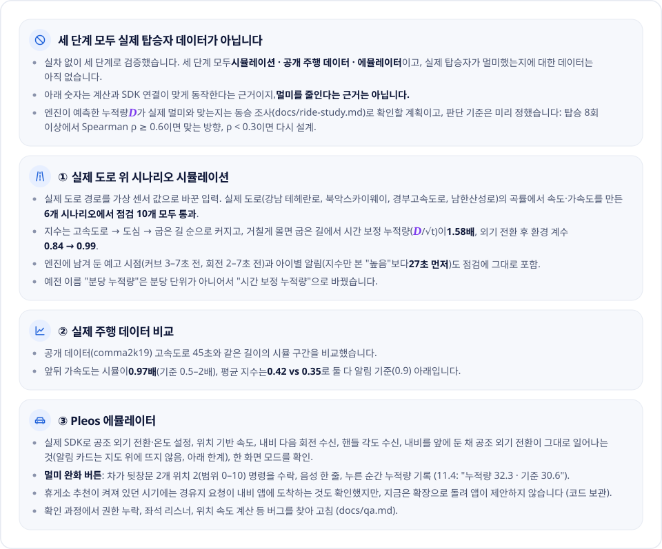

실제 탑승자 데이터는 없습니다. 동승 조사 계획: [`docs/ride-study.md`](ride-study.md), 점검 기록: [`docs/qa.md`](qa.md).

한계 (README 8절과 같음):

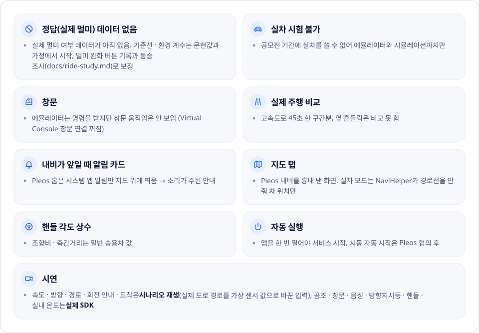

## 8. 사업성

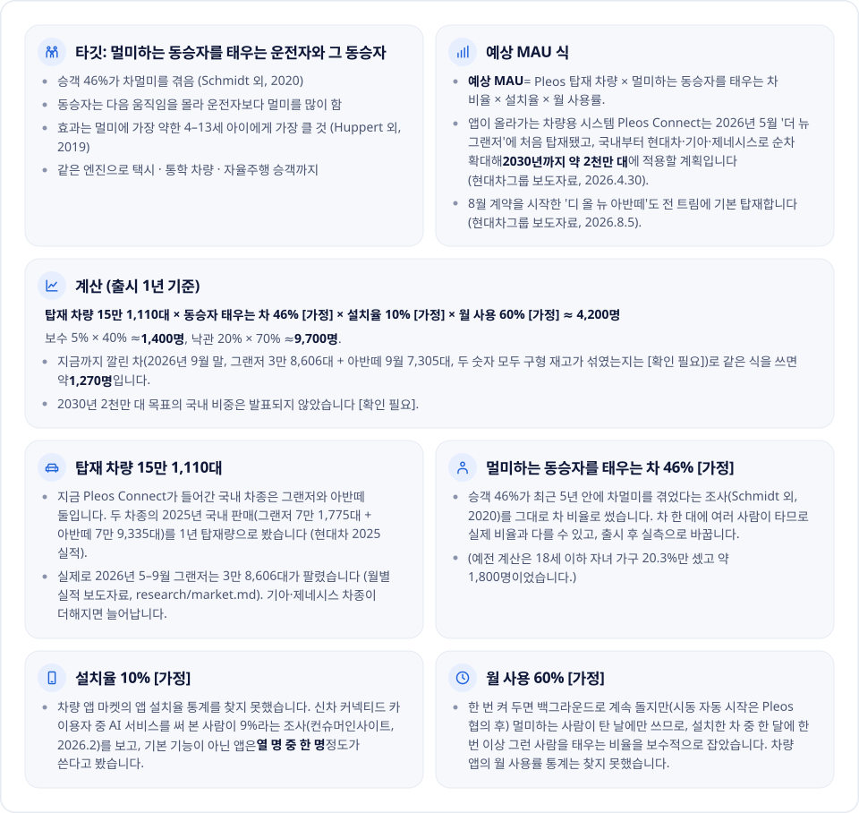

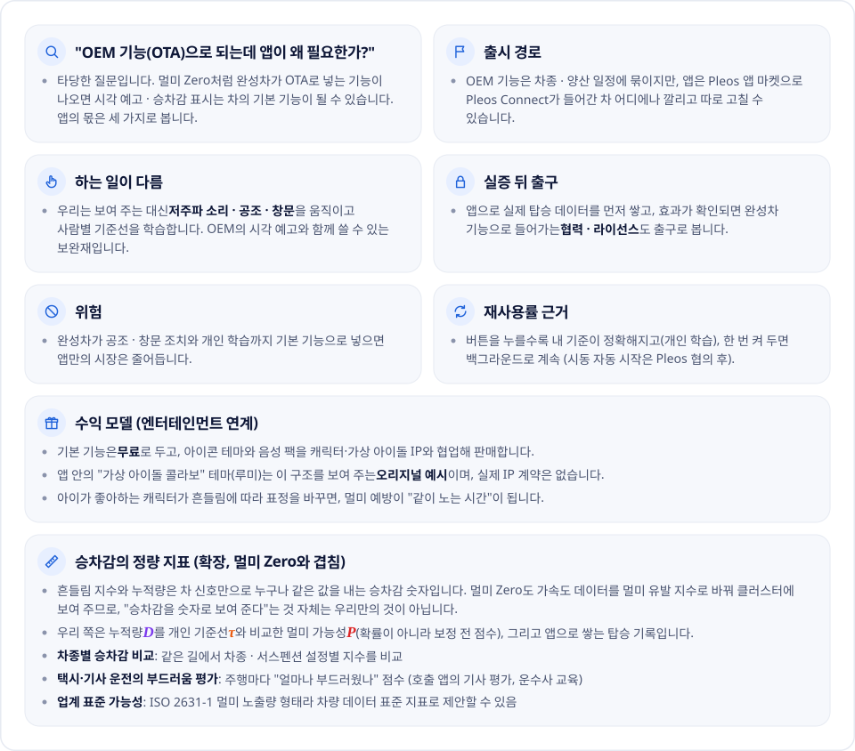

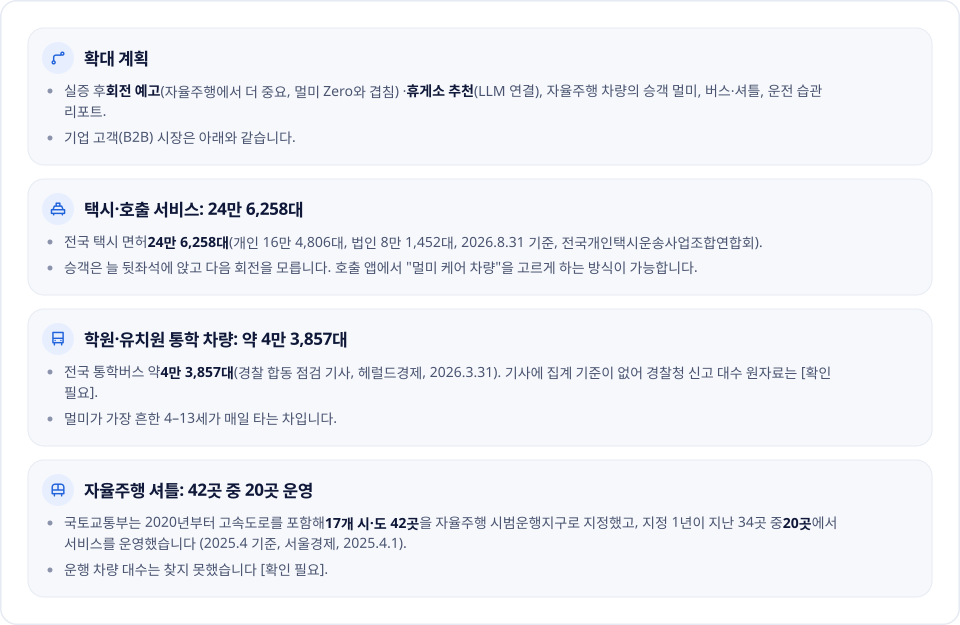

출처:
- [현대차그룹 보도자료, 2026.4.30](https://www.hyundaimotorgroup.com/ko/news/hyundai-motor-group-redefines-in-vehicle-experience-with-pleos-connect-next-generation-infotainment-system)
- [현대차그룹 보도자료, 2026.8.5](https://www.hyundaimotorgroup.com/ko/news/hyundai-motor-company-all-new-avante)
- [현대차 2025 실적](https://www.hyundaimotorgroup.com/ko/news/hyundai-motor-company-sales-4138180-units-2025)
- [컨슈머인사이트, 2026.2](https://www.consumerinsight.co.kr/autoinsight/abview?no=3859&id=pr4_list)
- [전국개인택시운송사업조합연합회](https://gntx.kr/information/information_02.php)
- [헤럴드경제, 2026.3.31](https://www.heraldk.com/article/2026033123432142372)
- [서울경제, 2025.4.1](https://www.sedaily.com/article/14047575)
- 월별 실적 보도자료 등 자세한 메모: [`research/market.md`](../research/market.md)

## 9. 개인정보 · 10. 팀과 역할

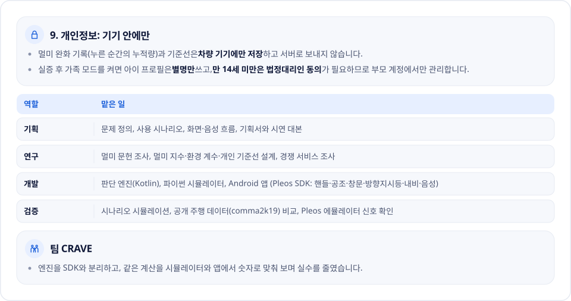
