# 실제 탑승 멀미 데이터 모으기 (주말 동승 키트)

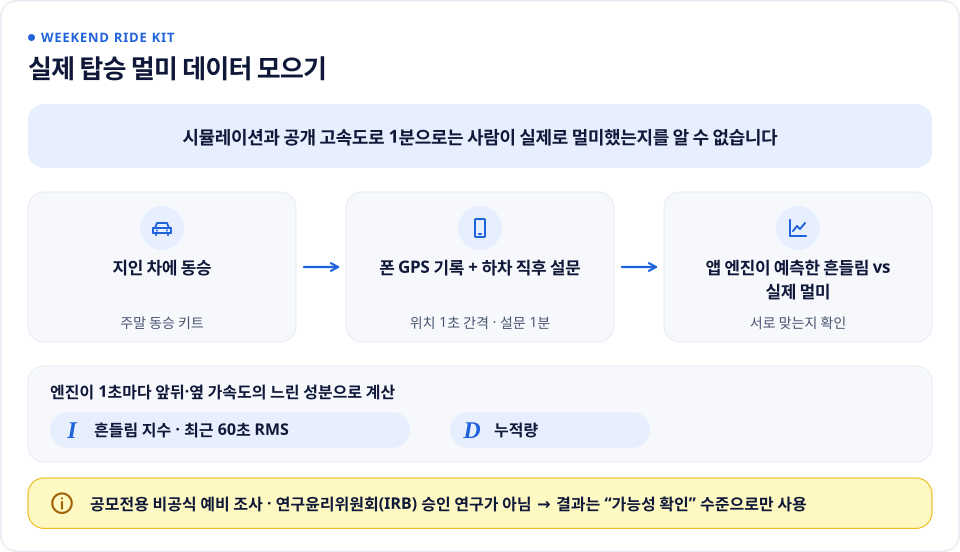

- 기록 변환·분석: `python3 sim/import_ride.py`, `python3 sim/ride_report.py`
- 데이터 폴더: `data/rides/` (위치 기록은 git에 올리지 않음, 7절 참고)

## 1. 무엇을 확인하나

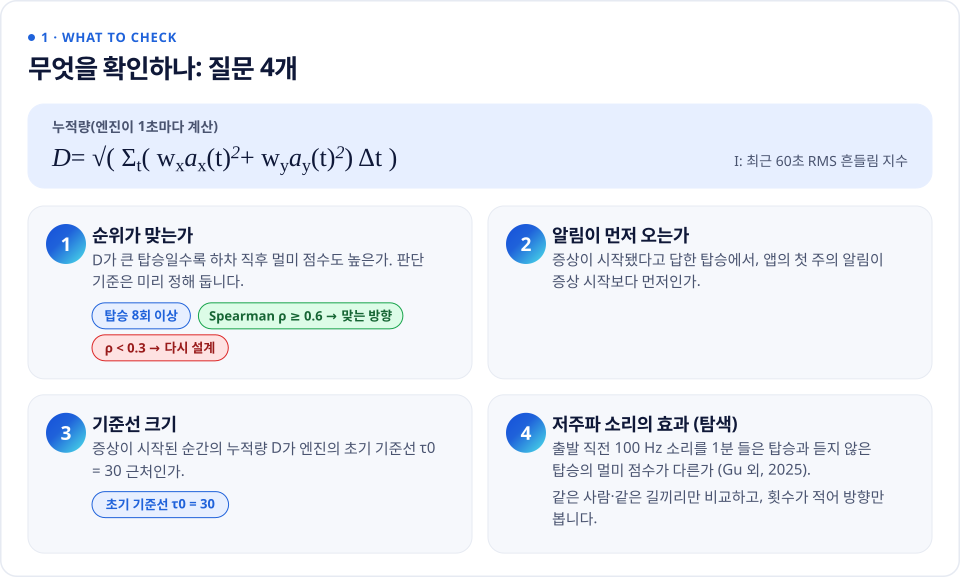

## 2. 준비물

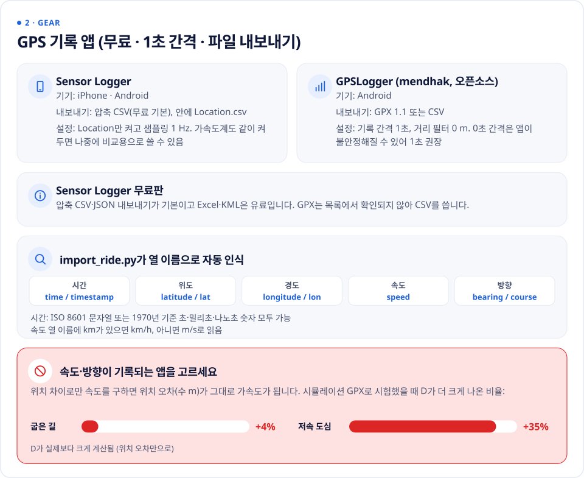

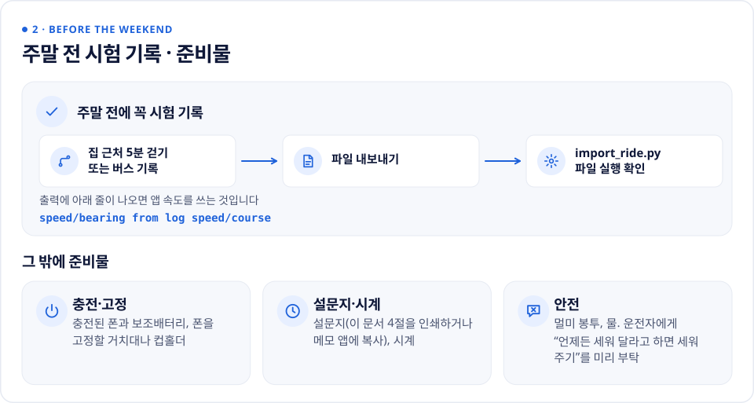

```bash
python3 sim/import_ride.py 파일
```

## 3. 탑승 절차

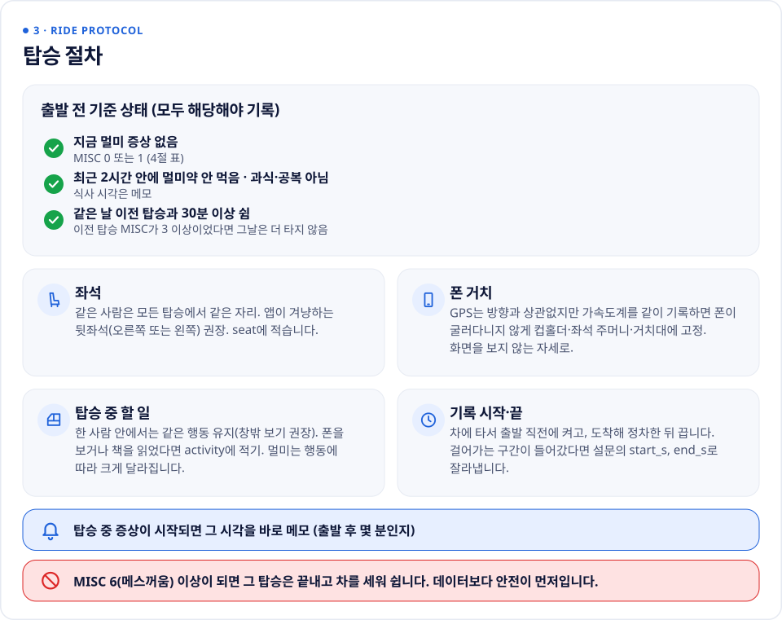

## 4. 하차 직후 설문 (1분)

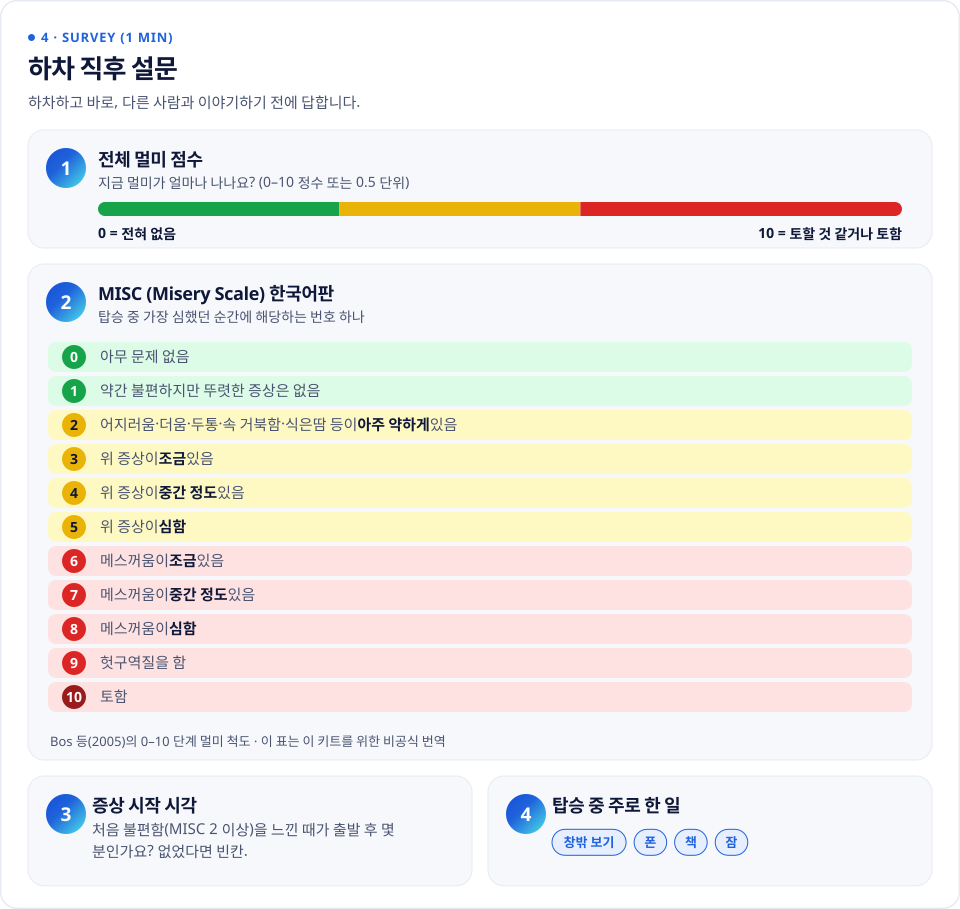

### 참여 동의 문구

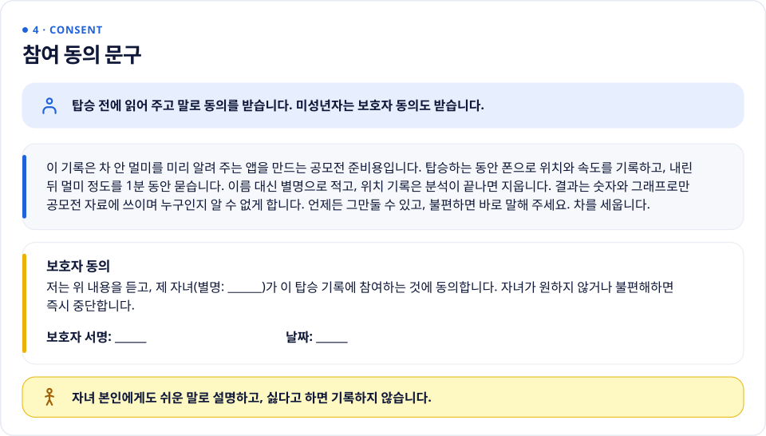

## 5. 탑승 구성 (총 5–10회)

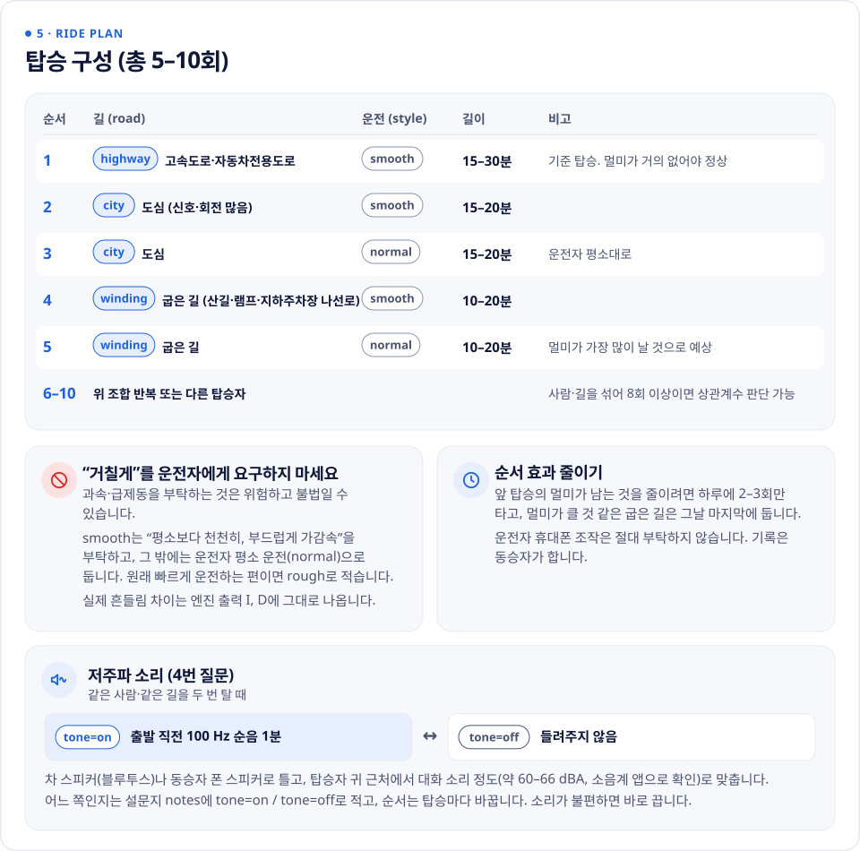

## 6. 파일 정리와 분석

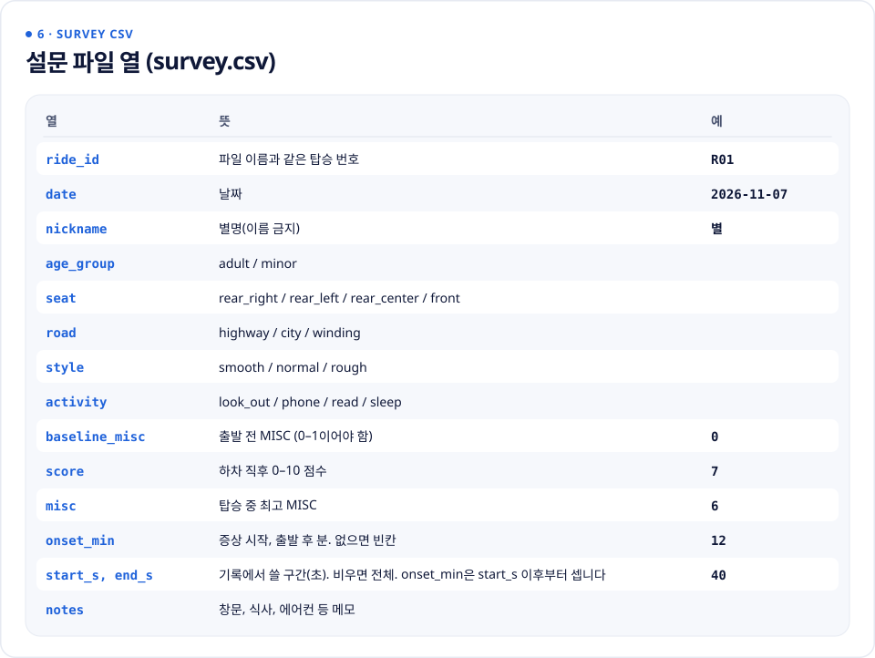

1. 내보낸 파일 이름을 탑승 번호로 바꿔 `data/rides/`에 둡니다: `R01.gpx`, `R02.csv` …
2. 설문을 `data/rides/survey.csv`로 적습니다. 형식 예: [ride-survey-example.csv](ride-survey-example.csv) (값은 가짜)
3. 탑승 하나씩 확인:

```bash
python3 sim/import_ride.py data/rides/R01.gpx
```

4. 전체 보고서:

```bash
python3 sim/ride_report.py
```

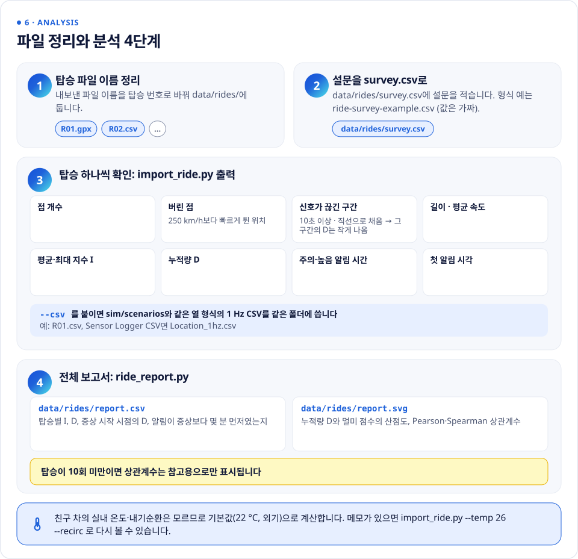

- 온도·내기순환 메모가 있으면: `python3 sim/import_ride.py --temp 26 --recirc 파일`

## 7. 개인정보

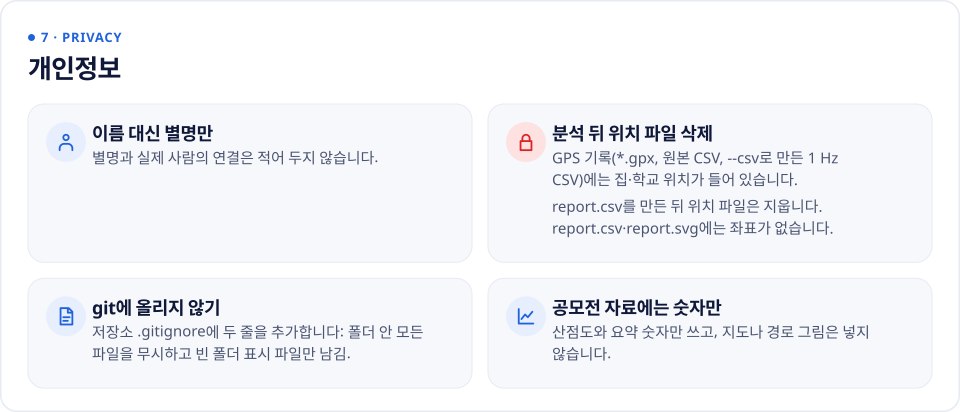

`.gitignore`에 추가 (폴더 안 모든 파일을 무시하고 빈 폴더 표시 파일만 남김):

```
data/rides/*
!data/rides/.gitkeep
```

추가한 뒤 확인:

```bash
git check-ignore -v data/rides/R01.gpx
```

## 출처

- Sensor Logger 앱 정보(무료, 압축 CSV·JSON 기본 내보내기): [App Store](https://apps.apple.com/us/app/sensor-logger/id1531582925), [Android](https://appwisp.com/app/android/com.kelvin.sensorapp)
- GPSLogger(GPX·KML·CSV·NMEA 기록, 1–3초 간격 권장): [F-Droid](https://f-droid.org/packages/com.mendhak.gpslogger/)
- MISC: Bos, J. E., MacKinnon, S. N., & Patterson, A. (2005). Motion sickness symptoms in a ship motion simulator: effects of inside, outside, and no view. *Aviation, Space, and Environmental Medicine*, 76(12), 1111–1118.
