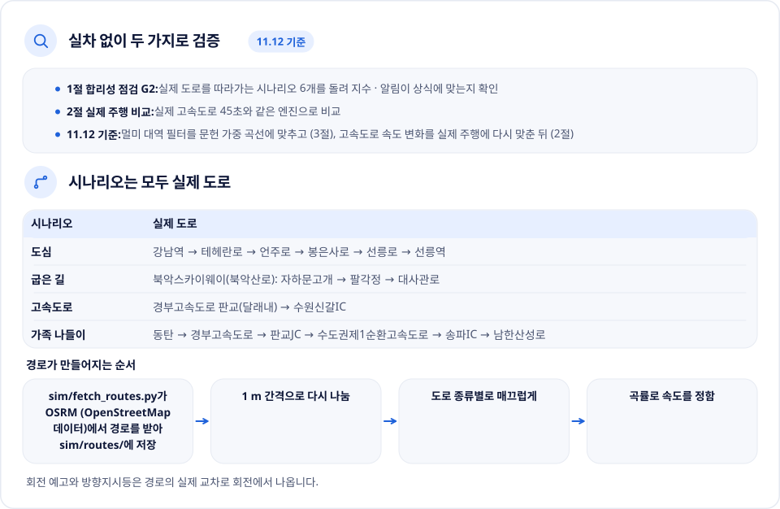
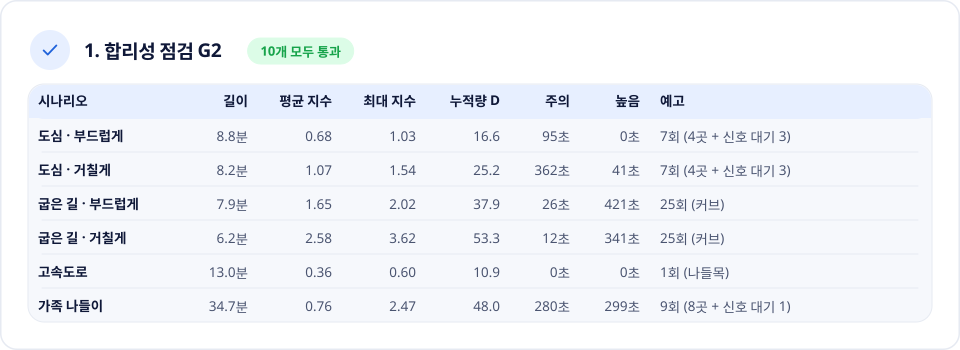
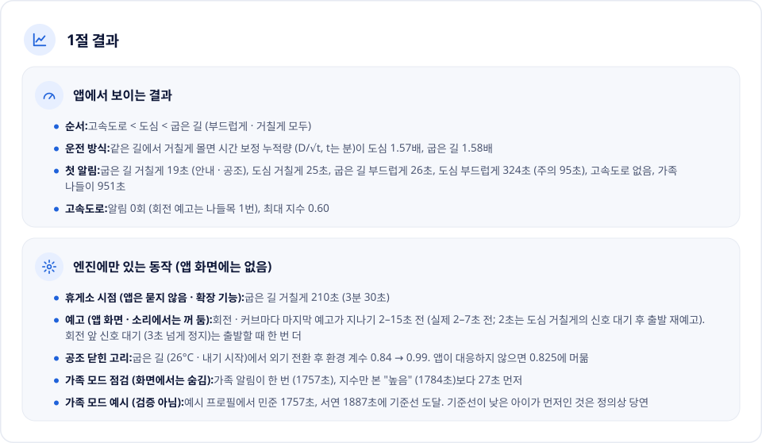
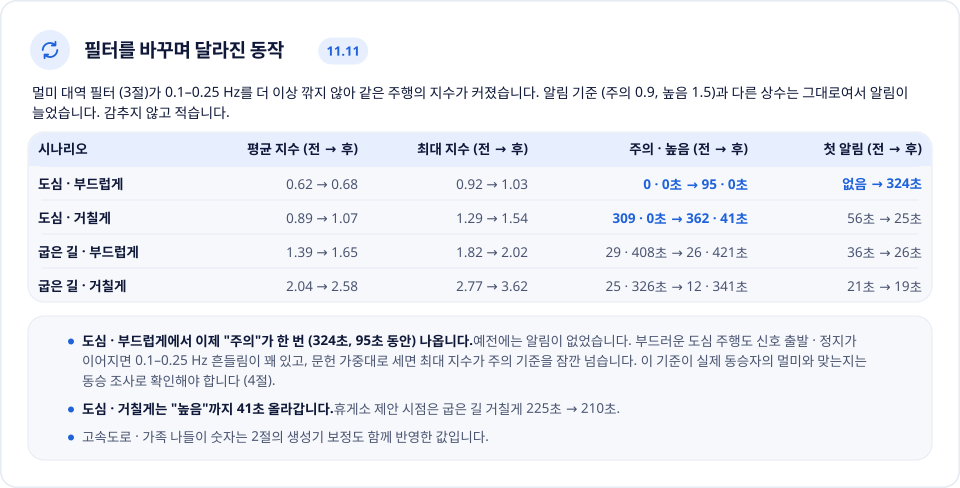
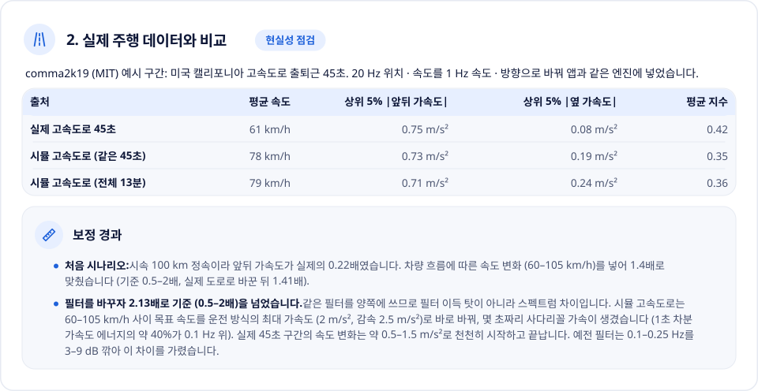
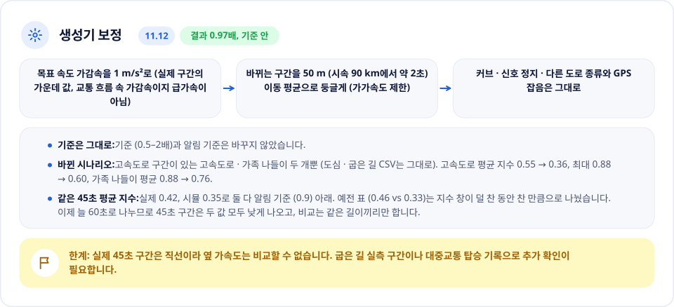
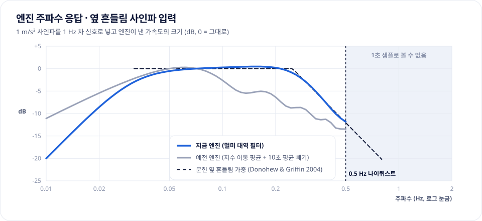
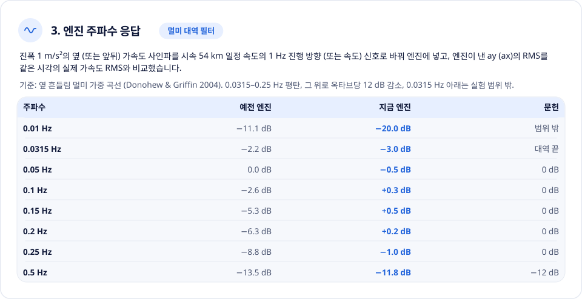
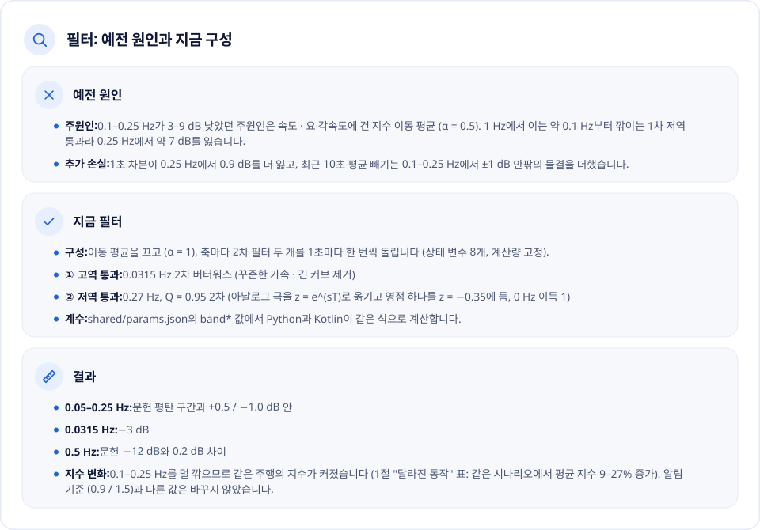
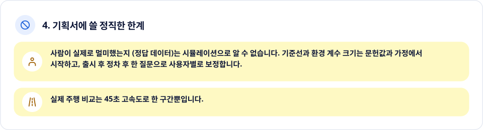

# 시뮬레이션 검증 결과 (기획서 "검증" 절의 근거)



모든 숫자는 아래 명령으로 다시 만들 수 있습니다 (경로는 `sim/fetch_routes.py`가 받아 둔 `sim/routes/`).

```
python3 sim/generator.py
python3 sim/prototype.py
python3 sim/public_check.py
python3 sim/freq_response.py
```

## 1. 합리성 점검 G2 (10개 모두 통과)





### 필터를 바꾸며 달라진 동작 (11.11)



## 2. 실제 주행 데이터와 비교 (현실성 점검)





## 3. 엔진 주파수 응답 (멀미 대역 필터)



`python3 sim/freq_response.py`로 다시 만들 수 있습니다. 파라미터는 `shared/params.json`의 `band*` 값입니다.





## 4. 기획서에 쓸 정직한 한계


