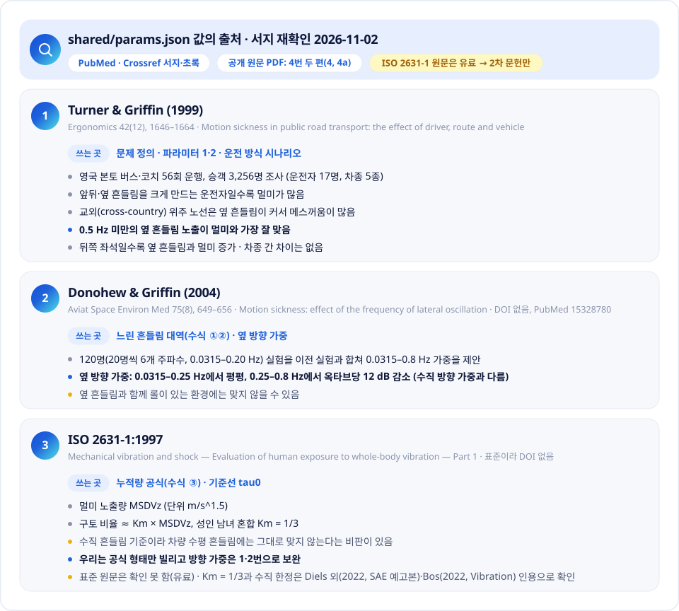
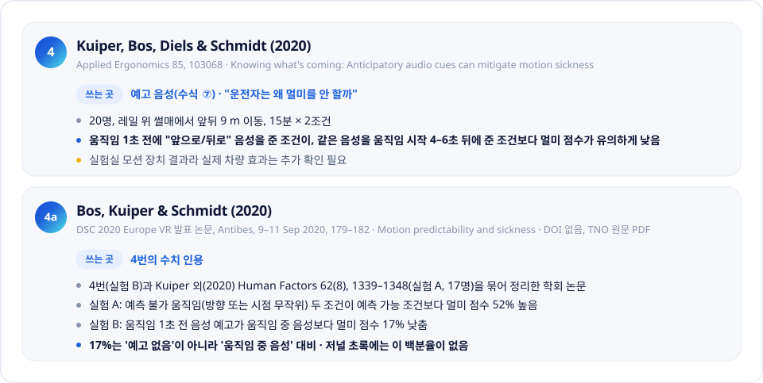
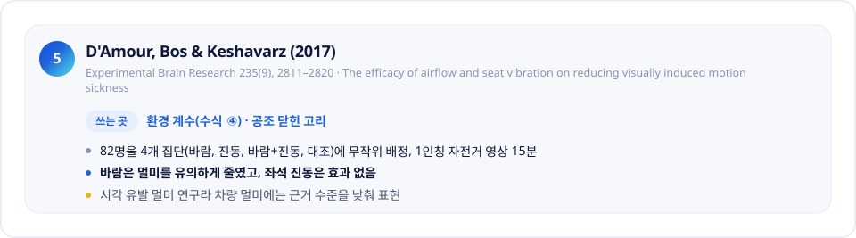
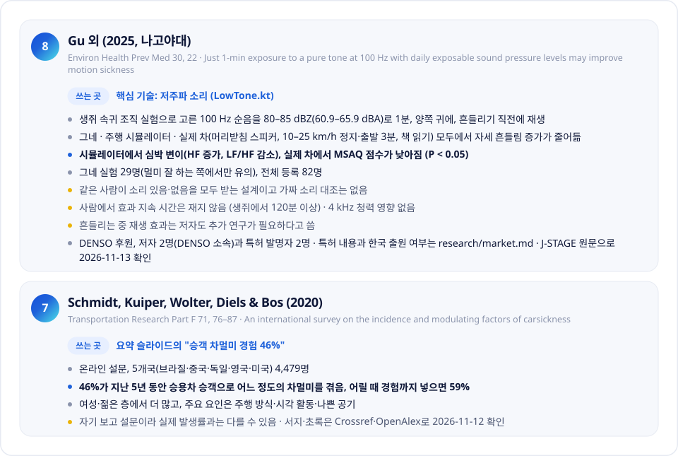
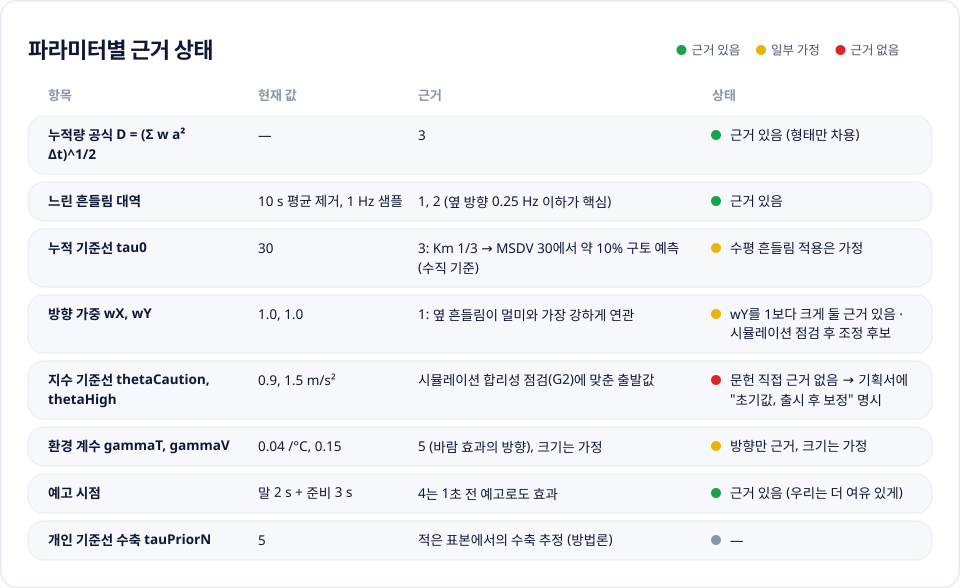
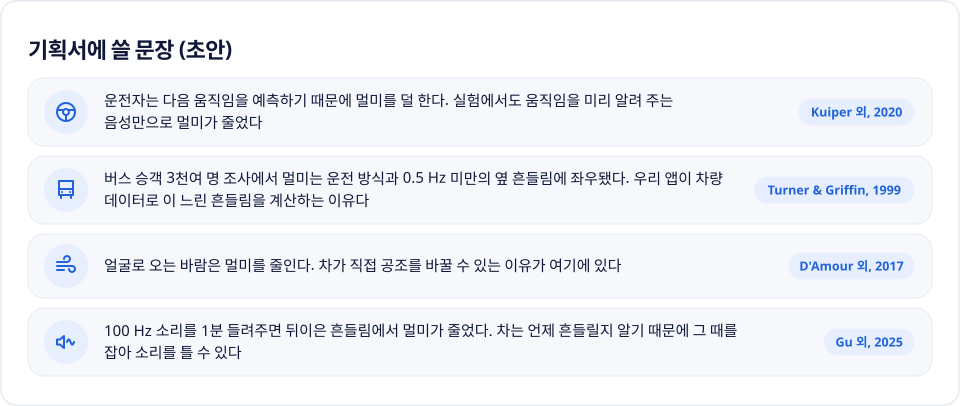

# STEP 2 · 공식과 상수의 근거

## 핵심 근거 8편

참고문헌 (DOI·원문 링크):

1. Turner & Griffin (1999) *Ergonomics* 42(12): [doi:10.1080/001401399184730](https://doi.org/10.1080/001401399184730)
2. Donohew & Griffin (2004) *Aviat Space Environ Med* 75(8): [PubMed 15328780](https://pubmed.ncbi.nlm.nih.gov/15328780/) (DOI 없음)
3. ISO 2631-1:1997: [iso.org/standard/7612](https://www.iso.org/standard/7612.html) (DOI 없음)
4. Kuiper, Bos, Diels & Schmidt (2020) *Applied Ergonomics* 85: [doi:10.1016/j.apergo.2020.103068](https://doi.org/10.1016/j.apergo.2020.103068)
4a. Bos, Kuiper & Schmidt (2020) DSC 2020 Europe VR: [TNO 원문 PDF](https://publications.tno.nl/publication/34645616/p6Xz0N58/bos-2020-driving.pdf) (DOI 없음) · 실험 A: Kuiper 외 (2020) *Human Factors* 62(8): [doi:10.1177/0018720819876139](https://doi.org/10.1177/0018720819876139)
5. D'Amour, Bos & Keshavarz (2017) *Exp Brain Res* 235(9): [doi:10.1007/s00221-017-5009-1](https://doi.org/10.1007/s00221-017-5009-1)
6. Huppert, Grill & Brandt (2019) *J Neurol* 266(Suppl 1): [doi:10.1007/s00415-019-09333-w](https://doi.org/10.1007/s00415-019-09333-w)
8. Gu, Ohgami, He, Kagawa, Kurniasari, Tong, Li, Tazaki, Takeda, Mouri & Kato (2025) *Environ Health Prev Med* 30: 22: [doi:10.1265/ehpm.24-00247](https://doi.org/10.1265/ehpm.24-00247) (특허는 [research/market.md](market.md))
7. Schmidt, Kuiper, Wolter, Diels & Bos (2020) *Transp Res Part F* 71: [doi:10.1016/j.trf.2020.03.012](https://doi.org/10.1016/j.trf.2020.03.012)

## 파라미터별 근거 상태

## 기획서에 쓸 문장 (초안)

## 출처 링크

- Turner & Griffin 1999: https://eprints.soton.ac.uk/406261
- Donohew & Griffin 2004: https://core.ac.uk/works/412108
- ISO 2631-1 해설과 한계: https://arxiv.org/pdf/2501.17664
- Kuiper 외 2020: https://researchonline.rca.ac.uk/4350/
- D'Amour 외 2017: https://cir.nii.ac.jp/crid/1364233270594795648
- Bos 외 2020 (DSC): https://publications.tno.nl/publication/34645616/p6Xz0N58/bos-2020-driving.pdf
- D'Amour 외 2017 (PubMed): https://pubmed.ncbi.nlm.nih.gov/28634889/
- Huppert 외 2019 (PubMed): https://pubmed.ncbi.nlm.nih.gov/31087161/
- Schmidt 외 2020: https://doi.org/10.1016/j.trf.2020.03.012
- Gu 외 2025 (나고야대 100 Hz): https://www.jstage.jst.go.jp/article/ehpm/30/0/30_24-00247/_html/-char/en
