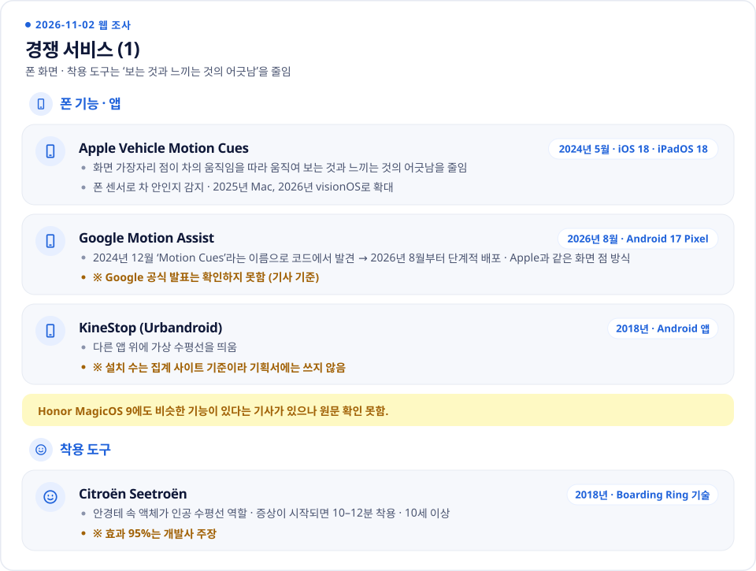
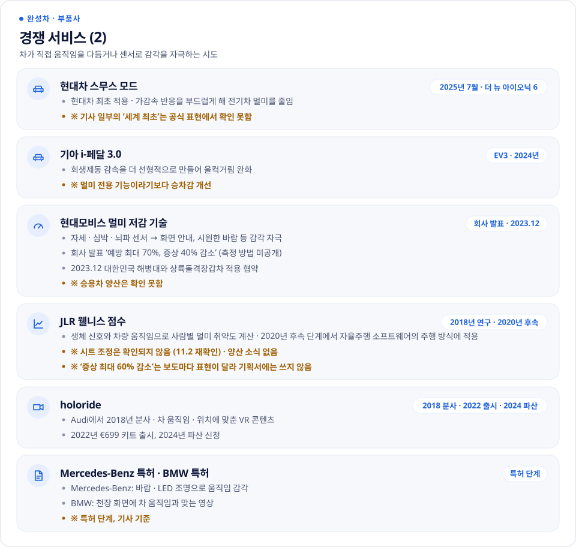
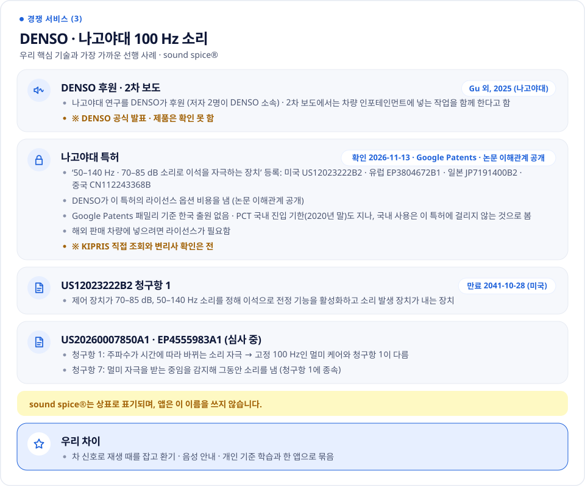
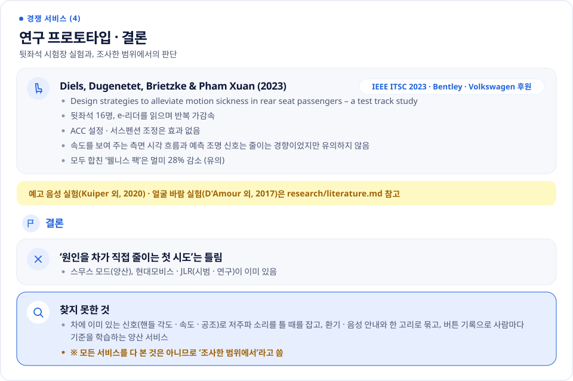
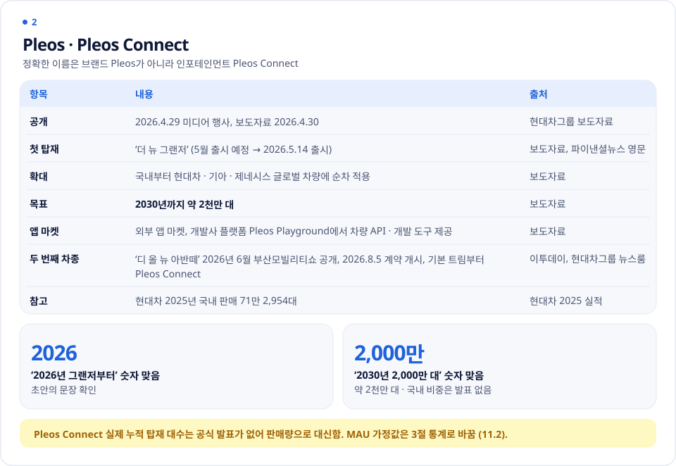
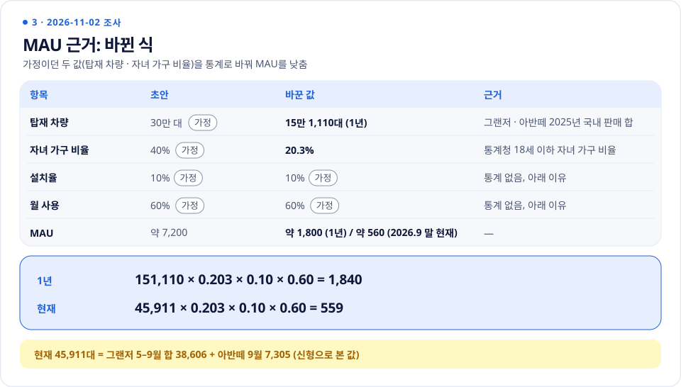
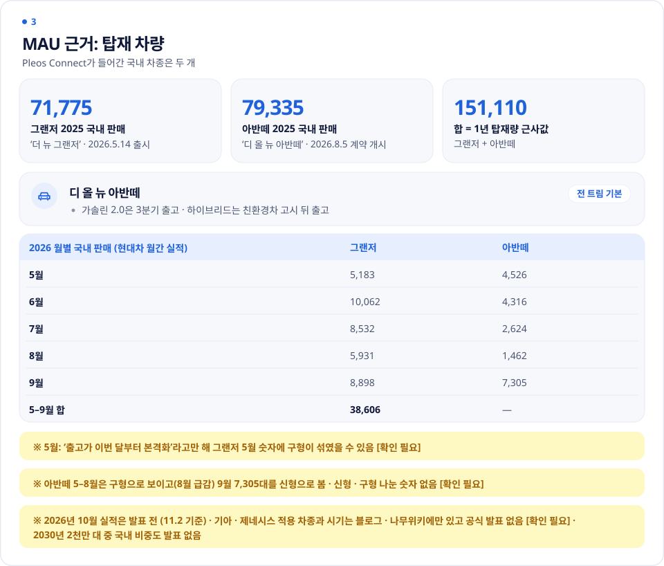
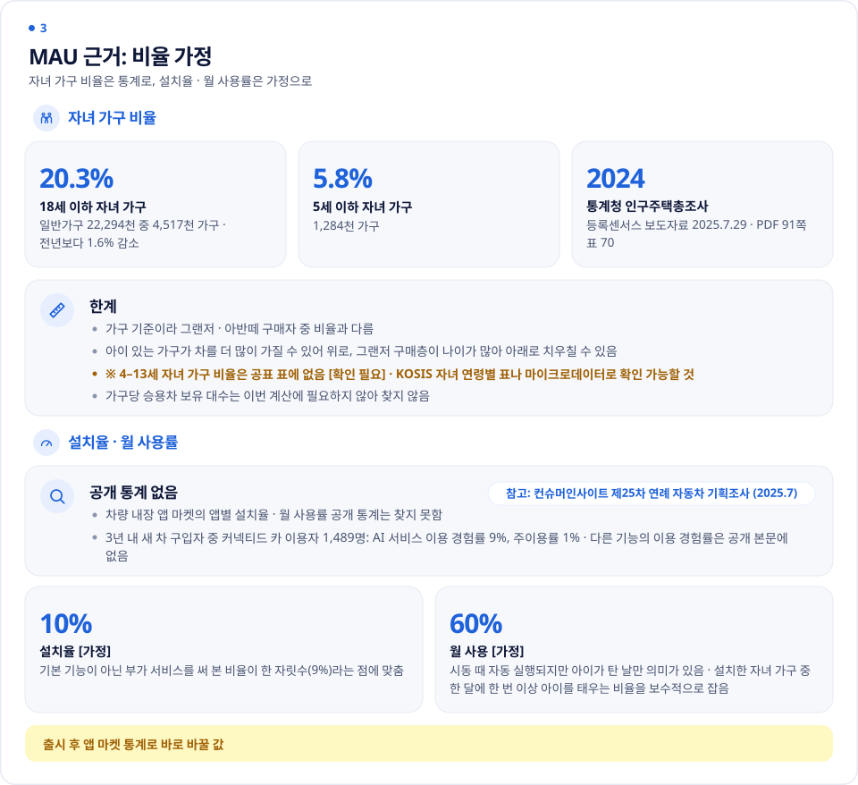
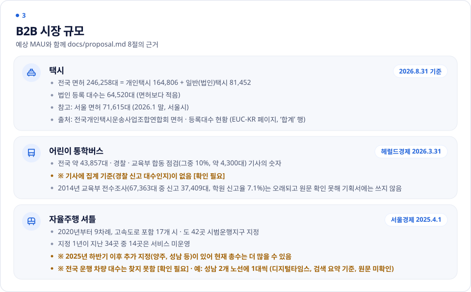

# 시장·경쟁 조사 메모

`docs/proposal.md` 4·5·8절의 근거입니다. 2026-11-02 웹 조사. 1차 출처(회사 보도자료·논문)를 먼저 적고, 없으면 기사로 대신했습니다.

## 1. 경쟁 서비스

### 폰 기능·앱·착용 도구

- Apple: [보도자료 2024.5](https://www.apple.com/newsroom/2024/05/apple-announces-new-accessibility-features-including-eye-tracking/), [지원 문서](https://support.apple.com/guide/iphone/iphone-comfortably-riding-a-vehicle-iph55564cb22/ios)
- Google: [Android Authority](https://www.androidauthority.com/google-android-motion-sickness-feature-rolling-out-3702494/)
- KineStop: [AppGoblin](https://appgoblin.info/apps/com.urbandroid.kinestop)
- Seetroën: [SAE 기사](https://www.sae.org/news/2019/02/citroen-seetrone-anti-motion-sickness-glasses), [CNN](https://edition.cnn.com/travel/article/motion-sickness-citroen-seetroen-glasses)

### 완성차·부품사

- 현대차 스무스 모드: [경향신문](https://www.khan.co.kr/article/202507281116011), [현대차그룹 뉴스룸](https://www.hyundaimotorgroup.com/ko/story/CONT0000000000193297)
- 현대모비스: [보도자료 (PR Newswire)](https://prnewswire.com/news-releases/hyundai-mobis-to-assist-marine-corps-in-reducing-motion-sickness-in-armored-vehicles-302023203.html)
- JLR: [IMechE](https://imeche.org/news/news-article/jlr-fights-motion-sickness-with-autonomous-car-tech)
- holoride: [Road to VR](https://roadtovr.com/audi-holoride-bankruptcy-vr-entertainment/)
- 특허: [EVXL (Mercedes)](https://evxl.co/2026/03/02/mercedes-benz-patents-anti-motion-sickness), [BMWBLOG](https://www.bmwblog.com/2024/01/19/bmw-7-series-theater-screen-aims-to-combat-motion-sickness-in-cars)

### DENSO·나고야대 100 Hz 소리 (sound spice®)

- 특허: [US12023222B2](https://patents.google.com/patent/US12023222B2/en), [US20260007850A1](https://patents.google.com/patent/US20260007850A1/en)
- 기사·원문: [J-STAGE 원문](https://www.jstage.jst.go.jp/article/ehpm/30/0/30_24-00247/_html/-char/en), [Earth.com](https://www.earth.com/news/unique-new-sound-therapy-reduces-motion-sickness-without-medication), [112.ua](https://112.ua/en/comu-vodiiv-nudit-v-elektromobilah-ta-so-z-cim-robiti-68650)

### 연구 프로토타입·결론

- [Diels 외 (2023) RCA Research Online PDF](https://researchonline.rca.ac.uk/5638/1/Diels%20et%20al%20IEEE%20ITSC23_Design%20strategies.pdf)
- 예고 음성 실험(Kuiper 외, 2020)과 얼굴 바람 실험(D'Amour 외, 2017)은 `research/literature.md` 참고.

## 2. Pleos·Pleos Connect

- 출처: [현대차그룹 보도자료](https://www.hyundaimotorgroup.com/ko/news/hyundai-motor-group-redefines-in-vehicle-experience-with-pleos-connect-next-generation-infotainment-system), [파이낸셜뉴스 영문](https://en.fnnews.com/news/202605140726467026), [이투데이](https://www.etoday.co.kr/news/view/2611117), [현대차그룹 뉴스룸](https://www.hyundaimotorgroup.com/ko/story/the-all-new-avante-world-premiere), [현대차 2025 실적](https://www.hyundaimotorgroup.com/ko/news/hyundai-motor-company-sales-4138180-units-2025)

## 3. MAU 근거

2026-11-02 조사. `docs/proposal.md` 8절의 예상 MAU와 B2B 시장 규모의 근거입니다.

### 바뀐 식

### 탑재 차량

- [현대차그룹 아반떼 보도자료 2026.8.5](https://www.hyundaimotorgroup.com/ko/news/hyundai-motor-company-all-new-avante), [현대차 2025 실적](https://www.hyundaimotorgroup.com/ko/news/hyundai-motor-company-sales-4138180-units-2025)
- 월간 실적: [5월](https://www.hyundaimotorgroup.com/ko/news/hyundai-motor-company-may-2026-sales), [6월](https://www.hyundaimotorgroup.com/ko/news/hyundai-motor-company-june-2026-sales), [7월](https://www.hyundaimotorgroup.com/ko/news/hyundai-motor-company-july-2026-sales), [8월](https://www.hyundaimotorgroup.com/ko/news/hyundai-motor-company-august-2026-sales), [9월](https://www.hyundaimotorgroup.com/ko/news/hyundai-motor-company-september-2026-sales)

### 자녀 가구 비율·설치율·월 사용률

- [통계청 2024 인구주택총조사(등록센서스) 보도자료, 2025.7.29](https://kostat.go.kr/board.es?mid=a10301020100&bid=203&act=view&list_no=437767) (PDF 91쪽 표 70)
- [컨슈머인사이트 2026.2.12](https://www.consumerinsight.co.kr/autoinsight/abview?no=3859&id=pr4_list)

### B2B 시장 규모

- 택시: [전국개인택시운송사업조합연합회 면허·등록대수 현황](https://gntx.kr/information/information_02.php) (EUC-KR 페이지, '합계' 행), [서울시](https://news.seoul.go.kr/traffic/archives/307)
- 통학버스: [헤럴드경제 2026.3.31](https://www.heraldk.com/article/2026033123432142372)
- 자율주행 셔틀: [서울경제 2025.4.1](https://www.sedaily.com/article/14047575), [디지털타임스](https://www.dt.co.kr/article/12036810)
